# 🏛️ Sistema de Gestión y Control de Acervo Cultural
## Bóveda de Documentación Oficial (Obsidian Vault)

Bienvenido a la base de conocimiento centralizada del **Sistema de Gestión de Acervo Cultural** de la Secretaría de Cultura y Turismo. Este repositorio de documentación combina el **Manual Técnico de Desarrollo y Arquitectura** con el **Manual de Operación de Usuario**, estructurados mediante notas enlazadas (`wikilinks`), diagramas visuales e inventario detallado de procesos.

> [!NOTE] 
> Esta bóveda está optimizada para su visualización y navegación en **Obsidian**. Utiliza los enlaces bidireccionales `[[Nombre de Nota]]` para explorar la arquitectura del sistema, los modelos de datos, las guías de desarrollo y los procedimientos operativos paso a paso.

---

## 🗺️ Mapa de Contenidos (MOC)

```mermaid
graph TD
    MOC["00 - Índice Principal"] --> GEN["01 - Generalidades y Arquitectura"]
    MOC --> DB["02 - Base de Datos y Modelo de Datos"]
    MOC --> TEC["03 - Manual Técnico de Desarrollo"]
    MOC --> USR["04 - Manual de Usuario (Operación)"]
    MOC --> ANX["05 - Anexos y Referencias"]

    GEN --> G1["Visión General y Objetivos"]
    GEN --> G2["Arquitectura Bee Framework MVC"]
    GEN --> G3["Stack Tecnológico y Dependencias"]
    GEN --> G4["Estructura de Directorios"]

    DB --> D1["Diagrama Entidad-Relación (ERD)"]
    DB --> D2["Tablas de Acervo Cultural"]
    DB --> D3["Préstamos y Transferencias"]
    DB --> D4["Auditoría y Trazabilidad"]
    DB --> D5["Catálogos y Auxiliares"]

    TEC --> T1["Controladores y Flujo de Peticiones"]
    TEC --> T2["Modelos y Capa PDO"]
    TEC --> T3["Control de Acceso RBAC"]
    TEC --> T4["Endpoints AJAX y API Interna"]
    TEC --> T5["Frontend, UI, CSS y JS"]
    TEC --> T6["Despliegue y Mantenimiento"]

    USR --> U1["Inicio de Sesión y Perfiles"]
    USR --> U2["Exploración y Búsqueda"]
    USR --> U3["Registro y Edición de Piezas"]
    USR --> U4["Semáforo de Revisión y Validación"]
    USR --> U5["Control de Préstamos y Transferencias"]
    USR --> U6["Fichas Técnicas y Reportes"]

    ANX --> A1["Diccionario de Datos"]
    ANX --> A2["Preguntas Frecuentes (FAQ)"]
    ANX --> A3["Bitácora de Versiones"]
```

---

## 📚 Estructura de la Documentación

### 1. Generalidades y Arquitectura
Fundamentos conceptuales, marco institucional y diseño estructural del software:
- [[01 - Visión General y Objetivos]]: Contexto institucional, alcance funcional y objetivos de custodia del patrimonio cultural.
- [[02 - Arquitectura Bee Framework MVC]]: Ciclo de vida de la petición, arquitectura Modelo-Vista-Controlador, sistema de hooks y middleware.
- [[03 - Stack Tecnológico y Dependencias]]: Detalle del entorno LAMP (Linux, Apache, MariaDB/MySQL, PHP 8.x), librerías frontend (Bootstrap 5, jQuery, Select2, SweetAlert2) y fuentes tipográficas.
- [[04 - Estructura de Directorios del Proyecto]]: Desglose detallado del árbol de carpetas `/app`, `/assets`, `/templates` y responsabilidades de cada módulo.

### 2. Base de Datos y Modelo de Datos
Esquema relacional, normalización y diccionario de almacenamiento:
- [[01 - Diagrama Entidad-Relación (ERD)]]: Modelo global de datos en formato Mermaid con llaves foráneas, cardinalidad e índices.
- [[02 - Tablas de Acervo (General, Arqueológico, Numismático)]]: Definición a nivel de columnas de `acervo_general`, `acervo_arqueologico` y `acervo_numismatica` (incluyendo dimensiones, ubicación física vs topográfica y estatus de revisión).
- [[03 - Módulo de Préstamos y Transferencias]]: Estructura de la tabla `prestamos_transferencias`, tipos de movimiento, folios únicos, orígenes, destinos y trazabilidad de entrega/devolución.
- [[04 - Sistema de Auditoría y Trazabilidad]]: Funcionamiento del registro forense en `auditoria`, almacenamiento de snapshots `datos_antes` y `datos_despues` en formato JSON, IP y direcciones físicas.
- [[05 - Catálogos y Tablas Auxiliares]]: Tablas maestras de soporte: `museos`, `materiales`, `tecnicas`, `epocas_periodos`, etc.

### 3. Manual Técnico de Desarrollo
Guía exhaustiva para ingenieros de software, administradores de sistemas y mantenedores:
- [[01 - Controladores y Flujo de Peticiones]]: Desglose exhaustivo de `adminController.php`, orquestación de peticiones, validación de inputs y respuestas JSON.
- [[02 - Modelos y Capa de Persistencia PDO]]: Clases modelo (`acervoGeneralModel`, `acervoArqueologicoModel`, `acervoNumismaticaModel`, `prestamosModel`, `userModel`) y clase base singleton `Db.php`.
- [[03 - Sistema de Roles y Permisos (RBAC)]]: Matriz de privilegios, evaluación jerárquica (`user_can()`, `is_admin_user()`), sesiones seguras y control de accesos.
- [[04 - Endpoints AJAX y API Interna]]: Especificación completa de contratos API, parámetros requeridos, respuestas HTTP y códigos de estado.
- [[05 - Componentes Frontend, Estilos CSS y JavaScript]]: Arquitectura de módulos JS (`acervo.js`, `revision.js`, `prestamos_transferencias.js`, `registrar.js`), solución de renderizado con Popper (`strategy: fixed`), menú de acciones dropdown dinámico y hojas de estilo `custom-admin.css`.
- [[06 - Despliegue, Servidor y Mantenimiento]]: Configuración de Apache VirtualHost, directivas `.htaccess`, permisos de escritura en carpetas de uploads, respaldos MySQL y rotación de logs.

### 4. Manual de Usuario - Operación del Sistema
Guía práctica e interactiva para operadores, capturistas, curadores y administradores:
- [[01 - Inicio de Sesión y Perfiles de Usuario]]: Credenciales de acceso, recuperación de contraseña, asignación de roles y navegación por el panel principal.
- [[02 - Exploración, Búsqueda y Filtrado del Acervo]]: Operación del catálogo unificado, filtros dinámicos por año, autor, técnica, material, ubicación y buscador global.
- [[03 - Registro y Edición de Piezas Culturales]]: Procedimiento paso a paso para el alta de piezas, selección entre bidimensional (`cm`) y tridimensional (`medidas`), selección de museos institucionales y sedes externas.
- [[04 - Flujo de Revisión y Semáforo de Aprobación]]: Protocolo curatorial de aprobación de piezas: estados Verde (Aprobado), Amarillo (Cambios Solicitados), Rojo (Rechazado) y Azul (Pendiente), retroalimentación y reenvío de correcciones.
- [[05 - Gestión de Préstamos y Transferencias]]: Guía de préstamos temporales y traslados definitivos, generación de folios, registro de responsables, retorno de piezas y cancelación de solicitudes.
- [[06 - Fichas Técnicas, Exportaciones y Auditoría]]: Generación de cédulas museográficas, exportación masiva a Excel y PDF con sellos institucionales, y consulta del historial de auditoría.

### 5. Anexos y Referencias
Información complementaria y material de consulta técnica:
- [[01 - Diccionario de Datos Completo]]: Catálogo de campos, tipos SQL, valores nulos y descripción funcional de toda la base de datos.
- [[02 - Preguntas Frecuentes y Solución de Problemas]]: Resolución de incidencias comunes de carga de imágenes, filtros de tablas, bloqueo de sesiones y permisos.
- [[03 - Bitácora de Versiones y Changelog]]: Registro cronológico de cambios, parches y mejoras aplicadas al sistema.

---

## ⚡ Enlaces Rápidos y Accesos Frecuentes

| Módulo / Función | Documentación Técnica | Manual Operativo |
| :--- | :--- | :--- |
| **Catálogo General** | [[02 - Tablas de Acervo (General, Arqueológico, Numismático)]] | [[02 - Exploración, Búsqueda y Filtrado del Acervo]] |
| **Alta de Piezas** | [[01 - Controladores y Flujo de Peticiones#Registro de Piezas]] | [[03 - Registro y Edición de Piezas Culturales]] |
| **Semáforo Curatorial** | [[04 - Endpoints AJAX y API Interna#Módulo de Revisión]] | [[04 - Flujo de Revisión y Semáforo de Aprobación]] |
| **Préstamos y Traslados** | [[03 - Módulo de Préstamos y Transferencias]] | [[05 - Gestión de Préstamos y Transferencias]] |
| **Seguridad y Auditoría** | [[04 - Sistema de Auditoría y Trazabilidad]] | [[06 - Fichas Técnicas, Exportaciones y Auditoría#Consulta de Auditoría]] |
| **Roles y Permisos** | [[03 - Sistema de Roles y Permisos (RBAC)]] | [[01 - Inicio de Sesión y Perfiles de Usuario]] |

