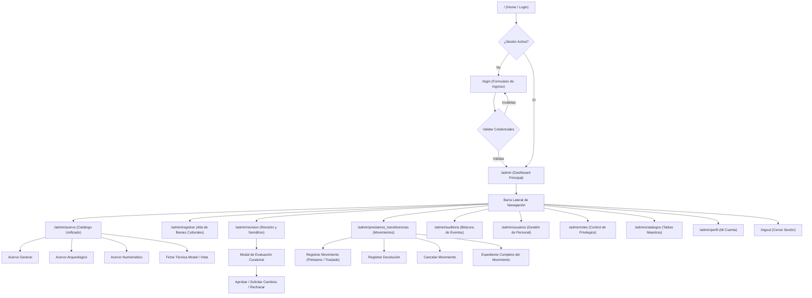
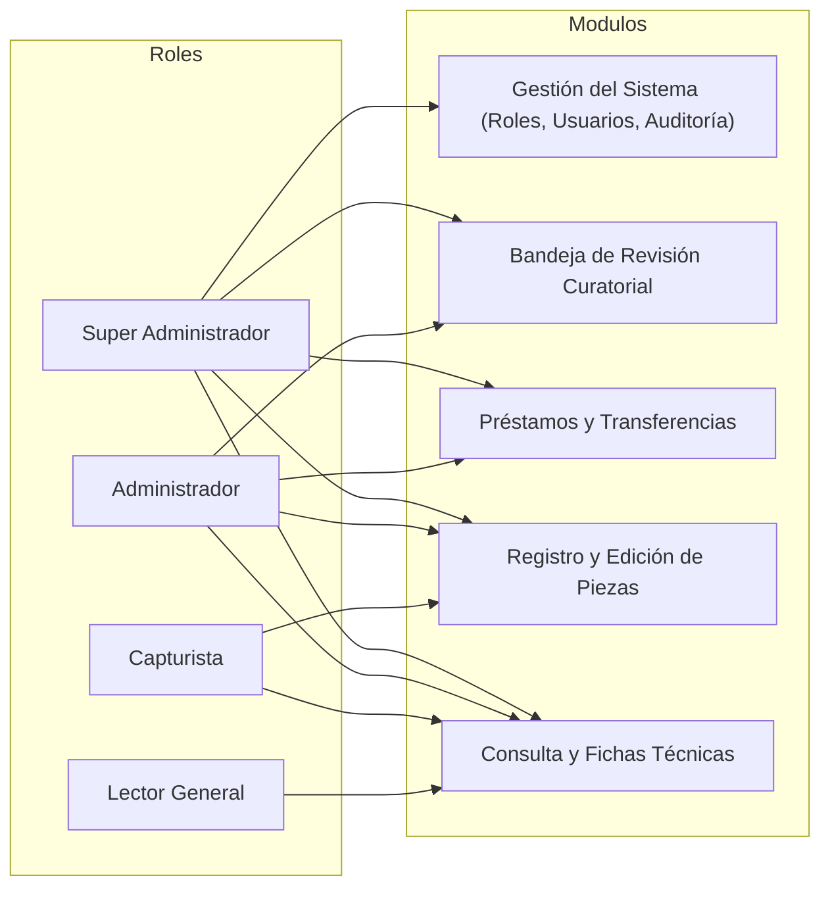

# 🗺️ Mapa de Navegación del Sistema

Esta nota describe la topología de navegación de la aplicación web, ilustrando las rutas accesibles según los roles de usuario y los flujos de interacción entre módulos.

---

## 1. Diagrama de Flujo de Navegación Global

El acceso a los diferentes módulos está gobernado por el estado de autenticación y los permisos RBAC (Role-Based Access Control) del usuario.

---

## 2. Mapa de Rutas y Controladores

A continuación se detalla la correspondencia entre las URIs del sistema, los métodos en los controladores y las vistas asociadas:

| URI del Sistema | Controlador / Método | Archivo de Vista | Descripción Funcional |
| :--- | :--- | :--- | :--- |
| `/login` | `loginController->index()` | `login/loginView.php` | Formulario de autenticación por usuario y contraseña. |
| `/logout` | `logoutController->index()` | *(Redirección a login)* | Cierra sesión segura y destruye variables globales. |
| `/admin` | `adminController->index()` | `admin/indexView.php` | Métricas generales, conteo de piezas, accesos rápidos. |
| `/admin/acervo` | `adminController->acervo()` | `admin/acervo/acervoView.php` | Listado tabular de piezas con filtrado AJAX, edición y eliminación. |
| `/admin/registrar` | `adminController->registrar()` | `admin/registrar/registrarView.php` | Formulario dinámico de alta de piezas con carga fotográfica. |
| `/admin/revision` | `adminController->revision()` | `admin/revision/revisionView.php` | Bandeja curatorial de control de calidad y semáforo. |
| `/admin/prestamos_transferencias` | `adminController->prestamos_transferencias()` | `admin/prestamos/prestamosView.php` | Control de traslados, préstamos entre recintos y devoluciones. |
| `/admin/auditoria` | `adminController->auditoria()` | `admin/auditoria/auditoriaView.php` | Monitoreo forense de modificaciones a registros patrimoniales. |
| `/admin/usuarios` | `adminController->usuarios()` | `admin/usuarios/usuariosView.php` | Catálogo de usuarios, altas, ediciones y asignación de rol. |
| `/admin/roles` | `adminController->roles()` | `admin/roles/rolesView.php` | Configuración de perfiles y asignación de permisos específicos. |
| `/admin/catalogos` | `adminController->catalogos()` | `admin/catalogos/catalogosView.php` | Gestión de vocabularios controlados (épocas, materiales, museos). |
| `/admin/perfil` | `adminController->perfil()` | `admin/perfilView.php` | Actualización de datos de cuenta del usuario conectado. |

---

## 3. Matriz de Permisos por Rol

El sistema implementa 4 roles predefinidos con diferentes alcances de navegación:

Para más detalles sobre la implementación técnica de este mecanismo, consulta:
- [[03 - Sistema de Roles y Permisos (RBAC)]]
- [[01 - Inicio de Sesión y Perfiles de Usuario]]

