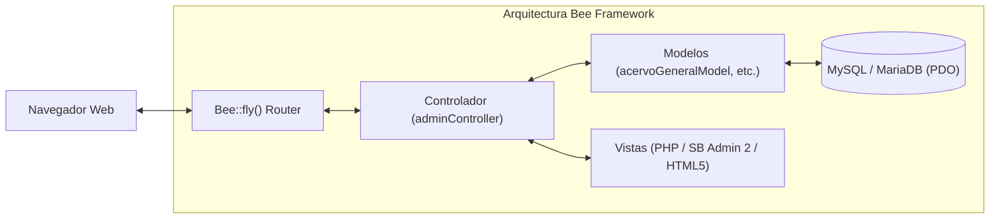
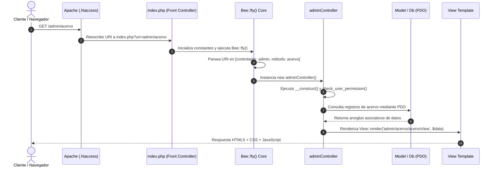

# 🐝 Arquitectura Bee Framework MVC

## 1. Fundamentos y Patrón de Diseño
El sistema está construido sobre el núcleo de **Bee Framework (v1.5.8)**, un framework PHP minimalista, estructurado bajo el patrón arquitectónico **Modelo-Vista-Controlador (MVC)**. Este diseño garantiza una estricta separación entre la lógica de negocio, la capa de persistencia relacional y la presentación de la interfaz de usuario.

---

## 2. Ciclo de Vida de una Petición (Request Lifecycle)

Cada petición entrante al servidor web sigue el siguiente ciclo de resolución:

### Fases del Procesamiento:
1. **Reescritura de URL (`.htaccess`)**: El servidor web Apache redirige todas las peticiones que no corresponden a archivos físicos existentes hacia `index.php`.
2. **Punto de Entrada (`index.php`)**: Invoca la clase principal `Bee` mediante el método estático `Bee::fly()`.
3. **Inicialización del Entorno (`app/config/bee_config.php`)**: Define constantes globales del sistema (`URL`, `BASEPATH`, `DB_*`), credenciales de acceso a base de datos, llaves de cifrado (`AUTH_SALT`) y configuraciones de sesión.
4. **Enrutamiento Dinámico**: El enrutador analiza la cadena `$_GET['uri']`, segmentándola mediante delimitadores `/` en:
   - Controlador: `controladorController.php` (ej. `adminController.php`).
   - Método de acción: nombre de la función a ejecutar (ej. `prestamos_transferencias()`).
   - Parámetros adicionales: argumentos pasados por URL posicionalmente.
5. **Control de Acceso y Middleware**: El constructor del controlador valida el estado de la sesión (`check_session()`) y verifica los privilegios RBAC antes de ejecutar cualquier lógica de negocio.
6. **Despacho y Respuesta**: El método correspondiente procesa los datos y devuelve una vista HTML o una respuesta serializada en formato JSON (para peticiones AJAX).

---

## 3. Componentes Principales del Sistema

### 3.1. Front Controller y Configuración
- **`index.php`**: Archivo raíz que inicializa el cargador de clases.
- **`app/config/bee_config.php`**: Archivo maestro de configuración. Contiene:
  - Detección automática del entorno (Local vs Producción) mediante `IS_LOCAL`.
  - Definición de credenciales de base de datos (`DB_HOST`, `DB_NAME`, `DB_USER`, `DB_PASS`).
  - Constantes de directorios (`CONTROLLERS`, `MODELS`, `VIEWS`, `UPLOADS`).

### 3.2. Capa de Controladores (`app/controllers/`)
Los controladores reciben las solicitudes del usuario, invocan los modelos pertinentes, aplican reglas de validación y determinan qué vista debe presentarse:
- **`adminController.php`**: Controlador neurálgico del panel administrativo. Administra más de 4,400 líneas de lógica para la consulta de acervo, alta de piezas, autorizaciones del semáforo curatorial, gestión de préstamos, usuarios y auditoría.
- **`loginController.php`** y **`logoutController.php`**: Gestión de ciclo de vida de sesiones y autenticación.
- **`homeController.php`**: Portal público o redirección inicial.

### 3.3. Capa de Modelos (`app/models/`)
Encapsulan las operaciones CRUD y las consultas relacionales directas sobre las tablas:
- `acervoGeneralModel.php`
- `acervoArqueologicoModel.php`
- `acervoNumismaticaModel.php`
- `prestamosModel.php`
- `userModel.php`

### 3.4. Capa de Vistas y Plantillas (`templates/views/`)
Las vistas utilizan PHP nativo para inyectar variables de forma segura. La interfaz administrativa se basa en una plantilla adaptativa con:
- Cabeceras (`headerView.php`), pie de página (`footerView.php`) y barra lateral (`sidebar.php`).
- Módulos específicos en subdirectorios: `admin/acervo/`, `admin/prestamos/`, `admin/revision/`, `admin/registrar/`, `admin/auditoria/`.

---

## 4. Patrón Singleton en la Conexión de Datos (`Db.php`)
Para evitar la sobrecarga por apertura excesiva de sockets a la base de datos MySQL, la clase `Db` implementa el patrón **Singleton**:
- Se mantiene una única instancia compartida del objeto `PDO` a lo largo del hilo de ejecución de la petición PHP.
- `PDO::ATTR_ERRMODE => PDO::ERRMODE_EXCEPTION` garantiza que cualquier inconsistencia relacional lance una excepción interceptable.
- `PDO::ATTR_DEFAULT_FETCH_MODE => PDO::FETCH_ASSOC` retorna arreglos indexados por nombre de columna.
- `PDO::ATTR_EMULATE_PREPARES => false` asegura el uso de sentencias preparadas nativas en el motor MySQL, previniendo inyecciones SQL.

---

## 5. Referencias Cruzadas
- Conoce el stack completo en: [[03 - Stack Tecnológico y Dependencias]]
- Profundiza en el modelo de datos en: [[01 - Diagrama Entidad-Relación (ERD)]]
- Consulta los endpoints en: [[04 - Endpoints AJAX y API Interna]]

