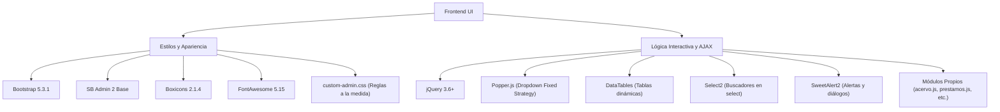

# 💻 Stack Tecnológico y Dependencias

Este documento especifica las tecnologías, librerías, estándares de codificación y dependencias que conforman el ecosistema de desarrollo y producción del **Sistema de Gestión de Acervo Cultural**.

---

## 1. Arquitectura de Servidor (Backend)

| Componente | Tecnología / Versión | Propósito / Responsabilidad |
| :--- | :--- | :--- |
| **Sistema Operativo** | Linux (Ubuntu Server / Debian) | Entorno base de ejecución del servidor web y base de datos. |
| **Servidor Web** | Apache HTTP Server 2.4+ | Gestión de tráfico HTTP/HTTPS, enrutamiento con módulo `mod_rewrite`. |
| **Lenguaje Backend** | PHP 8.1+ / 8.2+ | Lógica de negocio, controladores MVC, procesamiento de imágenes. |
| **Motor de Base de Datos** | MySQL 8.0+ / MariaDB 10.6+ | Base de datos relacional con soporte transaccional InnoDB y UTF-8 completo (`utf8mb4`). |
| **Driver de Datos** | PHP Data Objects (PDO) | Capa de abstracción y ejecución de sentencias preparadas contra inyección SQL. |
| **Manejo de Sesiones** | PHP Native Sessions | Almacenamiento seguro del contexto de usuario con cookies protegidas. |

---

## 2. Dependencias del Lado del Cliente (Frontend)

El frontend está construido sin frameworks pesados de compilación previa (como React o Angular), apostando por una carga ligera mediante módulos JavaScript Vanilla y jQuery, integrados con estilos basados en Bootstrap 5:



### Detalle de Librerías Frontend:
1. **Bootstrap 5.3.1**: Sistema de rejilla responsiva (grid), componentes de formularios, ventanas modales, badges y dropdowns.
2. **SB Admin 2**: Maquetación de la interfaz administrativa, barra lateral colapsable, barra superior con perfil de usuario y tarjetas informativas.
3. **Boxicons (v2.1.4)**: Catálogo primario de íconos vectoriales del sistema (`bx bx-show`, `bx bx-edit`, `bx bx-trash`, `bx bx-check-circle`, `bx bx-transfer`).
4. **Popper.js**: Motor de posicionamiento matemático para los menús desplegables (`.btn__actions`), configurado en modo `strategy: fixed` para evitar recortes dentro de contenedores con scroll (`.table-responsive`).
5. **DataTables**: Plugin de paginación, ordenamiento multinivel y búsqueda instantánea en tablas de catálogo y revisión.
6. **Select2**: Combos de selección enriquecidos con búsqueda en tiempo real, utilizados en la asignación de museos y selección de piezas para préstamos.
7. **SweetAlert2**: Notificaciones de retroalimentación elegantes, alertas de confirmación destructiva y ventanas modales de captura de observaciones.

---

## 3. Extensiones y Librerías Auxiliares de PHP

Para el procesamiento de archivos y reportes, el servidor requiere los siguientes módulos activos en `php.ini`:

- **`pdo_mysql`**: Comunicación con el servidor de base de datos MySQL/MariaDB.
- **`gd`** o **`imagick`**: Manipulación de fotografías de acervo, generación de miniaturas y compresión en formato JPEG/PNG/WebP.
- **`mbstring`**: Manipulación adecuada de cadenas multibyte (acentos, caracteres especiales en títulos y descripciones).
- **`json`**: Serialización y deserialización de datos para la API AJAX y los campos `datos_antes` y `datos_despues` de auditoría.
- **`fileinfo`**: Validación rigurosa del tipo MIME de las fotografías subidas por los capturistas.

---

## 4. Requisitos de Configuración (`php.ini`)

Para permitir la carga de fotografías de alta resolución correspondientes a las obras patrimoniales:

```ini
; Configuración recomendada para php.ini
upload_max_filesize = 32M
post_max_size = 64M
memory_limit = 256M
max_execution_time = 120
default_charset = "UTF-8"
date.timezone = "America/Mexico_City"
```

---

## 5. Referencias Cruzadas
- Conoce la disposición de archivos en: [[04 - Estructura de Directorios del Proyecto]]
- Consulta la interacción del frontend en: [[05 - Componentes Frontend, Estilos CSS y JavaScript]]
- Revisa las pautas de despliegue en: [[06 - Despliegue, Servidor y Mantenimiento]]

