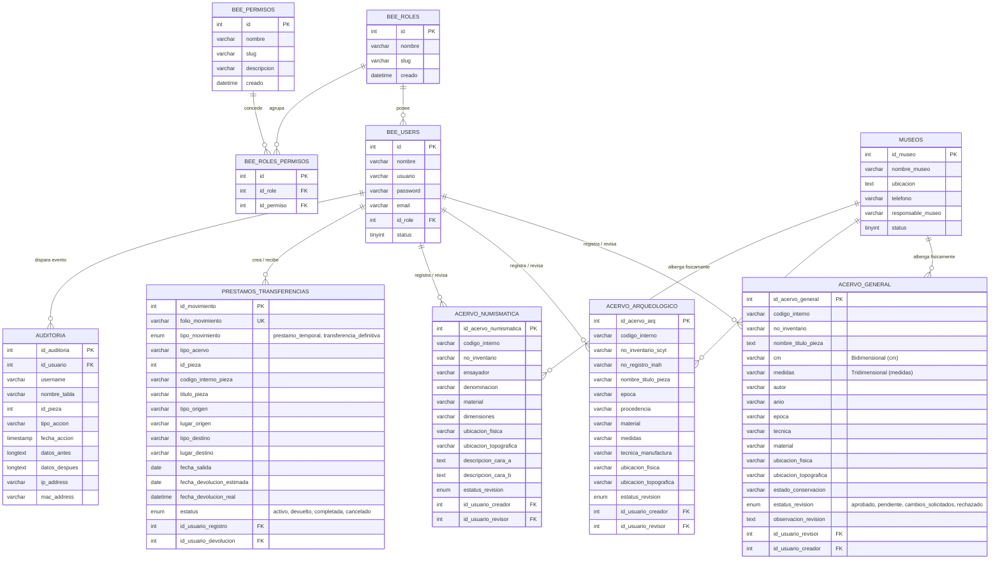

# 🗄️ Diagrama Entidad-Relación (ERD)

Este documento presenta el modelo conceptual y relacional de la base de datos `db_framework`, detallando las entidades principales, llaves primarias, foráneas, índices y la cardinalidad de sus interacciones.

---

## 1. Diagrama Global de Entidades

---

## 2. Relaciones Fundamentales y Restricciones de Integridad

### 2.1. Seguridad y Acceso (RBAC)
- **`bee_roles` $\rightarrow$ `bee_users`**: Relación 1 a N. Cada usuario tiene asignado exactamente un rol funcional (`id_role`), el cual determina su conjunto de permisos.
- **`bee_roles` $\leftrightarrow$ `bee_permisos`**: Relación N a M resuelta a través de la tabla intermedia `bee_roles_permisos`. Permite granularidad total en las operaciones autorizadas.

### 2.2. Custodia del Acervo y Trazabilidad Curatorial
- Cada tabla de acervo (`acervo_general`, `acervo_arqueologico`, `acervo_numismatica`) contiene dos llaves foráneas lógicas hacia `bee_users`:
  - `id_usuario_creador`: Identifica al capturista responsable del registro inicial.
  - `id_usuario_revisor`: Identifica al curador o administrador que autorizó, solicitó cambios o rechazó la pieza.

### 2.3. Trazabilidad de Movilidad (Préstamos y Traslados)
- `prestamos_transferencias` utiliza un polimorfismo estructurado mediante las columnas `tipo_acervo` (`general`, `arqueologico`, `numismatica`) e `id_pieza`. Esto permite enlazar un único módulo de movimientos con cualquiera de las tres colecciones sin redundancia de tablas.
- Genera un `folio_movimiento` único e indexado (ej. `MOV-2026-0042`) para control administrativo.

### 2.4. Integridad Forense (Auditoría)
- La tabla `auditoria` no tiene llaves foráneas restrictivas de tipo `CASCADE` o `RESTRICT` para evitar bloqueos transaccionales o fallos si un usuario fuera suspendido; captura instantáneas de datos en campos de texto enriquecido (`longtext`) serializados en formato JSON.

---

## 3. Notas Relacionadas
- Estructura detallada de piezas: [[02 - Tablas de Acervo (General, Arqueológico, Numismático)]]
- Detalle del ciclo de préstamos: [[03 - Módulo de Préstamos y Transferencias]]
- Mecanismo de auditoría: [[04 - Sistema de Auditoría y Trazabilidad]]
- Tablas maestras y catálogos: [[05 - Catálogos y Tablas Auxiliares]]

