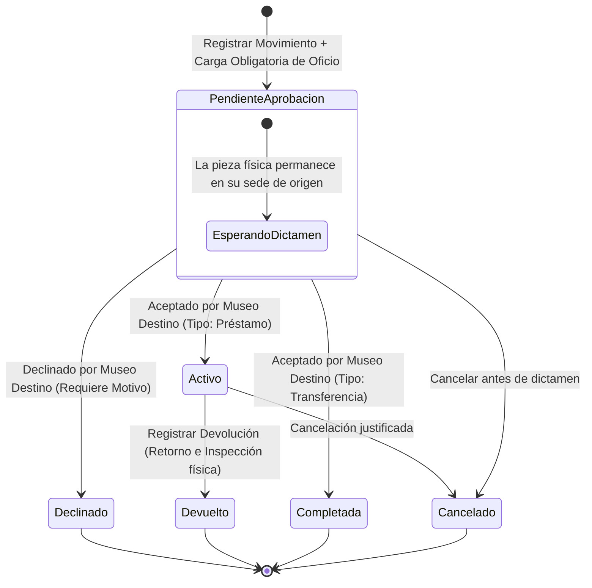

# 🚚 Módulo de Préstamos y Transferencias

El módulo de movilidad patrimonial fiscaliza la salida física temporal o el traslado definitivo de bienes culturales entre sedes de la Secretaría de Cultura y Turismo, dependencias gubernamentales externas o instituciones museísticas colaboradoras.

---

## 1. Esquema de la Tabla `prestamos_transferencias`

```sql
CREATE TABLE `prestamos_transferencias` (
  `id_movimiento` int NOT NULL AUTO_INCREMENT,
  `folio` varchar(50) NOT NULL UNIQUE,
  `tipo_movimiento` enum('prestamo','transferencia') NOT NULL,
  `tipo_acervo` varchar(50) NOT NULL,
  `id_pieza` int NOT NULL,
  `codigo_interno_pieza` varchar(100) DEFAULT NULL,
  `titulo_pieza` varchar(255) DEFAULT NULL,
  `coleccion` varchar(255) DEFAULT NULL,
  `tipo_origen` varchar(100) NOT NULL,
  `lugar_origen` varchar(255) NOT NULL,
  `id_museo_origen` int DEFAULT NULL,
  `responsable_origen` varchar(255) DEFAULT NULL,
  `tipo_destino` varchar(100) NOT NULL,
  `lugar_destino` varchar(255) NOT NULL,
  `id_museo_destino` int DEFAULT NULL,
  `responsable_destino` varchar(255) DEFAULT NULL,
  `fecha_salida` date NOT NULL,
  `fecha_devolucion_estimada` date DEFAULT NULL,
  `fecha_devolucion_real` datetime DEFAULT NULL,
  `motivo` text NOT NULL,
  `no_oficio_autorizacion` varchar(150) DEFAULT NULL,
  `archivo_oficio` varchar(255) DEFAULT NULL,
  `condiciones_entrega` text,
  `condiciones_devolucion` text,
  `lugar_devolucion` varchar(255) DEFAULT NULL,
  `observaciones` text,
  `estatus` enum('pendiente_aprobacion','activo','devuelto','completada','declinado','cancelado') NOT NULL DEFAULT 'pendiente_aprobacion',
  `id_usuario_registro` int NOT NULL,
  `id_usuario_devolucion` int DEFAULT NULL,
  `id_usuario_dictamen` int DEFAULT NULL,
  `fecha_dictamen` datetime DEFAULT NULL,
  `motivo_declinacion` text DEFAULT NULL,
  `observaciones_dictamen` text DEFAULT NULL,
  `created_at` timestamp DEFAULT CURRENT_TIMESTAMP,
  `updated_at` timestamp DEFAULT NULL ON UPDATE CURRENT_TIMESTAMP,
  PRIMARY KEY (`id_movimiento`),
  KEY `idx_tipo_acervo_pieza` (`tipo_acervo`, `id_pieza`),
  KEY `idx_fecha_salida` (`fecha_salida`),
  KEY `idx_estatus` (`estatus`),
  KEY `idx_museo_destino` (`id_museo_destino`)
) ENGINE=InnoDB DEFAULT CHARSET=utf8mb4;
```

---

## 2. Tipos de Movimiento y Ciclo de Vida del Dictamen



### 2.1. Estatus Inicial: `pendiente_aprobacion`
- Todo nuevo movimiento nace en este estatus.
- **Principio de inmovilidad provisional**: La ubicación física de la pieza en el catálogo no sufre alteración hasta que el administrador de la sede receptora (o el Super Administrador) autorice formalmente el movimiento.

### 2.2. Aceptación de Movimiento
- Solo puede ser efectuada por el usuario **Administrador asignado al museo receptor** (`id_museo_destino` / `bee_users.id_museo`) o por un **Super Administrador** (`id_role = 1`).
- **Préstamo temporal**: Cambia el estatus a `activo`. La ubicación física de la pieza se actualiza a formato dinámico: `En préstamo en: [Lugar Destino] (Folio: [Folio])`.
- **Transferencia definitiva**: Cambia el estatus a `completada`. La ubicación física pasa a ser de manera permanente el nuevo recinto.
- Se registra `id_usuario_dictamen`, `fecha_dictamen` y bitácora de auditoría.

### 2.3. Declinación de Movimiento (`declinado`)
- Permite a la sede receptora rechazar el movimiento si las condiciones de seguridad, climatización, embalaje o fundamentación legal no son idóneas.
- **Obligatoriedad del motivo**: Exige la captura detallada de `motivo_declinacion`.
- La pieza no sufre traslados y permanece íntegramente en su sede de origen.

### 2.4. Préstamo Temporal y Devolución (`devuelto`)
- Exige `fecha_devolucion_estimada` y dictamen del estado de conservación en `condiciones_entrega`.
- Al retornar la pieza, se registra la `fecha_devolucion_real`, `condiciones_devolucion`, `lugar_devolucion` y la obra regresa físicamente al recinto de origen.

---

## 3. Generación del Folio Institucional

El folio sigue una estructura única institucional autogenerada:
- Préstamos: `PRE-YYYY-XXXX` (ej. `PRE-2026-0001`)
- Transferencias: `TRA-YYYY-XXXX` (ej. `TRA-2026-0001`)
