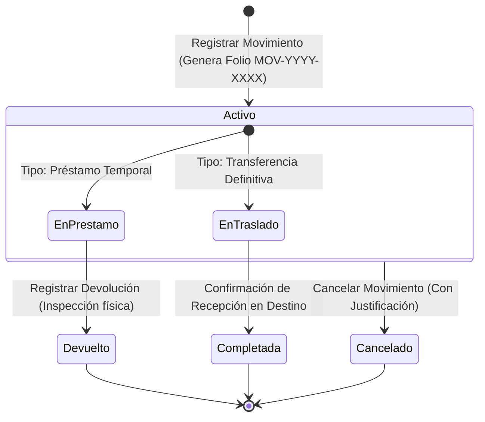

# 🚚 Módulo de Préstamos y Transferencias

El módulo de movilidad patrimonial fiscaliza la salida física temporal o el traslado definitivo de bienes culturales entre sedes de la Secretaría de Cultura y Turismo, dependencias gubernamentales externas o instituciones museísticas internacionales.

---

## 1. Esquema de la Tabla `prestamos_transferencias`

```sql
CREATE TABLE `prestamos_transferencias` (
  `id_movimiento` int NOT NULL AUTO_INCREMENT,
  `folio_movimiento` varchar(50) NOT NULL UNIQUE,
  `tipo_movimiento` enum('prestamo_temporal','transferencia_definitiva') NOT NULL,
  `tipo_acervo` varchar(50) NOT NULL,
  `id_pieza` int NOT NULL,
  `codigo_interno_pieza` varchar(100) DEFAULT NULL,
  `titulo_pieza` varchar(255) DEFAULT NULL,
  `tipo_origen` varchar(100) NOT NULL,
  `lugar_origen` varchar(255) NOT NULL,
  `responsable_origen` varchar(255) DEFAULT NULL,
  `tipo_destino` varchar(100) NOT NULL,
  `lugar_destino` varchar(255) NOT NULL,
  `responsable_destino` varchar(255) DEFAULT NULL,
  `fecha_salida` date NOT NULL,
  `fecha_devolucion_estimada` date DEFAULT NULL,
  `fecha_devolucion_real` datetime DEFAULT NULL,
  `motivo` text NOT NULL,
  `no_oficio_autorizacion` varchar(150) DEFAULT NULL,
  `condiciones_entrega` text,
  `condiciones_devolucion` text,
  `lugar_devolucion` varchar(255) DEFAULT NULL,
  `observaciones` text,
  `estatus` enum('activo','devuelto','completada','cancelado') NOT NULL DEFAULT 'activo',
  `id_usuario_registro` int NOT NULL,
  `id_usuario_devolucion` int DEFAULT NULL,
  `created_at` timestamp DEFAULT CURRENT_TIMESTAMP,
  `updated_at` timestamp DEFAULT NULL ON UPDATE CURRENT_TIMESTAMP,
  PRIMARY KEY (`id_movimiento`),
  KEY `idx_tipo_acervo_pieza` (`tipo_acervo`, `id_pieza`),
  KEY `idx_fecha_salida` (`fecha_salida`),
  KEY `idx_estatus` (`estatus`)
) ENGINE=InnoDB DEFAULT CHARSET=utf8mb4;
```

---

## 2. Tipos de Movimiento y Ciclo de Vida



### 2.1. Préstamo Temporal (`prestamo_temporal`)
- Utilizado para exhibiciones temporales en otros recintos, préstamos de investigación o traslados a talleres de restauración.
- **Requisitos**: Exige una `fecha_devolucion_estimada` y un dictamen del estado de conservación en `condiciones_entrega`.
- **Cierre**: Finaliza al invocar la acción `Devolver`, donde se registra la `fecha_devolucion_real`, `condiciones_devolucion` y el funcionario receptor en `responsable_destino`. El estatus pasa a `devuelto`.

### 2.2. Transferencia Definitiva (`transferencia_definitiva`)
- Utilizado para el cambio permanente de sede de custodia de una obra entre dos museos institucionales.
- Al completarse, el sistema actualiza automáticamente la columna `ubicacion_fisica` de la pieza en su respectiva tabla de acervo para reflejar el nuevo recinto custodio. El estatus queda como `completada`.

### 2.3. Cancelación (`cancelado`)
- En caso de contingencias (cancelación de la exposición o dictamen de no idoneidad para traslado), un administrador puede cancelar el movimiento. Requiere capturar una justificación en `observaciones`.

---

## 3. Generación del Folio Institucional

El folio de cada movimiento sigue una secuencia algorítmica autogenerada por el controlador:
$$\text{Folio} = \text{MOV} - \text{Año} - \text{Correlativo Formateado (4 dígitos)}$$
*Ejemplo:* `MOV-2026-0001`, `MOV-2026-0002`.

---

## 4. Trazabilidad Polimórfica de Piezas

Para posibilitar que cualquier pieza de los tres acervos sea movilizada sin romper la normalización relacional:
1. `tipo_acervo`: Almacena el discriminador de colección (`general`, `arqueologico`, `numismatica`).
2. `id_pieza`: Almacena el identificador numérico de la pieza (`id_acervo_general`, `id_acervo_arq` o `id_acervo_numismatica`).
3. Al momento del registro, el sistema guarda una copia estática de `codigo_interno_pieza` y `titulo_pieza` para que el expediente histórico del préstamo sea inmutable incluso si los datos descriptivos de la pieza sufrieran modificaciones posteriores.

---

## 5. Referencias Cruzadas
- Conoce el procedimiento en el manual de usuario: [[05 - Gestión de Préstamos y Transferencias]]
- Consulta el controlador correspondiente: [[01 - Controladores y Flujo de Peticiones#Gestión de Préstamos y Traslados]]
- Revisa el registro de auditoría de movimientos: [[04 - Sistema de Auditoría y Trazabilidad]]

---

Queda pendiente [[Préstamos y Transferencias]].
