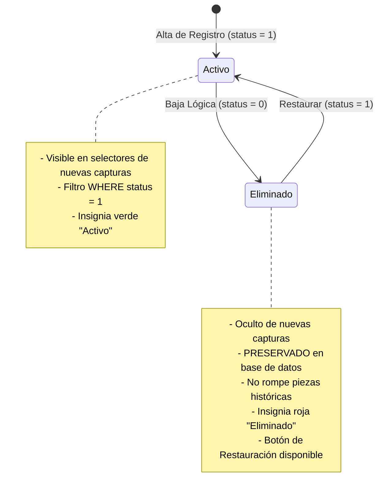
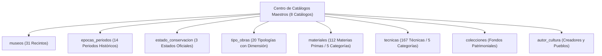

# 📚 Catálogos Maestros y Tablas Auxiliares Oficiales

Para garantizar la normalización de la información técnica, evitar discrepancias ortográficas y proteger la integridad del inventario patrimonial, el sistema centraliza la administración de **8 catálogos oficiales** validados por la Subdirección de Acervo Cultural y la Dirección de Patrimonio Cultural (documentos base: `boveda/ÉPOCA, TÉCNICAS Y MATERIALES.docx` y acuerdos de la Minuta 03 de 2026).

---

## 🛡️ Política Institucional de Borrado Lógico (Cero Borrado Físico)

A partir de la versión 1.9.6, todos los catálogos operan bajo la **Política de Preservación y Borrado Lógico Puro**:



> [!IMPORTANT]
> **Cero Borrado Físico (`DELETE FROM`)**: Ningún registro de catálogo se elimina físicamente de la base de datos MySQL. Cuando un administrador decide dar de baja un elemento, el sistema ejecuta:
> $$\text{UPDATE } tabla \text{ SET } status = 0, updated\_at = NOW() \text{ WHERE } pk = :id$$
> Esta regla garantiza que ninguna pieza registrada en `acervo_general`, `acervo_arqueologico`, `acervo_numismatica`, préstamo o transferencia sufra pérdida de consistencia o quede huérfana de referencia histórica.

---

## 1. Red Oficial de Museos y Recintos Culturales (`museos`)

Almacena la red oficial de **31 museos y recintos culturales** administrados por la Secretaría de Cultura y Turismo en el Estado de México.

### 1.1. Estructura de la Tabla

```sql
CREATE TABLE `museos` (
  `id_museo` int NOT NULL AUTO_INCREMENT,
  `nombre_museo` varchar(255) NOT NULL,
  `ubicacion` text DEFAULT NULL,
  `telefono` varchar(15) DEFAULT NULL,
  `responsable_museo` varchar(255) DEFAULT NULL,
  `status` tinyint(1) NOT NULL DEFAULT '1',
  `created_at` timestamp NOT NULL DEFAULT CURRENT_TIMESTAMP,
  `updated_at` timestamp NULL DEFAULT NULL ON UPDATE CURRENT_TIMESTAMP,
  PRIMARY KEY (`id_museo`)
) ENGINE=InnoDB DEFAULT CHARSET=utf8mb4;
```

### 1.2. Red de Museos Registrados (31 recintos)
1. Centro Cultural Mexiquense Bicentenario
2. Museo de Antropología e Historia
3. Museo de Arte Moderno
4. Museo Hacienda la Pila
5. Museo de Numismática
6. Museo de Bellas Artes
7. Museo de la Acuarela
8. Museo de la Estampa
9. Museo Taller Luis Nishizawa
10. Museo Casa Toluca 1920
11. Museo Galería Arte Mexiquense Torres Bicentenario
12. Museo del Deporte
13. Museo Virreinal de Zinacantepec
14. Casa Museo Horacio Zúñiga
15. Museo Arqueológico del Valle de Bravo
16. Museo Joaquín Arcadio Pagaza
17. Museo Arqueológico de Apaxco
18. Museo Casa de Morelos
19. Museo Arqueológico Román Piña Chán
20. Museo Centro Cultural Malinalco
21. Museo de Ciencias Naturales
22. Museo de la Minería
23. Museo Fray Bartolomé de Medina
24. Centro Regional de Cultura de Huixquilucan
25. Centro Regional de Cultura de Chalco
26. Centro Regional de Cultura de Valle de Bravo
27. Centro Regional de Cultura de Ocoyoacac
28. Centro Regional de Cultura de Acambay
29. Centro Regional de Cultura de Tecámac
30. Centro Regional de Cultura de Cuautitlán Izcalli
31. Centro Regional de Cultura de Ecatepec

### 1.3. Integración en Formularios (`obtenerOpcionesMuseos`)
La función `obtenerOpcionesMuseos()` en `app/functions/acervo_catalogos.php` consulta los museos activos (`WHERE status = 1`) y agrega la opción interactiva:
```php
$opciones['Otro'] = 'Otro (Especificar sede externa o dependencia)';
```
Al seleccionar **"Otro"**, la interfaz despliega automáticamente un campo de texto adicional para capturar la sede externa (ej. Palacio de Gobierno, Secretarías externas, recintos en comodato).

---

## 2. Catálogos de Vocabulario de Catalogación y Clasificación por Disciplinas



### 2.1. Materiales (`materiales`)
Almacena 112 materias primas estandarizadas con clasificación por disciplina mediante la columna `categoria`:

```sql
CREATE TABLE `materiales` (
  `id_material` int NOT NULL AUTO_INCREMENT,
  `nombre_material` varchar(255) NOT NULL,
  `categoria` varchar(100) DEFAULT NULL,
  `status` tinyint(1) NOT NULL DEFAULT '1',
  `created_at` timestamp NOT NULL DEFAULT CURRENT_TIMESTAMP,
  `updated_at` timestamp NULL DEFAULT NULL ON UPDATE CURRENT_TIMESTAMP,
  PRIMARY KEY (`id_material`)
) ENGINE=InnoDB DEFAULT CHARSET=utf8mb4;
```

#### Clasificación por Disciplinas:
* **Materiales Pictóricos (65)**: Óleo, acrílico, acuarela, gouache, temple, pastel, tinta china, lienzo de lino, madera de cedro, papel algodón, etc.
* **Materiales para Culturas Populares (12)**: Barro natural, barro vidriado, barro policromado, carrizo, palma, madera de copal, hoja de maíz, cera escamada, talavera, etc.
* **Materiales para Ciencias Naturales (6)**: Fósil vegetal, fósil animal, ámbar natural, taxidermia, resina natural, roca mineral.
* **Arqueológico (22)**: Obsidiana verde, obsidiana negra, jadeíta, serpentina, basalto, piedra caliza, andesita, concha marina, turquesa, etc.
* **Numismática (7)**: Oro, plata, bronce, cobre, níquel, cuproníquel, bimetálica.

---

### 2.2. Técnicas de Manufactura y Arte (`tecnicas`)
Registra 167 técnicas artísticas, artesanales y arqueológicas organizadas por categoría:

```sql
CREATE TABLE `tecnicas` (
  `id_tecnica` int NOT NULL AUTO_INCREMENT,
  `nombre_tecnica` varchar(255) NOT NULL,
  `categoria` varchar(100) DEFAULT NULL,
  `status` tinyint(1) NOT NULL DEFAULT '1',
  `created_at` timestamp NOT NULL DEFAULT CURRENT_TIMESTAMP,
  `updated_at` timestamp NULL DEFAULT NULL ON UPDATE CURRENT_TIMESTAMP,
  PRIMARY KEY (`id_tecnica`)
) ENGINE=InnoDB DEFAULT CHARSET=utf8mb4;
```

#### Clasificación por Disciplinas:
* **Técnicas Pictóricas (35)**: Óleo sobre tela, acuarela sobre papel, grabado al aguafuerte, serigrafía, encausto, temple al huevo, dibujo a sanguina, etc.
* **Técnicas de Culturas Populares (19)**: Modelado en barro, vidriado al plomo, tejido en telar de cintura, cestería en espiral, talla en madera con copal, cartonería tradicional, cerería tradicional.
* **Técnicas para Ciencias Naturales (15)**: Taxidermia artística, inclusión en resina sintética, preparación osteológica, moldeado en yeso científico.
* **Manufactura Arqueológica (28)**: Percusión directa, percusión indirecta, presión bifacial, pulido por fricción, modelado directo, pastillaje, enrollado (colombín), vaciado en molde.
* **Decorativas Arqueológicas (70)**: Incisión fina, excisión profunda, pintura al negativo, esgrafiado, pseudocloisonné, baño de engobe, acanalado, pastillaje antropomorfo.

---

### 2.3. Tipos de Obra y Conmutación de Dimensiones (`tipo_obras`)
Registra las tipologías que gobiernan la alternancia inteligente entre medidas bidimensionales (`cm`) y tridimensionales (`medidas`):

```sql
CREATE TABLE `tipo_obras` (
  `id_tipo_obra` int NOT NULL AUTO_INCREMENT,
  `nombre_tipo_obra` varchar(255) NOT NULL,
  `categoria` varchar(50) DEFAULT 'Bidimensional',
  `status` tinyint(1) NOT NULL DEFAULT '1',
  `created_at` timestamp NOT NULL DEFAULT CURRENT_TIMESTAMP,
  `updated_at` timestamp NULL DEFAULT NULL ON UPDATE CURRENT_TIMESTAMP,
  PRIMARY KEY (`id_tipo_obra`)
) ENGINE=InnoDB DEFAULT CHARSET=utf8mb4;
```

#### Grupos de Dimensiones:
* **Bidimensional** (cm de largo × ancho): Pintura, Dibujo, Grabado, Fotografía, Acuarela, Textil.
* **Tridimensional** (medidas alto × ancho × profundidad): Escultura, Mobiliario, Cerámica, Objeto, Otro.
* **Numismática**: Moneda, Billete, Medalla, Condecoración, Troquel, Ficha de Hacienda, Bono/Obligación.

---

### 2.4. Épocas y Periodos Históricos (`epocas_periodos`)
Registra las 14 temporalidades y siglos oficiales:
* **Preclásico** (2500 a.C. - 200 d.C.)
* **Clásico** (200 d.C. - 900 d.C.)
* **Epiclásico** (650 d.C. - 900 d.C.)
* **Posclásico** (900 d.C. - 1521 d.C.)
* **Posclásico Temprano** / **Posclásico Tardío**
* **Virreinal / Colonial** (Siglos XVI, XVII, XVIII)
* **Siglo XIX** / **Porfiriato** / **Revolución Mexicana**
* **Siglo XX** / **Contemporáneo (Siglo XXI)**

---

### 2.5. Estados de Conservación (`estado_conservacion`)
Normalizado a los 3 valores oficiales de la Subdirección de Acervo Cultural:
1. `Bueno`: Integridad estructural plena, sin agentes de deterioro activos.
2. `Regular`: Desgaste superficial, pátina histórica o pérdidas menores que no comprometen la lectura formal.
3. `Malo`: Daño estructural severo, ataque biológico activo, fracturas o desprendimiento que requiere dictamen de restauración emergente.

---

### 2.6. Colecciones Patrimoniales (`colecciones`)
Fondos y agrupaciones temáticas utilizadas en el módulo de [[05 - Gestión de Préstamos y Transferencias]]:
* Colección Numismática Mexiquense
* Fondo Arte Virreinal
* Fondo Arqueológico Teotihuacano
* Colección Culturas Populares del Altiplano

---

### 2.7. Autores y Culturas (`autor_cultura`)
Catálogo normalizado de creadores plásticos, artistas mexiquenses y culturas mesoamericanas:
* Creadores: José María Velasco, Felipe Santiago Gutiérrez, Luis Nishizawa, Leopoldo Flores, etc.
* Culturas Prehispánicas: Cultura Otomí, Cultura Mazahua, Cultura Matlatzinca, Cultura Teotihuacana, Cultura Mexica, Cultura Tolteca.

---

## 3. Algoritmo Defensivo de Integridad Relacional (`contarUsoRelacional`)

Antes de realizar una baja lógica, el modelo `catalogosModel::contarUsoRelacional($slug, $id, $nombre)` ejecuta una inspección exhaustiva de referencias:

```php
switch ($slug) {
  case 'museos':
    // Verifica bee_users, prestamos_transferencias y acervo_* (ubicacion_fisica)
    break;
  case 'materiales':
    // Inspecciona columnas 'material' en acervo_general, acervo_numismatica, acervo_arqueologico
    break;
  case 'tecnicas':
    // Inspecciona tecnica, tecnica_manufactura y tecnica_decorativa
    break;
  case 'tipo_obras':
    // Inspecciona tipo_obra en acervo_general y acervo_numismatica
    break;
  // ...
}
```

Al pasar a `status = 0`, el registro no se borra físicamente, por lo que el inventario existente nunca sufre pérdida de datos.

---

## 4. Trazabilidad Forense de Catálogos

Todas las modificaciones a los catálogos se registran de forma inmutable en la tabla `auditoria`:

| Acción | Tipo de Evento | Captura de Datos |
| :--- | :--- | :--- |
| Alta de nuevo elemento | `CREAR_CATALOGO` | `datos_despues` con el registro creado (`status: 1`) |
| Modificación de nombre o categoría | `ACTUALIZAR_CATALOGO` | Snapshots JSON completos de `datos_antes` y `datos_despues` |
| Baja lógica | `ELIMINAR_CATALOGO` | Registro con `status: 0` |
| Restauración de registro | `RESTAURAR_CATALOGO` | Reactivación con `status: 1` |

---

## 5. Referencias Cruzadas
- Arquitectura de modelos: [[02 - Modelos y Capa de Persistencia PDO]]
- Controlador y endpoints AJAX: [[01 - Controladores y Flujo de Peticiones]]
- Manual de usuario de catálogos: [[07 - Gestión de Catálogos Maestros]]
- Matriz de permisos RBAC: [[03 - Sistema de Roles y Permisos (RBAC)]]
