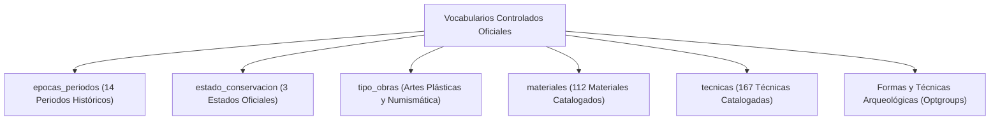

# 📚 Catálogos y Tablas Auxiliares Oficiales

Para garantizar la normalización de la información curatorial y evitar discrepancias ortográficas, el sistema se apoya en una serie de catálogos y tablas maestras oficiales proporcionadas por la Subdirección de Acervo Cultural y la Dirección de Patrimonio Cultural (documento fuente: `boveda/ÉPOCA, TÉCNICAS Y MATERIALES.docx`, formalizado en la Minuta 03 del 16 de octubre de 2026).

---

## 1. Catálogo Oficial de Museos (`museos`)

Almacena la red oficial de **31 museos y recintos culturales** administrados por la Secretaría de Cultura y Turismo en el Estado de México.

### 1.1. Estructura de la Tabla

```sql
CREATE TABLE `museos` (
  `id_museo` int NOT NULL AUTO_INCREMENT,
  `nombre_museo` varchar(255) DEFAULT NULL,
  `ubicacion` text,
  `telefono` varchar(10) DEFAULT NULL,
  `responsable_museo` varchar(255) DEFAULT NULL,
  `status` tinyint(1) NOT NULL DEFAULT '1',
  `created_at` timestamp NOT NULL DEFAULT CURRENT_TIMESTAMP,
  `updated_at` timestamp NULL DEFAULT NULL ON UPDATE CURRENT_TIMESTAMP,
  PRIMARY KEY (`id_museo`)
) ENGINE=InnoDB DEFAULT CHARSET=utf8mb4;
```

### 1.2. Red de Museos Registrados (31 recintos)
1. Centro Cultural Mexiquense Bicentenario
2. Museo de Antropología e Historia
3. Museo de Arte Moderno
4. Museo Hacienda la Pila
5. Museo de Numismática
6. Museo de Bellas Artes
7. Museo de la Acuarela
8. Museo de la Estampa
9. Museo Taller Luis Nishizawa
10. Museo Casa Toluca 1920
11. Museo Galería Arte Mexiquense Torres Bicentenario
12. Museo del Deporte
13. Museo Virreinal de Zinacantepec
14. Casa Museo Horacio Zúñiga
15. Museo Arqueológico del Valle de Bravo
16. Museo Joaquín Arcadio Pagaza
17. Museo Arqueológico de Apaxco
18. Museo Casa de Morelos
19. Museo Arqueológico Román Piña Chán
20. Museo Centro Cultural Malinalco
21. Museo de Ciencias Naturales
22. Museo de la Minería
23. Museo Fray Bartolomé de Medina
24. Centro Regional de Cultura de Huixquilucan
25. Centro Regional de Cultura de Chalco
26. Centro Regional de Cultura de Valle de Bravo
27. Centro Regional de Cultura de Ocoyoacac
28. Centro Regional de Cultura de Acambay
29. Centro Regional de Cultura de Tecámac
30. Centro Regional de Cultura de Cuautitlán Izcalli
31. Centro Regional de Cultura de Ecatepec

### 1.3. Integración en Formularios (`obtenerOpcionesMuseos`)
La función `obtenerOpcionesMuseos()` en `app/functions/acervo_catalogos.php` consulta los museos activos (`status = 1`) y agrega la opción interactiva:
```php
$opciones['Otro'] = 'Otro (Especificar sede externa o dependencia)';
```
> [!NOTE]
> Al seleccionar **"Otro"**, la interfaz despliega automáticamente un campo de texto adicional para capturar la sede externa (ej. Palacio de Gobierno, Secretarías externas, galerías externas o recintos en comodato).

---

## 2. Catálogos de Vocabulario Curatorial



### 2.1. Épocas y Periodos (`epocas_periodos`)
Registra las 14 temporalidades oficiales para asociar a las piezas:
- `Preclásico`
- `Clásico`
- `Epiclásico`
- `Posclásico`
- `Virreinal (Siglo XVI)`
- `Virreinal (Siglo XVII)`
- `Virreinal (Siglo XVIII)`
- `Siglo XIX (México Independiente)`
- `Porfiriato`
- `Revolución Mexicana`
- `Siglo XX (Primera Mitad)`
- `Siglo XX (Segunda Mitad)`
- `Contemporáneo (Siglo XXI)`
- `Sin Época Determinada / No Identificada`

### 2.2. Estado de Conservación (`estado_conservacion`)
Validado y estandarizado a 3 valores canónicos:
- **`Bueno`**: Conservación óptima, sin compromiso formal o estructural.
- **`Regular`**: Desgaste natural o deterioro leve que requiere monitoreo preventivo.
- **`Malo`**: Afectación estructural severa o fractura que amerita restauración prioritaria.

### 2.3. Tipos de Obra y Numismática (`tipo_obras`)
- **Acervo General:**
  - *Bidimensionales:* Pintura, Dibujo, Grabado, Fotografía, Acuarela, Textil.
  - *Tridimensionales:* Escultura, Mobiliario, Cerámica, Objeto, Otro.
- **Acervo Numismático (10 tipos oficiales):**
  - *Tridimensionales:* Monedas, Medallística, Tlacos, Condecoraciones, Otro.
  - *Bidimensionales:* Billetes o notafilia, Filatelia, Loterofilia, Acciones, Documentos fiduciarios, Sellos.

### 2.4. Materiales y Técnicas
- **Materiales:** 112 materiales estandarizados (artes plásticas, ciencias naturales, culturas populares, metales numismáticos y lítica/cerámica arqueológica).
- **Técnicas:** 167 técnicas clasificadas que cubren técnicas pictóricas, estampación, modelado, orfebrería y manufactura arqueológica.

### 2.5. Catálogo Especializado para Acervo Arqueológico
Implementado con agrupación semántica `<optgroup>` en `BeeFormBuilder` y vistas modales:
- **Formas Arqueológicas (180 formas en 7 grupos):**
  - *Contenedores* (Cajete, olla, vaso, tecomate, jarra, copa, sahumador, etc.)
  - *Artefactos* (Navajilla, punta de proyectil, metate, mano de metate, hacha, etc.)
  - *Instrumentos* (Silbato, ocarina, raspador, aguja, anzuelo, etc.)
  - *Figuras y efigies* (Figurilla antropomorfa, zoomorfa, máscara, placa, etc.)
  - *Elementos arquitectónicos* (Almena, clavo arquitectónico, losa, dintel, etc.)
  - *Ornamentos y parafernalia* (Cuenta, orejera, pendiente, pectoral, bezote, etc.)
  - *Otros* (Mortero, tejuelo, fragmento no clasificado, etc.)
- **Técnicas de Manufactura (28 técnicas en 4 grupos):** Modelado, Vaciado, Lapidaria, Desbastado, etc.
- **Técnicas Decorativas (70 técnicas en 4 grupos):** Inciso, Pastillaje, Esgrafiado, Policromado, etc.

---

## 3. Arquitectura de Helpers (`app/functions/acervo_catalogos.php`)

Para centralizar el acceso y desacoplar los formularios de consultas repetitivas a la base de datos, se creó el archivo central de catálogo:
- `obtenerOpcionesMuseos()`
- `obtenerOpcionesEpocas()`
- `obtenerOpcionesEstadoConservacion()`
- `obtenerOpcionesTiposGeneral()`
- `obtenerOpcionesTecnicasGeneral()`
- `obtenerOpcionesMaterialesGeneral()`
- `obtenerOpcionesTiposNumismatica()`
- `obtenerOpcionesMaterialesNumismatica()`
- `obtenerOpcionesTecnicasNumismatica()`
- `obtenerOpcionesFormasArqueologico()`
- `obtenerOpcionesTecnicasManufacturaArqueologico()`
- `obtenerOpcionesTecnicasDecorativasArqueologico()`
- `obtenerOpcionesMaterialesArqueologico()`
- `renderizarOpcionesSelect(array $opciones, $seleccionado = null)`

---

## 4. Referencias Cruzadas
- Consulta cómo se vinculan los museos al dar de alta una pieza: [[03 - Registro y Edición de Piezas Culturales]]
- Conoce el modelo ERD global: [[01 - Diagrama Entidad-Relación (ERD)]]
- Consulta el módulo de préstamos: [[03 - Módulo de Préstamos y Transferencias]]
- Consulta la bitácora de versiones: [[03 - Bitácora de Versiones y Changelog]]
