# 🕹️ Controladores y Flujo de Peticiones

El backend del sistema opera mediante controladores especializados en `app/controllers/`. El controlador preponderante de toda la plataforma administrativa es `adminController.php`, que agrupa la lógica de negocio, validaciones y despacho de datos.

---

## 1. Arquitectura de `adminController.php`

El controlador extiende de la clase base del framework e inicializa el entorno de sesión en su constructor:

```php
class adminController extends Controller
{
  private function check_user_permission(string $permissionSlug)
  {
    if (!check_user_permission($permissionSlug)) {
      Flasher::new('No tienes permisos suficientes para acceder a esta sección.', 'danger');
      Redirect::to('admin');
      exit;
    }
  }

  function __construct()
  {
    // Verifica que el usuario cuente con sesión activa
    if (!check_session()) {
      Redirect::to('login');
      exit;
    }
  }
  // ... Métodos de acción
}
```

---

## 2. Mapa Integral de Métodos por Módulo

```mermaid
graph TD
    AC["adminController"] --> M_Dash["Dashboard (index)"]
    AC --> M_Cat["Catálogo de Acervo"]
    AC --> M_Reg["Registro de Piezas"]
    AC --> M_Rev["Revisión y Semáforo"]
    AC --> M_Mov["Préstamos y Traslados"]
    AC --> M_Exp["Exportaciones (Excel/PDF)"]
    AC --> M_Adm["Administración (Usuarios/Roles/Auditoría)"]

    M_Cat --> M_Cat1["get_acervo_general()"]
    M_Cat --> M_Cat2["get_acervo_arq()"]
    M_Cat --> M_Cat3["get_acervo_numismatica()"]
    M_Cat --> M_Cat4["acervo_*_editar()"]
    M_Cat --> M_Cat5["acervo_*_eliminar()"]
    M_Cat --> M_Cat6["ficha_tecnica()"]

    M_Reg --> M_Reg1["registrar()"]
    M_Reg --> M_Reg2["post_registro() [General]"]
    M_Reg --> M_Reg3["post_registro_arq()"]
    M_Reg --> M_Reg4["post_registro_numismatica()"]

    M_Rev --> M_Rev1["revision()"]
    M_Rev --> M_Rev2["get_revision_data()"]
    M_Rev --> M_Rev3["autorizar_pieza()"]
    M_Rev --> M_Rev4["solicitar_cambios_pieza()"]
    M_Rev --> M_Rev5["rechazar_pieza()"]

    M_Mov --> M_Mov1["prestamos_transferencias()"]
    M_Mov --> M_Mov2["get_prestamos_transferencias_data()"]
    M_Mov --> M_Mov3["buscar_piezas_para_movimiento()"]
    M_Mov --> M_Mov4["post_crear_movimiento()"]
    M_Mov --> M_Mov5["post_devolver_prestamo()"]
    M_Mov --> M_Mov6["post_cancelar_movimiento()"]
```



---

## 3. Desglose de Métodos Clave

### 3.1. Consulta y Paginación Filtrada (`get_acervo_*`)
- **Filtros Soportados**:
  - `busqueda`: Coincidencia parcial con `codigo_interno`, `no_inventario` o `nombre_titulo_pieza`.
  - `filtro_ubicacion`: Búsqueda por museo o recinto físico.
  - `filtro_anio`: Coincidencia por año o periodo de creación.
  - `filtro_autor_cultura`: Filtro por artista (General) o cultura prehispánica (Arqueológico).
- **Control de Visibilidad**: Si el usuario conectado tiene el rol `Capturista`, los métodos filtran automáticamente para mostrar solo los registros dados de alta por él mismo (`id_usuario_creador = session_user_id`), salvo en modo consulta general autorizada.

### 3.2. Registro de Piezas (`post_registro*`)
- **Procesamiento de Dimensiones en Acervo General**:
  - Conmutador frontend `tipo_dimension`: Si es `bidimensional`, se almacena en el campo `cm` y se limpia `medidas`. Si es `tridimensional`, se estructuran las cotas en `medidas` y se limpia `cm`.
- **Procesamiento de Ubicación**:
  - Evalúa si `ubicacion_fisica == 'Otro'`. De ser así, concatena `Otro: ` junto con el valor capturado en `ubicacion_fisica_otro`.
  - El campo `ubicacion_topografica` se almacena independientemente como coordenadas internas de vitrina o estante.
- **Carga de Archivo Fotográfico**:
  - Valida extensiones (`jpg`, `jpeg`, `png`, `webp`).
  - Genera un nombre criptográfico único con `uniqid()` para evitar colisiones.
  - Mueve el binario a `assets/uploads/acervo/` y persiste la ruta relativa en la base de datos.
- **Auditoría Automática**:
  - Inserta el registro inicial con `estatus_revision = 'pendiente'`.
  - Genera una entrada en la tabla `auditoria` con el payload JSON de la nueva pieza.

### 3.3. Revisión Curatorial (`revision`, `autorizar_pieza`, etc.)
- **`autorizar_pieza()`**:
  - Actualiza `estatus_revision = 'aprobado'`, fija `fecha_revision = NOW()` y asigna `id_usuario_revisor`.
  - Registra auditoría con `tipo_accion = 'REVISION_APROBADA'`.
- **`solicitar_cambios_pieza()`**:
  - Recibe el texto de retroalimentación curatorial en `observaciones`.
  - Realiza un respaldo del registro actual en la columna `datos_anteriores_edicion` para trazabilidad de la corrección.
  - Actualiza `estatus_revision = 'cambios_solicitados'`.
- **`rechazar_pieza()`**:
  - Fija `estatus_revision = 'rechazado'`, documentando la causa de no idoneidad patrimonial en `observacion_revision`.

### 3.4. Préstamos y Transferencias
- **`buscar_piezas_para_movimiento()`**:
  - Endpoint AJAX con respuesta JSON que devuelve las piezas aprobadas del acervo solicitado coincidentes con el término ingresado para poblar el autocompletado en el modal de movimiento.
- **`post_crear_movimiento()`**:
  - Genera el folio correlativo único `MOV-YYYY-XXXX`.
  - Valida si la pieza seleccionada no tiene un préstamo activo previo.
  - Inserta el registro en `prestamos_transferencias` y registra auditoría.
- **`post_devolver_prestamo()`**:
  - Marca el movimiento como `devuelto`.
  - Registra la inspección física de retorno y la marca temporal `fecha_devolucion_real`.
- **`post_cancelar_movimiento()`**:
  - Permite al administrador anular un préstamo o transferencia no concretada con registro de causa.

---

## 4. Referencias Cruzadas
- Especificación de payloads: [[04 - Endpoints AJAX y API Interna]]
- Modelos subyacentes: [[02 - Modelos y Capa de Persistencia PDO]]
- Interfaz gráfica y scripts JS: [[05 - Componentes Frontend, Estilos CSS y JavaScript]]
- Matriz de permisos: [[03 - Sistema de Roles y Permisos (RBAC)]]

