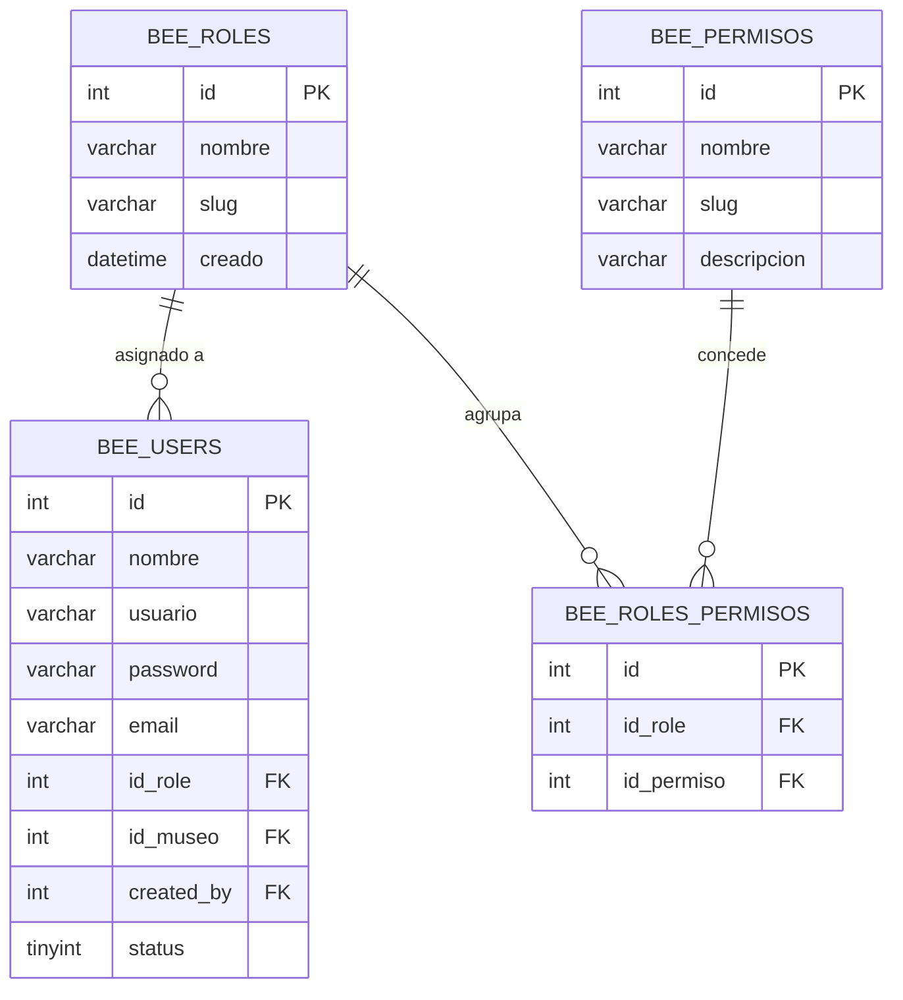
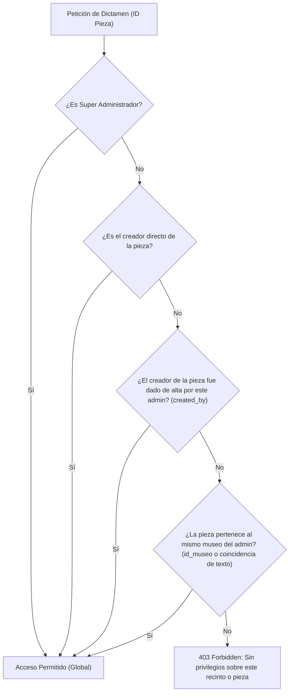

# 🛡️ Sistema de Roles y Permisos (RBAC)

La plataforma implementa un esquema de **Control de Acceso Basado en Roles (RBAC - Role-Based Access Control)** dinámico y granular que asegura que cada funcionario acceda exclusivamente a los módulos y acciones autorizados.

---

## 1. Modelo de Datos de Seguridad

El esquema relacional se compone de cuatro entidades interconectadas:



---

## 2. Catálogo Oficial de Roles Institucionales

| ID | Nombre del Rol | Slug del Rol | Alcance y Responsabilidades |
| :--- | :--- | :--- | :--- |
| **1** | **Super Administrador** | `super-administrador` | Acceso irrestricto total. Configuración del sistema, auditoría, gestión de roles, usuarios y parámetros de base de datos. |
| **2** | **Administrador** | `administrador` | Gestión curatorial y de recintos. Aprobación/rechazo en semáforo, autorización de préstamos/transferencias, edición y exportaciones. |
| **5** | **Capturista** | `capturista` | Personal operativo y técnico de museos. Registro de piezas, carga de fotografías, corrección de observaciones solicitadas. |
| **6** | **Lector General** | `lector-general` | Personal de consulta, investigadores o directivos. Búsqueda y visualización de fichas técnicas sin privilegios de edición o alta. |

---

## 3. Matriz de Permisos (`bee_permisos`)

| ID | Permiso (`slug`) | Super Admin | Administrador | Capturista | Lector General |
| :---: | :--- | :---: | :---: | :---: | :---: |
| `1` | `admin-access` | ✅ | ✅ | ✅ | ✅ |
| `10` | `ver_acervo_general` | ✅ | ✅ | ✅ | ✅ |
| `11` | `registrar_acervo_general` | ✅ | ✅ | ✅ | ❌ |
| `12` | `editar_acervo_general` | ✅ | ✅ | ⚠️ *(Propias)* | ❌ |
| `13` | `eliminar_acervo_general` | ✅ | ✅ | ❌ | ❌ |
| `14` | `ver_acervo_arqueologico` | ✅ | ✅ | ✅ | ✅ |
| `15` | `registrar_acervo_arqueologico` | ✅ | ✅ | ✅ | ❌ |
| `16` | `editar_acervo_arqueologico` | ✅ | ✅ | ⚠️ *(Propias)* | ❌ |
| `17` | `eliminar_acervo_arqueologico` | ✅ | ✅ | ❌ | ❌ |
| `18` | `ver_acervo_numismatica` | ✅ | ✅ | ✅ | ✅ |
| `19` | `registrar_acervo_numismatica` | ✅ | ✅ | ✅ | ❌ |
| `20` | `editar_acervo_numismatica` | ✅ | ✅ | ⚠️ *(Propias)* | ❌ |
| `21` | `eliminar_acervo_numismatica` | ✅ | ✅ | ❌ | ❌ |
| `22` | `exportar_excel` | ✅ | ✅ | ❌ | ❌ |
| `23` | `exportar_pdf` | ✅ | ✅ | ✅ | ✅ |

> [!NOTE]
> Los capturistas únicamente pueden editar piezas que ellos mismos registraron (`id_usuario_creador = session_user_id`) y que se encuentren en estado `cambios_solicitados` o `pendiente`. Las piezas aprobadas quedan protegidas contra edición por capturistas.

---

## 4. Implementación en Código

### 4.1. Funciones Helper de Verificación
En `app/functions/bee_custom_functions.php`:
```php
function check_user_permission(string $permissionSlug): bool
{
  $user = get_user();
  if (!$user) return false;
  
  // Super Administrador tiene bypass de autorización
  if ($user['id_role'] === 1 || $user['slug_rol'] === 'super-administrador') {
    return true;
  }
  
  $permisos = $_SESSION['user_permissions'] ?? [];
  return in_array($permissionSlug, $permisos, true);
}
```

### 4.2. Protección en Controladores
Antes de ejecutar una acción en `adminController.php`:
```php
public function acervo_general_eliminar()
{
  $this->check_user_permission('eliminar_acervo_general');
  // Proceso de eliminación...
}
```

### 4.3. Renderizado Condicional en Vistas (Sidebar / Botones)
En `templates/includes/sidebar.php` y vistas de catálogo:
```php
<?php if (check_user_permission('registrar_acervo_general')): ?>
  <a class="btn btn-primary" href="<?php echo URL; ?>admin/registrar">
    <i class="bx bx-plus-circle"></i> Nueva Pieza
  </a>
<?php endif; ?>
```

---

## 5. Tenencia Territorial por Museo y Jerarquía de Creador (Multi-Tenancy)

A partir de la versión 1.9.0, el sistema cuenta con un esquema de aislamiento y supervisión territorial por museo (`id_museo`) y jerarquía de creación de usuarios (`created_by`), complementando el modelo RBAC tradicional.

### 5.1. Herencia de Museo en Usuarios Creados
Cuando un usuario con rol de **Administrador** da de alta a un nuevo usuario (típicamente un **Capturista** o **Lector General**):
1. El backend asigna automáticamente el campo `created_by = $admin_id`.
2. El nuevo usuario hereda obligatoriamente el `id_museo` del administrador creador.
3. En la interfaz gráfica (`usuariosView.php`), el selector de museo se bloquea y preselecciona dicho museo de adscripción, impidiendo asignaciones accidentales o no autorizadas a otros recintos.
4. El rol **Super Administrador** (`id_role = 1`) mantiene el selector editable para asignar o reasignar usuarios libremente a cualquiera de los 31 museos del catálogo.

### 5.2. Reglas de Validación Curatorial y Alcance del Semáforo (`check_museo_tenancy`)
La función interna `check_museo_tenancy($tipo_acervo, $id_pieza)` en `adminController.php` gobierna qué piezas puede dictaminar cada usuario en los endpoints `/admin/autorizar_pieza`, `/admin/solicitar_cambios_pieza` y `/admin/rechazar_pieza`:



### 5.3. Prevención de IDOR (Insecure Direct Object Reference)
Este mecanismo neutraliza cualquier intento de manipulación cruzada: incluso si un administrador malicioso conoce el identificador numérico de una pieza resguardada en otro museo o registrada por un capturista ajeno a su jurisdicción, el sistema aborta la transacción con una excepción HTTP 403 y registra la alerta de seguridad en la bitácora de auditoría.

---

## 6. Referencias Cruzadas
- Consulta el flujo de autenticación en: [[01 - Inicio de Sesión y Perfiles de Usuario]]
- Revisa el controlador central en: [[01 - Controladores y Flujo de Peticiones]]
- Modelo de datos: [[01 - Diagrama Entidad-Relación (ERD)]]
- Flujo curatorial de semáforo: [[04 - Flujo de Revisión y Semáforo de Aprobación]]

