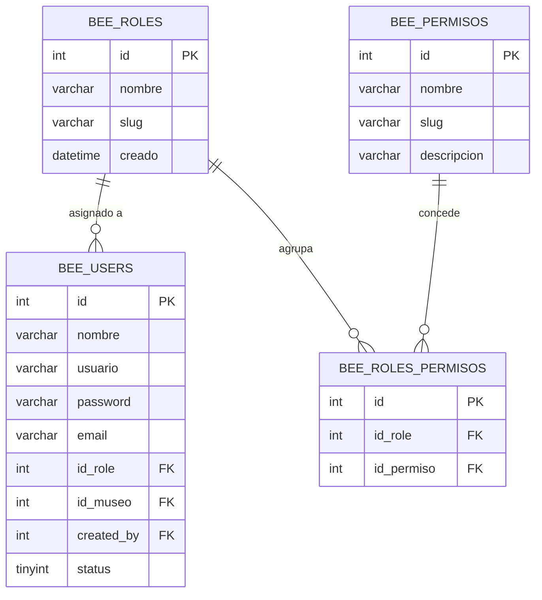
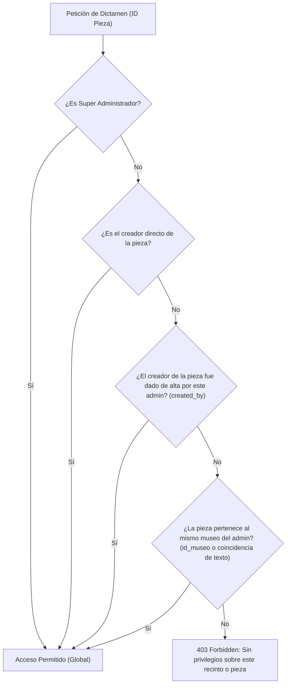

# 🛡️ Sistema de Roles y Permisos (RBAC)

La plataforma implementa un esquema de **Control de Acceso Basado en Roles (RBAC - Role-Based Access Control)** dinámico y granular que asegura que cada funcionario acceda exclusivamente a los módulos y acciones autorizados.

---

## 1. Modelo de Datos de Seguridad

El esquema relacional se compone de cuatro entidades interconectadas:



---

## 2. Catálogo Oficial de Roles Institucionales

| ID | Nombre del Rol | Slug del Rol | Alcance y Responsabilidades |
| :--- | :--- | :--- | :--- |
| **1** | **Super Administrador** | `super-administrador` | Acceso irrestricto total. Configuración del sistema, auditoría, gestión de roles, usuarios y parámetros de base de datos. |
| **2** | **Administrador** | `administrador` | Gestión de acervo y recintos. Aprobación/rechazo en semáforo, autorización de préstamos/transferencias, edición y exportaciones. |
| **5** | **Capturista** | `capturista` | Personal operativo y técnico de museos. Registro de piezas, carga de fotografías, corrección de observaciones solicitadas. |
| **6** | **Lector General** | `lector-general` | Personal de consulta, investigadores o directivos. Búsqueda y visualización de fichas técnicas sin privilegios de edición o alta. |

---

## 3. Matriz Oficial de Permisos (`bee_permisos`)

El sistema cuenta con un catálogo de **26 permisos granulares**, clasificados temáticamente en 7 áreas funcionales para facilitar su asignación y auditoría:

| Categoría | ID | Permiso (`slug`) | Nombre Oficial | Super Admin | Admin | Capturista | Lector |
| :--- | :---: | :--- | :--- | :---: | :---: | :---: | :---: |
| **Acervo General** | `10` | `ver_acervo_general` | Visualizar Acervo General | ✅ | ✅ | ✅ | ✅ |
| | `11` | `registrar_acervo_general` | Registrar Acervo General | ✅ | ✅ | ✅ | ❌ |
| | `12` | `editar_acervo_general` | Editar Acervo General | ✅ | ✅ | ⚠️ *(Propias)* | ❌ |
| | `13` | `eliminar_acervo_general` | Eliminar Acervo General | ✅ | ✅ | ❌ | ❌ |
| **Acervo Arqueológico** | `14` | `ver_acervo_arqueologico` | Visualizar Acervo Arqueológico | ✅ | ✅ | ✅ | ✅ |
| | `15` | `registrar_acervo_arqueologico` | Registrar Acervo Arqueológico | ✅ | ✅ | ✅ | ❌ |
| | `16` | `editar_acervo_arqueologico` | Editar Acervo Arqueológico | ✅ | ✅ | ⚠️ *(Propias)* | ❌ |
| | `17` | `eliminar_acervo_arqueologico` | Eliminar Acervo Arqueológico | ✅ | ✅ | ❌ | ❌ |
| **Acervo Numismático** | `18` | `ver_acervo_numismatica` | Visualizar Acervo Numismático | ✅ | ✅ | ✅ | ✅ |
| | `19` | `registrar_acervo_numismatica` | Registrar Acervo Numismático | ✅ | ✅ | ✅ | ❌ |
| | `20` | `editar_acervo_numismatica` | Editar Acervo Numismático | ✅ | ✅ | ⚠️ *(Propias)* | ❌ |
| | `21` | `eliminar_acervo_numismatica` | Eliminar Acervo Numismático | ✅ | ✅ | ❌ | ❌ |
| **Revisión y Dictamen** | `24` | `ver_revision_acervo` | Visualizar Revisión de Acervo | ✅ | ✅ | ❌ | ❌ |
| | `25` | `dictaminar_acervo` | Dictaminar Piezas de Acervo | ✅ | ✅ | ❌ | ❌ |
| | `26` | `ver_mis_registros` | Visualizar Mis Registros | ✅ | ✅ | ✅ | ❌ |
| **Préstamos y Transferencias** | `27` | `ver_prestamos_transferencias` | Visualizar Préstamos y Transferencias | ✅ | ✅ | ❌ | ❌ |
| | `28` | `registrar_prestamo_transferencia` | Registrar Préstamos y Transferencias | ✅ | ✅ | ❌ | ❌ |
| | `29` | `dictaminar_prestamo_transferencia` | Dictaminar Movimientos de Obra | ✅ | ✅ | ❌ | ❌ |
| | `30` | `devolver_prestamo` | Registrar Devolución de Préstamos | ✅ | ✅ | ❌ | ❌ |
| | `31` | `cancelar_prestamo_transferencia` | Cancelar Movimientos de Obra | ✅ | ✅ | ❌ | ❌ |
| **Reportes y Exportación** | `22` | `exportar_excel` | Exportar Excel | ✅ | ✅ | ❌ | ❌ |
| | `23` | `exportar_pdf` | Exportar PDF | ✅ | ✅ | ✅ | ✅ |
| **Ingesta Masiva** | `36` | `importar_acervo` | Importación Masiva de Acervo | ✅ | ✅ | ❌ | ❌ |
| **Gestión y Auditoría** | `1` | `admin-access` | Acceso de administrador | ✅ | ❌ | ❌ | ❌ |
| | `32` | `gestion_usuarios` | Gestión de Usuarios | ✅ | ✅ | ❌ | ❌ |
| | `33` | `gestion_roles` | Gestión de Roles y Permisos | ✅ | ❌ | ❌ | ❌ |
| | `35` | `gestion_catalogos` | Gestión de Catálogos Maestros | ✅ | ✅ | ❌ | ❌ |
| | `34` | `ver_auditoria` | Visualizar Auditoría Forense | ✅ | ✅ | ❌ | ❌ |

> [!NOTE]
> - **Super Administrador (ID 1)**: Posee la totalidad de los 27 permisos y cuenta con bypass irrestricto en `user_can()`. Es el único perfil facultado para asignar roles de nivel de administración general o superior (como `administrador-general` / #13).
> - **Administrador (ID 2)** y demás roles: Sus facultades se evalúan **estrictamente de forma dinámica** contra la tabla relacional `bee_roles_permisos`. Si el Super Administrador revoca un permiso específico (como `ver_auditoria`), el acceso a dicho módulo y su elemento en el menú lateral (`sidebar.php`) se inhabilitan en tiempo real. Al gestionar usuarios, los selectores de rol ocultan automáticamente perfiles reservados (`super-administrador` y `administrador-general`).
> - Los permisos de administración raíz (`admin-access` y `gestion_roles`) quedan reservados exclusivamente al Super Administrador.

---

## 4. Implementación en Código

### 4.1. Funciones Helper de Verificación Granular
En `app/functions/bee_custom_functions.php`:
```php
// Consulta atómica de permisos por slug
function user_can(string $permissionSlug): bool;

// Módulo de Acervo
function user_can_view_acervo(): bool;
function user_can_register(): bool;
function user_can_import_acervo(): bool;
function user_can_edit_acervo(?string $tipo = null): bool;
function user_can_delete_acervo(?string $tipo = null): bool;

// Módulo de Revisión y Dictamen
function user_can_access_revision(): bool;
function user_can_dictate_acervo(): bool;
function user_can_view_mis_registros(): bool;

// Módulo de Préstamos y Transferencias
function user_can_access_prestamos(): bool;
function user_can_register_prestamos(): bool;
function user_can_dictate_prestamos(): bool;
function user_can_dictate_movement($movimiento): bool; // Valida además sede destino
function user_can_return_prestamos(): bool;
function user_can_cancel_prestamos(): bool;

// Módulo de Gestión y Auditoría
function user_can_manage_users(): bool;
function user_can_manage_roles(): bool;
function user_can_view_auditoria(): bool;
```

### 4.2. Protección en Controladores (`adminController.php`)
Cada endpoint verifica de forma imperativa el permiso correspondiente antes de procesar datos:
```php
public function revision()
{
  if (!user_can_access_revision()) {
    Flasher::error('Acceso denegado. No cuentas con permisos para acceder a Revisión de Acervo.');
    Redirect::to(user_can_view_acervo() ? 'admin/acervo' : 'admin');
    exit;
  }
  // ...
}
```

### 4.3. Renderizado Condicional en Vistas (Sidebar y Módulos)
En `templates/includes/admin/sidebar.php` y en las interfaces de usuario:
```php
<?php if (user_can_access_revision()): ?>
  <li class="nav-item" data-page="revision">
    <a class="nav-link" href="admin/revision">
      <i class='bx bx-clipboard-check'></i>
      <span>Revisión de Acervo</span>
    </a>
  </li>
<?php endif; ?>
```

---

## 5. Tenencia Territorial por Museo y Jerarquía de Creador (Multi-Tenancy)

A partir de la versión 1.9.0, el sistema cuenta con un esquema de aislamiento y supervisión territorial por museo (`id_museo`) y jerarquía de creación de usuarios (`created_by`), complementando el modelo RBAC tradicional.

### 5.1. Herencia de Museo en Usuarios Creados
Cuando un usuario con rol de **Administrador** da de alta a un nuevo usuario (típicamente un **Capturista** o **Lector General**):
1. El backend asigna automáticamente el campo `created_by = $admin_id`.
2. El nuevo usuario hereda obligatoriamente el `id_museo` del administrador creador.
3. En la interfaz gráfica (`usuariosView.php`), el selector de museo se bloquea y preselecciona dicho museo de adscripción, impidiendo asignaciones accidentales o no autorizadas a otros recintos.
4. El rol **Super Administrador** (`id_role = 1`) mantiene el selector editable para asignar o reasignar usuarios libremente a cualquiera de los 31 museos del catálogo.

### 5.2. Reglas de Validación Curatorial y Alcance del Semáforo (`check_museo_tenancy`)
La función interna `check_museo_tenancy($tipo_acervo, $id_pieza)` en `adminController.php` gobierna qué piezas puede dictaminar cada usuario en los endpoints `/admin/autorizar_pieza`, `/admin/solicitar_cambios_pieza` y `/admin/rechazar_pieza`:



### 5.3. Prevención de IDOR (Insecure Direct Object Reference)
Este mecanismo neutraliza cualquier intento de manipulación cruzada: incluso si un administrador malicioso conoce el identificador numérico de una pieza resguardada en otro museo o registrada por un capturista ajeno a su jurisdicción, el sistema aborta la transacción con una excepción HTTP 403 y registra la alerta de seguridad en la bitácora de auditoría.

---

## 6. Referencias Cruzadas
- Consulta el flujo de autenticación en: [[01 - Inicio de Sesión y Perfiles de Usuario]]
- Revisa el controlador central en: [[01 - Controladores y Flujo de Peticiones]]
- Modelo de datos: [[01 - Diagrama Entidad-Relación (ERD)]]
- Flujo curatorial de semáforo: [[04 - Flujo de Revisión y Semáforo de Aprobación]]

