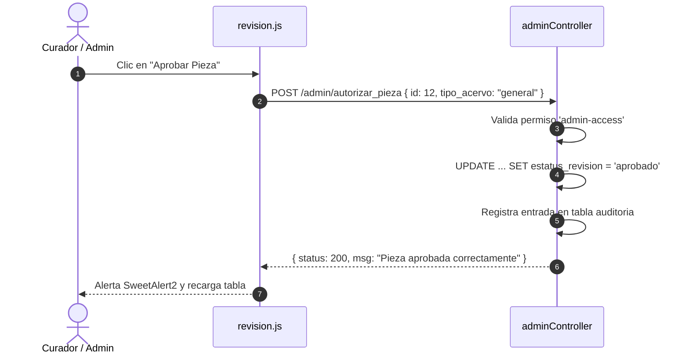

# 📡 Endpoints AJAX y API Interna

El sistema opera mediante una API asíncrona interna consumida por los scripts JavaScript de la interfaz administrativa. Todas las peticiones `POST` implementan validación contra ataques CSRF mediante tokens de sesión.

---

## 1. Convenciones y Estructura de Respuestas

Las respuestas de la API utilizan el tipo MIME `application/json; charset=UTF-8` y se apegan a la siguiente estructura base:

```json
{
  "status": 200,
  "msg": "Mensaje descriptivo del resultado de la operación.",
  "data": []
}
```

### Códigos de Estado Empleados:
- `200 OK`: Operación completada satisfactoriamente.
- `400 Bad Request`: Parámetros obligatorios faltantes o tipos de datos inválidos.
- `401 Unauthorized`: Sesión expirada o no autenticada.
- `403 Forbidden`: Permisos insuficientes (RBAC) para el recurso solicitado.
- `404 Not Found`: Registro patrimonial o movimiento inexistente.
- `500 Internal Error`: Excepción de base de datos o fallo de servidor.

---

## 2. Endpoints del Catálogo de Acervo

### 2.1. Listado Filtrado de Acervo General
- **Ruta**: `GET /admin/get_acervo_general`
- **Parámetros Query**:
  - `search` / `busqueda` *(string, opcional)*: Término de texto en código, título, autor o descripción.
  - `ubicacion` / `filtro_ubicacion` *(string, opcional)*: Museo, sede física o ID de ubicación.
  - `anio` / `filtro_anio` *(string, opcional)*: Año o temporalidad.
  - `page` *(int, opcional, por defecto 1)*: Número de página solicitada.
  - `per_page` *(int, opcional, por defecto 10)*: Cantidad de registros por página (optimizado a nivel SQL).
- **Respuesta (200 OK)**:
```json
{
  "data": [
    {
      "id_acervo_general": 12,
      "codigo_interno": "SCYT-AG-0012",
      "no_inventario": "INV-7842",
      "nombre_titulo_pieza": "Retrato de Sor Juana Inés de la Cruz",
      "cm": "65 x 50 cm",
      "medidas": null,
      "fotografia": "assets/uploads/acervo/foto_sorjuana.jpg",
      "autor": "Miguel Cabrera (Círculo de)",
      "anio": "1750",
      "ubicacion_fisica": "Museo Virreinal de Zinacantepec",
      "ubicacion_topografica": "Sala Capitular, Muro Sur",
      "estado_conservacion": "Bueno",
      "estatus_revision": "aprobado",
      "acciones": "<div class='dropdown'>...</div>"
    }
  ]
}
```

### 2.2. Obtención de Pieza por ID (Modal de Edición)
- **Ruta**: `POST /admin/acervo_general_get_by_id`
- **Payload**: `id=12&csrf=...`
- **Respuesta**: Objeto completo de la pieza con campos dimensionales y de ubicación listos para precargar en el formulario.

### 2.3. Edición de Pieza
- **Ruta**: `POST /admin/acervo_general_editar`
- **Encabezado**: `multipart/form-data`
- **Payload**: Campos actualizados de la pieza + archivo de fotografía (opcional).

### 2.4. Exportación Masiva de Acervo a PDF (Optimizado)
- **Ruta**: `POST /admin/exportar_acervo_pdf`
- **Payload**: `tipo_acervo=general|arqueologico|numismatica&filtro_ubicacion=...&csrf=...`
- **Arquitectura de Rendimiento (Versión 1.9.0)**:
  - Generación de PDF optimizada mediante consultas SQL directas indexadas (sin instanciación redundante de modelos pesados).
  - Procesamiento en bloques (chunking) de 500 registros para evitar el agotamiento de memoria RAM (`memory_limit`) y mitigar tiempos de espera en servidores web.
  - Streaming directo al buffer de salida con cabeceras `Content-Type: application/pdf; filename=inventario_acervo_*.pdf`.

---

## 3. Endpoints del Módulo de Revisión y Semáforo



### 3.1. Listado de Revisión Curatorial
- **Ruta**: `GET /admin/get_revision_data`
- **Parámetros Query**:
  - `tipo` *(string, opcional)*: `todos`, `general`, `arqueologico`, `numismatica`.
  - `semaforo` *(string, opcional)*: `todos`, `pendiente`, `cambios_solicitados`, `aprobado`, `rechazado`.
  - `search` *(string, opcional)*: Búsqueda textual en código interno, título o autor.
  - `page` *(int, por defecto 1)*: Paginación.
  - `per_page` *(int, por defecto 10)*: Registros por página.
- **Optimización de Rendimiento (Versión 1.9.0)**:
  - Implementa **Subquery Pushdown** en MariaDB/MySQL unificando los tres tipos de acervo mediante `UNION ALL` con pre-filtrado de límites, reduciendo el tiempo de respuesta de **26 segundos a menos de 100 milisegundos**.
  - **Alcance Tenancy**: El Super Administrador visualiza todo el inventario estatal. Los Administradores visualizan piezas registradas por ellos mismos, por sus usuarios dependientes (`created_by`), o asignadas a su mismo museo.
- **Respuesta (200 OK)**:
```json
{
  "status": 200,
  "data": [
    {
      "id": 12,
      "codigo_interno": "SCYT-AG-0012",
      "nombre_titulo_pieza": "Retrato de Sor Juana Inés de la Cruz",
      "tipo_acervo": "general",
      "estatus_revision": "pendiente",
      "creador": "Lic. Ana Gómez",
      "museo": "Museo Virreinal de Zinacantepec",
      "fecha_registro": "2026-11-20 14:30:00"
    }
  ],
  "pagination": { "page": 1, "per_page": 10, "total_records": 45, "total_pages": 5 }
}
```

### 3.2. Listado de "Mis Registros en Revisión"
- **Ruta**: `GET /admin/get_mis_registros`
- **Función**: Permite a capturistas dar seguimiento al estatus de sus piezas enviadas, y a administradores consultar de forma directa tanto sus propias piezas como las enviadas por sus capturistas dependientes (`created_by = session_user_id`).
- **Respuesta**: Estructura paginada idéntica a `get_revision_data` filtrada por autoría directa o supervisión jerárquica.

### 3.3. Autorizar Pieza
- **Ruta**: `POST /admin/autorizar_pieza`
- **Payload**: `id=12&tipo_acervo=general&csrf=...`
- **Seguridad**: Valida `check_museo_tenancy()` para evitar IDOR; ejecuta transacción atómica con `Db::query()` y registra auditoría.

### 3.4. Solicitar Cambios (Devolución a Capturista)
- **Ruta**: `POST /admin/solicitar_cambios_pieza`
- **Payload**:
  - `id`: `12`
  - `tipo_acervo`: `general`
  - `observaciones`: `"Corregir las medidas de profundidad y verificar la técnica."`
- **Efecto**: Guarda snapshot en `datos_anteriores_edicion`, pasa el estatus a `cambios_solicitados` y valida permisos territoriales con `check_museo_tenancy()`.

### 3.5. Rechazar Pieza
- **Ruta**: `POST /admin/rechazar_pieza`
- **Payload**: `id=12&tipo_acervo=general&observaciones="Pieza apócrifa o duplicada en inventario"`
- **Seguridad**: Dictamina descarte definitivo previa comprobación de tenencia territorial y registro forense en auditoría.

---

## 4. Endpoints de Préstamos y Transferencias

### 4.1. Búsqueda de Piezas para Asignación
- **Ruta**: `POST /admin/buscar_piezas_para_movimiento`
- **Payload**: `tipo_acervo=general&q=Velasco`
- **Respuesta**: Lista de coincidencias con ID, código interno, título y ubicación actual para alimentar el combo Select2.

### 4.2. Registro de Nuevo Movimiento
- **Ruta**: `POST /admin/post_crear_movimiento`
- **Payload Form**:
  - `tipo_movimiento`: `prestamo_temporal` | `transferencia_definitiva`
  - `tipo_acervo`: `general` | `arqueologico` | `numismatica`
  - `id_pieza`: `12`
  - `lugar_origen`: `Museo de Bellas Artes`
  - `responsable_origen`: `Lic. Juan Pérez`
  - `lugar_destino`: `Centro Cultural Mexiquense Bicentenario`
  - `responsable_destino`: `Mtra. Ana Gómez`
  - `fecha_salida`: `2026-11-10`
  - `fecha_devolucion_estimada`: `2027-02-15` (requerido si es temporal)
  - `motivo`: `"Exposición Temporal: Retrospectiva del Paisaje"`
  - `no_oficio_autorizacion`: `"SCyT/DGM/2026/0458"`
  - `condiciones_entrega`: `"Enmarcado en perfecto estado, sin faltantes de soporte"`

### 4.3. Registro de Retorno (Devolución)
- **Ruta**: `POST /admin/post_devolver_prestamo`
- **Payload**:
  - `id_movimiento`: `45`
  - `condiciones_devolucion`: `"Pieza recibida íntegra, sin alteraciones"`
  - `lugar_devolucion`: `"Bóveda Central de Toluca"`

### 4.4. Cancelación de Movimiento
- **Ruta**: `POST /admin/post_cancelar_movimiento`
- **Payload**: `id_movimiento=45&motivo_cancelacion="Suspensión del evento por remodelación del recinto destino"`

### 4.5. Búsqueda de Piezas Disponibles para Movimiento
- **Ruta**: `GET /admin/buscar_piezas_para_movimiento`
- **Parámetros Query**: `q` (búsqueda de texto), `tipo_acervo` (`general`, `arqueologico`, `numismatica`, `todos`), `limit` (entero).
- **Respuesta**: Lista de piezas en estatus `aprobado` con `id_pieza`, `codigo_interno`, `titulo`, `coleccion`, `ubicacion_fisica`, `fotografia` y resolución de origen.

### 4.6. Detección Inteligente de Origen de Pieza
- **Ruta**: `GET /admin/obtener_origen_pieza`
- **Parámetros Query**: `tipo_acervo`, `id_pieza`.
- **Respuesta**: Resuelve el museo institucional o dependencia donde se encuentra físicamente la obra basándose en su catálogo y movimientos históricos.

---

## 5. Endpoints de Sesión y Seguridad

### 5.1. Heartbeat y Renovación de Sesión Activa
- **Ruta**: `GET /admin/ping_session`
- **Función**: Verifica la vigencia de la sesión en servidor y actualiza `$_SESSION['user_session']['last_activity'] = time()`.
- **Respuesta 200 OK**:
  ```json
  {
    "status": 200,
    "msg": "Sesión activa renovada",
    "time": 1795479550,
    "last_activity": 1795479550,
    "timeout_seconds": 1800
  }
  ```
- **Respuesta 401 Unauthorized**: Si transcurrieron más de 1,800 segundos de inactividad, devuelve estado 401 ordenando redirección a `login?timeout=1`.

---

## 6. Referencias Cruzadas
- Conoce los scripts que invocan estos servicios: [[05 - Componentes Frontend, Estilos CSS y JavaScript]]
- Revisa el controlador backend en: [[01 - Controladores y Flujo de Peticiones]]
- Modelo de auditoría que registra estas llamadas: [[04 - Sistema de Auditoría y Trazabilidad]]

