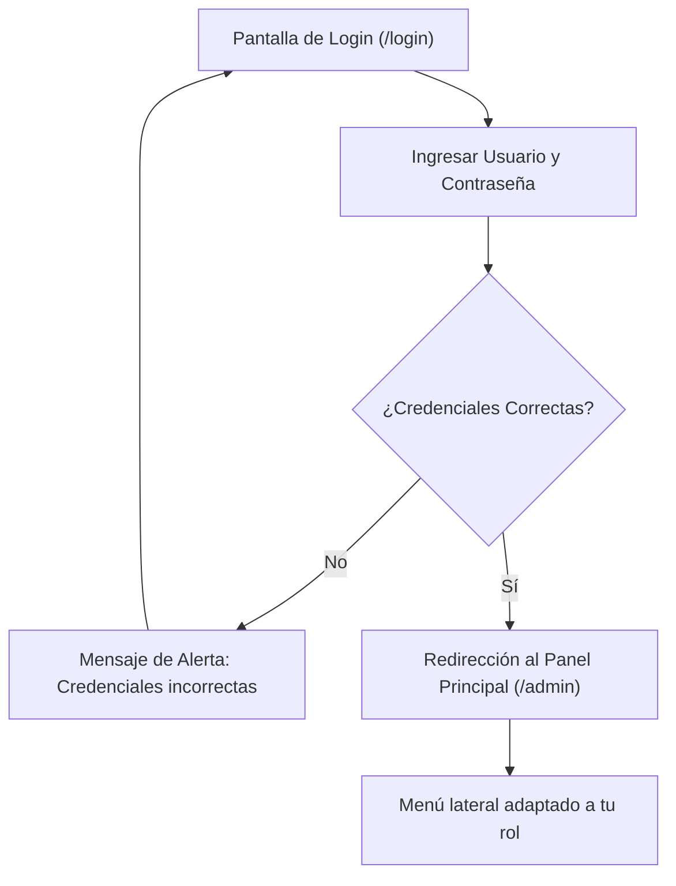

# 👤 Inicio de Sesión, Identidad Visual y Perfiles de Usuario

Bienvenido al **Manual de Operación de Usuario** del Sistema de Inventario Para el Acervo Cultural (**SIPAC**). Esta sección explica la identidad gráfica de la plataforma, el proceso de autenticación y el comportamiento de la interfaz según el perfil asignado.

---

## 1. Identidad Institucional SIPAC

A partir de la versión 1.9.0, la plataforma adopta la identidad visual oficial del Gobierno del Estado de México:
- **Título en Navegador**: Todas las pestañas del navegador despliegan la nomenclatura estandarizada: `<title>[Sección] - SIPAC</title>` (reemplazando cualquier denominación genérica anterior).
- **Logotipo y Favicon**: Suite multirresolución institucional (`assets/favicon/favicon.ico`, `favicon-16x16.png`, `favicon-32x32.png` y `apple-touch-icon.png`) visible en pestañas, accesos directos y marcadores.
- **Avatar Institucional del Sistema**: Representa el Colibrí oficial en la paleta cromática gubernamental Granate (`#8A2035`) y Oro (`#B99056`). Se asigna automáticamente como identidad predeterminada a todos los funcionarios públicos en el Topbar, tablas de administración de usuarios y cédulas de perfil.

---

## 2. Acceso a la Plataforma

Para ingresar al sistema:
1. Abre tu navegador web de preferencia (Google Chrome, Mozilla Firefox, Microsoft Edge o Safari).
2. Dirígete a la dirección URL institucional asignada (ejemplo: `http://localhost/ACERVO_CULTURAL/login` o dominio de la Secretaría).
3. En la pantalla de inicio de sesión:
   - Introduce tu **Nombre de Usuario** o **Correo Electrónico**.
   - Digita tu **Contraseña**.
4. Haz clic en el botón azul **"Iniciar Sesión"**.

> [!TIP]
> Si olvidaste tu contraseña o requieres el desbloqueo de tu cuenta, contacta al **Super Administrador** o al área de Informática de la Secretaría de Cultura y Turismo.

---

## 2. Perfiles y Niveles de Acceso

Tu experiencia en la plataforma dependerá del rol asignado a tu cuenta:

### 2.1. 👑 Super Administrador
- **Para quién es**: Directores generales de tecnología y administradores de sistemas.
- **Capacidades**:
  - Control absoluto de todos los módulos.
  - Creación y edición de cuentas de usuarios del personal.
  - Creación de roles y asignación de permisos individuales.
  - Supervisión de la bitácora forense de auditoría.
  - Acceso total al catálogo, revisión, préstamos y catálogos maestros.

### 2.2. 👔 Administrador (Curador / Coordinador de Acervo)
- **Para quién es**: Directores de museos, conservadores en jefe y coordinadores de colecciones.
- **Capacidades**:
  - **Bandeja de Revisión Curatorial**: Aprobar, solicitar cambios o rechazar piezas capturadas por el personal operativo de su museo o por usuarios dados de alta por su cuenta (`created_by`).
  - **Creación de Usuarios Dependientes**: Puede dar de alta personal operativo (Capturistas) o de consulta (Lectores Generales); el sistema asigna y bloquea automáticamente su mismo museo de adscripción (`id_museo`) al nuevo usuario.
  - **Préstamos y Traslados**: Autorizar y registrar salidas temporales o definitivas de obra, así como fiscalizar el retorno de las piezas.
  - Edición y eliminación de registros de cualquier colección bajo su jurisdicción.
  - Exportación de inventarios consolidados a Excel y reportes PDF de alta velocidad con sellos oficiales.

### 2.3. ✍️ Capturista (Personal Operativo y Registradores)
- **Para quién es**: Investigadores, restauradores y catalogadores de campo asignados a los recintos.
- **Capacidades**:
  - **Registro de Piezas**: Alta de nuevas obras en Acervo General, Arqueológico o Numismático con carga de fotografías y dimensiones.
  - **Edición de Piezas Propias**: Modificar fichas técnicas cuando un revisor le haya devuelto la pieza con observaciones en el estatus de *Cambios Solicitados*.
  - Consulta del catálogo de piezas aprobadas e historial de sus registros enviados.

### 2.4. 📖 Lector General (Consulta y Directivos)
- **Para quién es**: Personal administrativo, auditores externos o personal de atención al público.
- **Capacidades**:
  - Búsqueda, filtrado y exploración en el catálogo de piezas aprobadas.
  - Visualización y descarga de **Fichas Técnicas** en formato museográfico.
  - No puede modificar, registrar ni eliminar registros.

---

## 3. Navegación por la Interfaz

Una vez autenticado, visualizarás:
- **Barra Lateral Izquierda (Sidebar)**:
  - Contiene los enlaces a los módulos a los que tienes acceso (`Acervo`, `Registrar`, `Revisión de Acervo`, `Préstamos y Transferencias`, `Usuarios`, etc.).
  - Puedes colapsarla o expandirla con el botón de flecha inferior.
- **Barra Superior (Topbar)**:
  - Muestra tu nombre de usuario, fotografía de perfil y menú desplegable de cuenta.
- **Área Central de Trabajo**:
  - Despliega las tablas interactivas, tarjetas métricas y formularios del módulo activo.

---

## 4. Gestión de tu Cuenta, Autoservicio de Contraseña y Cierre de Sesión

Para actualizar tus datos o salir de la plataforma:
1. Haz clic sobre tu nombre o avatar en la esquina superior derecha (`topbar`).
2. En el menú desplegable dispones de accesos directos estructurados:
   - **Mi Perfil**: Te lleva a tu cédula institucional y datos de contacto.
   - **Seguridad y Contraseña**: Te posiciona directamente en el formulario de cambio de clave.
   - **Bitácora de Auditoría** (para Administradores) o **Mis Registros** (para Capturistas): Consulta rápida de actividad.
   - **Cerrar Sesión**: Abre el cuadro de diálogo de confirmación para terminar la sesión de trabajo.

### 4.1. Actualización de Correo Institucional
En la pestaña **"Datos de la Cuenta"** de tu perfil:
1. Podrás verificar tu identificador de usuario, tu rol institucional y tu museo asignado (estos datos están protegidos contra alteraciones arbitrarias).
2. Para cambiar tu dirección de contacto, edita el campo **"Correo Electrónico Institucional"**.
3. Haz clic en **"Guardar Cambios"**. El sistema verificará que el correo no esté ocupado por otro funcionario y registrará la actualización en la auditoría.

### 4.2. Cambio de Contraseña Seguro (Autoservicio)
En la pestaña **"Seguridad y Contraseña"**:
1. Introduce tu **Contraseña Actual** en el primer campo (puedes pulsar el ícono de ojo para verificar que no haya errores tipográficos).
2. Escribe tu **Nueva Contraseña** (el indicador dinámico te señalará en verde cuando cumplas con el mínimo de **8 caracteres**).
3. Reescribe la contraseña en **Confirmar Nueva Contraseña** (el asistente te indicará si coinciden con exactitud).
4. Haz clic en el botón amarillo **"Actualizar Contraseña"**.
5. Por seguridad, la contraseña se cifra con el algoritmo seguro `BCRYPT` y la sal secreta institucional, impidiendo que sea igual a la contraseña actual y registrando la firma temporal en la auditoría forense.

---

## 5. Política de Seguridad: Expiración por Inactividad (30 Minutos)

Para salvaguardar la confidencialidad del patrimonio cultural y evitar accesos no autorizados en estaciones de trabajo desatendidas:

1. **Tiempo Límite**: El sistema otorga un máximo de **30 minutos de inactividad**.
2. **Monitor Activo**: Mientras estés navegando, haciendo clic, escribiendo o desplazando la página, tu sesión se renueva de forma transparente en segundo plano.
3. **Advertencia Preventiva a los 28 Minutos**:
   - Si transcurren 28 minutos sin interacción, se desplegará en pantalla una alerta interactiva con una **cuenta regresiva de 120 segundos**.
   - Puedes hacer clic en **"Mantener sesión activa"** para continuar trabajando sin interrupción.
   - O bien, pulsar **"Salir"** para cerrar la sesión voluntariamente.
4. **Cierre Automático**:
   - Si el temporizador llega a cero (30 minutos cumplidos), la sesión se destruye en el servidor, se registra la auditoría institucional y la pantalla te redirige a `/login` con el aviso:
     > *"Tu sesión se ha cerrado automáticamente después de 30 minutos de inactividad por seguridad. Por favor, vuelve a iniciar sesión."*
   - Por motivos de seguridad bancaria/gubernamental, **las sesiones no se mantienen abiertas indefinidamente mediante cookies**; al recargar el navegador tras expirar el tiempo, el sistema exigirá forzosamente tus credenciales.

---

## 6. Referencias Cruzadas
- Aprende a buscar obras en: [[02 - Exploración, Búsqueda y Filtrado del Acervo]]
- Guía de alta de obras: [[03 - Registro y Edición de Piezas Culturales]]
- Guía curatorial: [[04 - Flujo de Revisión y Semáforo de Aprobación]]

