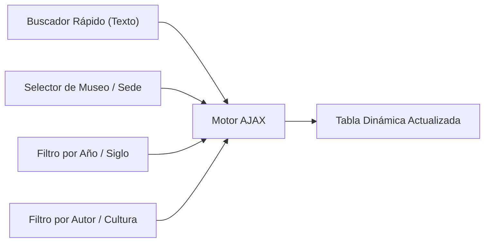
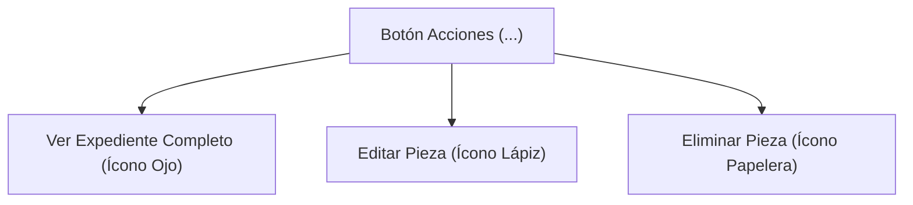

# 🔍 Exploración, Búsqueda y Filtrado del Acervo

El módulo **Catálogo de Acervo** (`/admin/acervo`) es el centro de consulta principal donde se visualiza la totalidad de las piezas patrimoniales registradas en la Secretaría.

---

## 1. Conmutador de Colecciones (Pestañas Superiores)

En la parte superior de la vista encontrarás tres pestañas principales para alternar entre colecciones:

1. **Acervo General**: Obras pictóricas, escultóricas, grabados, mobiliario histórico y artes aplicadas.
2. **Acervo Arqueológico**: Bienes prehispánicos con registro ante el INAH, técnicas de manufactura y procedencia.
3. **Acervo Numismático**: Monedas coloniales e históricas, medallas conmemorativas y billetes.

Al pulsar sobre una pestaña, la tabla se recarga instantáneamente con los campos específicos de dicha disciplina.

---

## 2. Barra de Filtros Avanzados

Para localizar rápidamente una pieza entre miles de registros, utiliza la barra de filtrado ubicada sobre la tabla:

### Controles Disponibles:
- **Caja de Búsqueda Rápida**: Escribe cualquier fragmento del **Código Interno**, **Número de Inventario** o **Título de la Pieza**. La búsqueda se ejecuta en tiempo real.
- **Filtro de Ubicación Física**: Despliega la lista de todos los museos de la Secretaría (ej. *Museo de Bellas Artes*, *Museo Virreinal de Zinacantepec*) y sedes externas.
- **Filtro de Temporalidad**: Permite seleccionar años específicos o periodos históricos para análisis cronológico.
- **Filtro de Autor o Cultura**: Permite aislar obras de un artista específico (ej. *José María Velasco*) o de una filiación cultural prehispánica (ej. *Matlatzinca*, *Mexica*, *Teotihuacana*).
- **Botón "Limpiar Filtros"**: Restablece todos los selectores a su estado inicial para mostrar el catálogo completo.

---

## 3. Elementos de la Tabla de Resultados

Cada fila de la tabla presenta información resumida y de alta relevancia:

| Columna | Descripción Visual |
| :--- | :--- |
| **Fotografía** | Miniatura de la obra. Al hacer clic sobre ella, se abre un visor ampliado para inspeccionar detalles iconográficos. |
| **Código Interno** | Identificador patrimonial único asignado por la institución. |
| **No. Inventario** | Clave oficial de inventario de bienes muebles del gobierno. |
| **Título / Denominación**| Nombre formal de la obra o descripción genérica del bien cultural. |
| **Dimensiones** | - En obras bidimensionales: Cotas expresadas en **cm** (Alto $\times$ Ancho). - En obras tridimensionales: **Medidas** completas (Alto, Ancho, Profundidad y Peso). |
| **Autor / Cultura** | Creador de la obra o cultura mesoamericana atribuida. |
| **Ubicación Física** | Nombre del museo o recinto donde se encuentra resguardada. |
| **Ubicación Topográfica**| Coordenadas exactas al interior del inmueble (Sala, Vitrina, Bóveda, Estante). |
| **Semáforo** | Insignia de color que indica el estatus curatorial: Verde (Aprobado), Amarillo (Cambios Solicitados), Azul (Pendiente) o Rojo (Rechazado). |
| **Acciones** | Menú desplegable con herramientas operativas. |

---

## 4. Menú de Acciones de Cada Pieza

En la última columna de cada fila encontrarás el botón desplegable **"Acciones"** (`.btn__actions`). Al desplegarlo, tendrás acceso a:

1. 👁️ **Ver Expediente Completo**: Abre una ventana modal con la cédula técnica detallada, historial de conservación, observaciones curatoriales e imagen en alta definición.
2. ✏️ **Editar Pieza**: Abre el formulario de actualización de datos. (Solo disponible para Administradores, o para Capturistas si la pieza requiere correcciones).
3. 🗑️ **Eliminar Pieza**: Solicita una confirmación interactiva mediante SweetAlert2 para dar de baja lógica el registro. (Restringido a Administradores).

> [!NOTE]
> El menú de acciones cuenta con posicionamiento matemático avanzado (`Popper fixed`), lo que garantiza que nunca se corte con los bordes de la tabla ni genere barras de desplazamiento indeseadas.

---

## 5. Exportación de Datos

En la esquina superior derecha del catálogo dispones de dos opciones de salida:
- 📊 **Exportar a Excel**: Descarga una hoja de cálculo estructurada con las piezas filtradas en pantalla para auditorías e informes de gestión.
- 📄 **Exportar a PDF**: Genera un documento con membrete y sellos oficiales de la Secretaría de Cultura y Turismo, ideal para actas de entrega-recepción.

---

## 6. Referencias Cruzadas
- Guía para dar de alta una nueva obra: [[03 - Registro y Edición de Piezas Culturales]]
- Conoce el semáforo curatorial: [[04 - Flujo de Revisión y Semáforo de Aprobación]]
- Guía de préstamos: [[05 - Gestión de Préstamos y Transferencias]]

