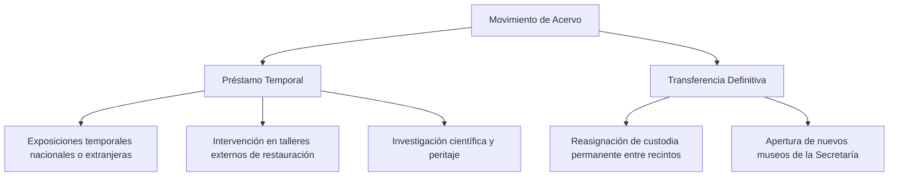
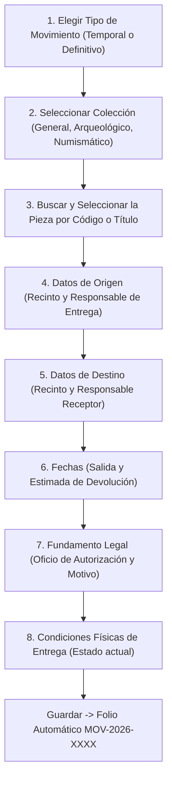

# 🚚 Gestión de Préstamos y Transferencias

El módulo **Préstamos y Transferencias** (`/admin/prestamos_transferencias`) administra la trazabilidad y custodia jurídica de las piezas que salen temporal o permanentemente de su recinto de origen.

---

## 1. Tipos de Movimientos Patrimoniales

El sistema contempla dos categorías normativas:

1. **Préstamo Temporal**: La pieza sale por un periodo determinado y debe regresar al recinto de origen antes de la **Fecha Estimada de Devolución**.
2. **Transferencia Definitiva**: Cambio permanente de asignación de la obra entre museos de la Secretaría. La ubicación física de la pieza se actualiza de manera definitiva en el catálogo.

---

## 2. Registro de un Nuevo Movimiento (Paso a Paso)

Para registrar una salida de obra:

1. Haz clic en el botón superior derecho **"Registrar Movimiento"**.
2. Se abrirá la ventana modal con barra de desplazamiento vertical integrada (puedes desplazarte libremente por el formulario con el ratón o pantalla táctil).

### Campos Requeridos:
- **Tipo de Movimiento**: Selecciona *Préstamo Temporal* o *Transferencia Definitiva*.
- **Colección**: Selecciona la disciplina correspondiente.
- **Pieza a Movilizar**: Escribe parte del título o código en el buscador interactivo Select2. Solo aparecerán obras con estatus curatorial **Aprobado**.
- **Lugar y Responsable de Origen**: Se precarga automáticamente con la ubicación física actual de la obra. Registra el nombre del funcionario que entrega la pieza.
- **Lugar y Responsable de Destino**: Selecciona el museo receptor o captura la institución externa, junto con el funcionario que recibirá la custodia.
- **Fecha de Salida**: Día en que la obra abandona el recinto.
- **Fecha Estimada de Devolución**: Requerida obligatoriamente en préstamos temporales.
- **No. de Oficio de Autorización**: Número de oficio oficial emitido por la Dirección General o la Secretaría (ej. `SCYT/DGM/2026/0894`).
- **Condiciones de Entrega**: Dictamen de estado de conservación al momento del embalaje.

3. Haz clic en **"Registrar Movimiento"**. El sistema generará el folio único institucional (ej. `MOV-2026-0003`) y la pieza pasará al estatus de **Activo**.

---

## 3. Retorno e Inspección de la Pieza (Registrar Devolución)

Cuando una pieza en préstamo temporal regresa a su recinto de custodia:

1. En la tabla de movimientos, localiza el registro con estatus **Activo**.
2. Despliega el menú **"Acciones"** y selecciona **"Registrar Devolución"** (`bx-undo`).
3. En el formulario de retorno captura:
   - **Fecha Real de Devolución**: Fecha y hora de recepción en almacén o sala.
   - **Lugar de Devolución**: Bóveda o recinto que recibe la obra.
   - **Condiciones de Devolución**: Dictamen comparativo para verificar que la obra no haya sufrido deterioros, fracturas o afectaciones durante el traslado o exhibición.
4. Presiona **"Confirmar Devolución"**. El estatus del movimiento cambiará a **"Devuelto"** (badge verde).

---

## 4. Cancelación de un Movimiento

En caso de que un préstamo autorizado se suspenda antes de ejecutarse:
1. En el menú **"Acciones"**, selecciona **"Cancelar Movimiento"** (`bx-x-circle`).
2. Digita una justificación obligatoria en el cuadro de confirmación (ejemplo: *"Exposición cancelada por causas de fuerza mayor"*).
3. El registro pasará a estatus **"Cancelado"** para efectos de auditoría histórica.

---

## 5. Consulta del Expediente Completo

En cualquier momento puedes pulsar **"Ver Expediente Completo"** (`bx-eye`) para consultar la bitácora íntegra del movimiento:
- Folio institucional y marcas de tiempo.
- Fotografía de la pieza y ficha técnica vinculada.
- Oficio de autorización gubernamental.
- Funcionarios responsables de entrega y recepción.
- Dictámenes comparativos de salida y devolución.

---

## 6. Referencias Cruzadas
- Conoce el catálogo de obras: [[02 - Exploración, Búsqueda y Filtrado del Acervo]]
- Consulta el modelo técnico de datos: [[03 - Módulo de Préstamos y Transferencias]]
- Verificación en auditoría: [[04 - Sistema de Auditoría y Trazabilidad]]

