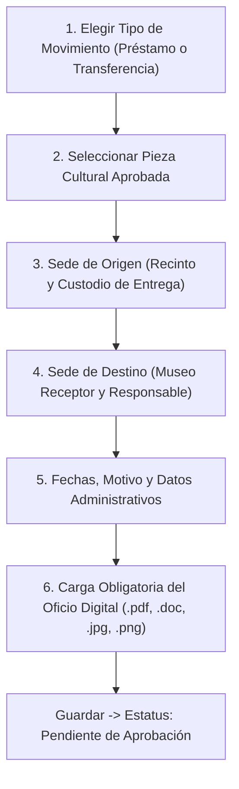

# 🚚 Gestión de Préstamos y Transferencias

El módulo **Préstamos y Transferencias** (`/admin/prestamos_transferencias`) administra la trazabilidad jurídica y física de las obras de arte y bienes culturales que se trasladan entre museos de la red estatal o hacia instituciones externas.

---

## 1. Asignación Institucional y Alcance Territorial por Museo

A partir de la actualización de seguridad y control territorial:
- **Administradores Regulares (`id_role = 2`)**: Están asignados a un museo específico de la Secretaría de Cultura y Turismo. 
  - **Alcance de Visualización**: Únicamente pueden visualizar y consultar en la tabla los préstamos y transferencias donde su recinto figure como **origen** o como **destino**.
  - **Indicadores Clave (KPIs)**: Las métricas numéricas del panel superior se calculan en tiempo real exclusivamente con base en los movimientos de su recinto.
  - **Facultad de Dictamen**: Acotada exclusivamente a aquellos movimientos donde su recinto sea la **sede de destino** (o Super Administrador).
  - **Seguridad perimetral**: Si un administrador intenta consultar detalles o cancelar un movimiento de otra sede, el servidor deniega la petición con código de protección `403 Prohibido`.
- **Super Administradores (`id_role = 1`)**: No tienen restricción por recinto y cuentan con atribuciones y alcance global para supervisar, registrar, aceptar, declinar o cancelar cualquier movimiento en toda la red de 31 museos y dependencias.

---

## 2. Registro de un Nuevo Movimiento (Paso a Paso)

Para registrar una salida de obra:

1. Haz clic en el botón superior derecho **"Registrar Movimiento"**.
2. Completa las secciones del formulario:

### Campos Obligatorios y Documentación:
- **Tipo de Movimiento**: *Préstamo Temporal* (requiere fecha estimada de retorno) o *Transferencia Definitiva*.
- **Pieza a Movilizar**: Buscador interactivo por código interno o título. Solo se despliegan obras en estatus curatorial **Aprobado**.
- **Sede de Origen**: Recinto actual y funcionario que entrega.
- **Sede de Destino**: Museo o recinto que recibirá la obra. Al elegir un museo registrado, el sistema asocia automáticamente la entidad receptora.
- **Fechas**: Fecha de salida y fecha estimada de devolución (para préstamos).
- **Oficio Digital Adjunto (OBLIGATORIO)**: Se debe adjuntar el archivo digital escaneado del oficio o memorándum de autorización (.pdf, .doc, .docx, .jpg o .png, máx. 20MB).
- **Motivo y Condiciones**: Justificación del traslado y dictamen de estado de conservación al embalar.

3. Al presionar **"Confirmar y Registrar Movimiento"**, el sistema genera el folio (`PRE-2026-XXXX` o `TRA-2026-XXXX`) y asigna el estatus **"Pendiente de Aprobación"** (badge amarillo).
   > [!IMPORTANT]
   > La pieza **NO se reubica físicamente** de manera inmediata. Permanecerá resguardada en su sede de origen hasta que el administrador de destino la acepte formalmente.

---

## 3. Dictamen de Movimientos por la Sede Receptora

Cuando el museo receptor recibe la notificación de un movimiento pendiente:

### 3.1. Desde la Tabla de Movimientos
1. Localiza el registro en estatus **"Pendiente"**.
2. Si eres el administrador asignado al museo de destino o Super Administrador, el menú desplegable de **"Acciones"** mostrará dos opciones prioritarias:
   - **Aceptar Movimiento** (`bx-check-circle` en verde): Despliega un cuadro de diálogo donde puedes ingresar observaciones de recepción opcionales. Al confirmar:
     - El estatus pasa a **Activo** (préstamo) o **Completada** (transferencia).
     - La ubicación física de la pieza se actualiza a la sede de destino.
   - **Declinar Movimiento** (`bx-x-circle` en rojo): Abre un cuadro obligatorio donde debes escribir la **justificación o motivo del rechazo** (ej. *Capacidad de sala agotada, condiciones climáticas inadecuadas o inconsistencia en fundamentación legal*). Al confirmar:
     - El estatus pasa a **Declinado**.
     - La obra no se traslada y permanece en su recinto original.

### 3.2. Desde el Modal "Ver Expediente"
1. Al abrir el expediente del movimiento, encontrarás el botón para **"Descargar / Ver Oficio Adjunto"**.
2. En el pie del modal se disponen los botones directos **"Aceptar Movimiento"** y **"Declinar Movimiento"** para evaluar el expediente tras revisar el documento oficial.

---

## 4. Retorno e Inspección de la Pieza (Registrar Devolución)

Para préstamos temporales activos que regresan a su sede original:

1. En la tabla de movimientos, despliega el menú de acciones y selecciona **"Registrar Devolución"**.
2. Captura la **Fecha Real de Devolución**, el **Lugar de Reincorporación** (sala o bodega) y las **Condiciones Físicas al Recibir** (verificando que no existan deterioros durante la estancia externa).
3. Al confirmar, el estatus pasa a **"Devuelto"** (badge verde) y la obra se reincorpora a su sala original.

---

## 5. Visualización e Impresión de Expedientes

Pulsando **"Ver Expediente"** (`bx-eye-alt`):
- Ficha técnica completa de la pieza y fotografía.
- Diagrama del trayecto (Origen ➔ Destino).
- Enlace directo al **Oficio Digital Adjunto**.
- Ficha de dictamen institucional con nombre del funcionario evaluador, fecha y motivo en caso de haber sido declinado.
- Botón **"Imprimir"** para generar la carátula oficial de entrega-recepción con líneas de firma y sellos institucionales.
