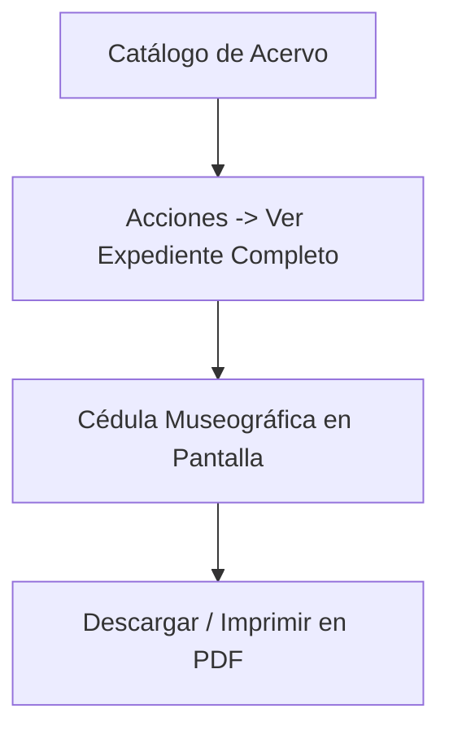
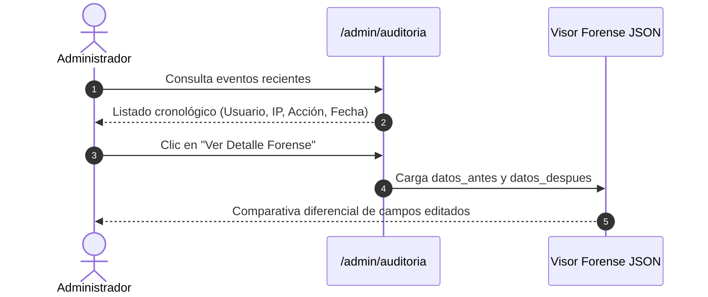

# 📄 Fichas Técnicas, Exportaciones y Auditoría

Esta guía describe cómo generar cédulas museográficas, exportar padrones patrimoniales y auditar los movimientos del sistema.

---

## 1. Generación de Cédulas y Fichas Técnicas

La **Ficha Técnica** es el expediente museográfico oficial de cada bien cultural.

### 1.1. Procedimiento de Consulta:
1. En el catálogo (`/admin/acervo`), ubica la pieza deseada.
2. En el menú **"Acciones"**, haz clic en **"Ver Expediente Completo"** (ícono de ojo `bx-eye`).
3. Se desplegará la ficha estructurada con los siguientes apartados:
   - **Encabezado Institucional**: Logotipos oficiales del Gobierno y la Secretaría.
   - **Registro Patrimonial**: Código interno, número de inventario oficial y folio INAH (si aplica).
   - **Identificación Artística**: Título de la obra, autor o filiación cultural, época histórica y año de creación.
   - **Cédula Material**: Técnica de manufactura, material de soporte y dimensiones (detallando `cm` para obras bidimensionales o `medidas completas` para tridimensionales).
   - **Resguardo y Conservación**: Ubicación física (museo o sede externa), ubicación topográfica (sala, vitrina, estante) y estado físico de conservación.
   - **Registro Visual**: Fotografía en alta resolución.
   - **Reseña Descriptiva**: Texto analítico y observaciones curatoriales.

### 1.2. Impresión Oficial en PDF:
- Desde el modal de la ficha, haz clic en el botón superior **"Imprimir Ficha PDF"**.
- El sistema compilará un archivo PDF con formato oficial de hoja membretada institucional listo para archivar en expedientes físicos o entregar a comités curatoriales.

---

## 2. Exportación Masiva de Inventarios

El sistema permite descargar la información consultada en pantalla para informes de auditoría o cruce con inventarios de bienes muebles:

### 2.1. Exportar a Excel (`.xlsx`)
- **Cómo hacerlo**: Haz clic en el botón verde **"Exportar a Excel"** ubicado en la esquina superior de la tabla de acervo.
- **Características**:
  - Respeta los filtros aplicados en pantalla (por ejemplo, exportará únicamente las piezas del *Museo de Bellas Artes* si ese filtro está activo).
  - Incluye columnas limpias y normalizadas aptas para análisis en tablas dinámicas.

### 2.2. Exportar a PDF (`.pdf`)
- **Cómo hacerlo**: Haz clic en el botón rojo **"Exportar a PDF"**.
- **Características**:
  - Genera un catálogo tabulado con tipografía corporativa, logotipos vectoriales de la administración, pie de página con paginación (`Página X de Y`) y fecha y hora de emisión del reporte.

---

## 3. Consulta del Historial de Auditoría

Los usuarios con privilegios de **Super Administrador** o **Administrador** pueden fiscalizar cualquier cambio ocurrido en el sistema ingresando a **"Auditoría"** (`/admin/auditoria`).

### 3.1. Campos Visibles en la Bitácora:
- **Fecha y Hora**: Marca temporal exacta del evento (`YYYY-MM-DD HH:MM:SS`).
- **Usuario Responsable**: Nombre de usuario y cuenta institucional.
- **Módulo / Tabla**: Entidad afectada (`acervo_general`, `prestamos_transferencias`, `bee_users`, etc.).
- **Tipo de Acción**: Registro, Edición, Eliminación, Aprobación de Semáforo o Movimiento de Préstamo.
- **Dirección de Red**: Dirección IP y parámetros de conexión del equipo informático emisor.

### 3.2. Visor Forense de Snapshots (JSON):
Al pulsar en **"Ver Detalle"** en cualquier fila de auditoría, se desplegará una ventana comparativa:
- **Datos Anteriores (`datos_antes`)**: Valores que tenía el registro antes de la modificación.
- **Datos Posteriores (`datos_despues`)**: Nuevos valores guardados tras la operación.

> [!TIP]
> Esta herramienta permite detectar con absoluta certeza quién modificó una medida, alteró una ubicación física o autorizó un traslado patrimonial.

---

## 4. Referencias Cruzadas
- Conoce los filtros de catálogo en: [[02 - Exploración, Búsqueda y Filtrado del Acervo]]
- Sistema técnico de auditoría: [[04 - Sistema de Auditoría y Trazabilidad]]
- Inicio de sesión y roles: [[01 - Inicio de Sesión y Perfiles de Usuario]]

