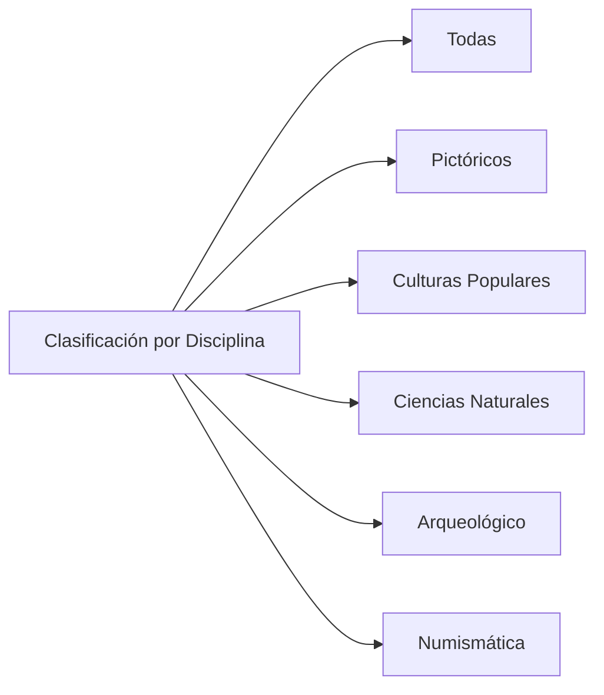
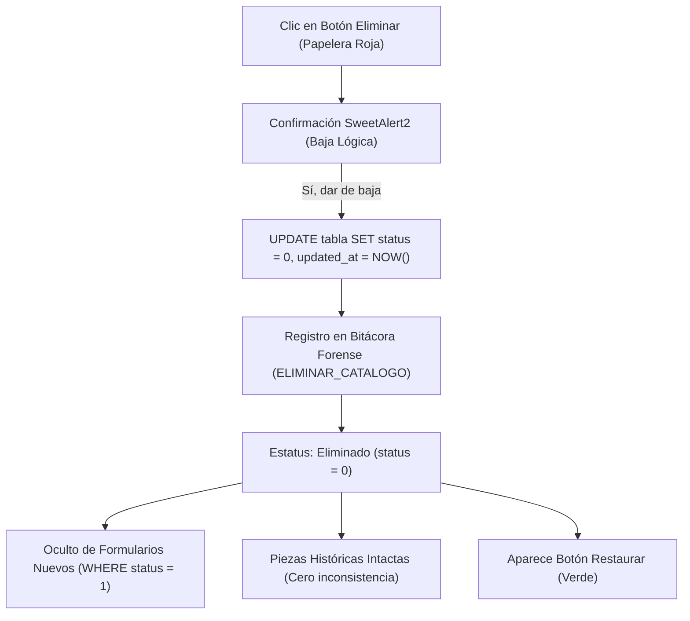

# 📚 Gestión Administrativa de Catálogos Maestros

El módulo **Catálogos Maestros** (`/admin/catalogos`) es el centro de control unificado para administrar, estandarizar, dar de alta y controlar el estatus de los 8 vocabularios controlados oficiales del patrimonio cultural del Estado de México.

---

## 1. Acceso y Permisos Requeridos

El acceso a este módulo está gobernado por el sistema RBAC:
* **Permiso Oficial**: `gestion_catalogos` (ID 35 en `bee_permisos`).
* **Roles Autorizados**:
  * 🛡️ **Super Administrador (`id_role = 1`)**: Control absoluto e irrestricto sobre todos los catálogos.
  * 👤 **Administrador (`id_role = 2`)**: Administración institucional autorizada de vocabularios.
* **Ubicación en el Sistema**: En la barra lateral de navegación izquierda, dentro de la sección **GESTIÓN**, seleccionar **"Catálogos"** (icono `bx bx-book-bookmark`).

---

## 2. Los 8 Catálogos Oficiales Disponibles

En la columna izquierda de la interfaz se encuentra el listado de catálogos oficiales con su contador en vivo de elementos activos y totales:

| Catálogo | Icono | Descripción Institucional | Campos Especiales |
| :--- | :---: | :--- | :--- |
| **Museos y Recintos Culturales** | `bx bx-building-house` | Red de 31 museos oficiales de la Secretaría de Cultura y Turismo. | Ubicación, Responsable, Teléfono |
| **Materiales** | `bx bx-cube` | 112 materias primas estructuradas por disciplina artística/científica. | Categoría / Disciplina |
| **Técnicas** | `bx bx-paint` | 167 técnicas artísticas, tradicionales y arqueológicas. | Categoría / Disciplina |
| **Épocas y Periodos Históricos** | `bx bx-history` | 14 líneas temporales prehispánicas, virreinales y contemporáneas. | Siglo asociado |
| **Tipos de Obra** | `bx bx-palette` | 20 tipologías para conmutación de dimensiones (Bidimensional / Tridimensional). | Clasificación / Dimensión |
| **Estados de Conservación** | `bx bx-shield-quarter` | Integridad física oficial: Bueno, Regular y Malo. | Ninguno (estándar) |
| **Colecciones Patrimoniales** | `bx bx-archive` | Fondos temáticos y agrupaciones de acervo para préstamos. | Nombre de colección |
| **Autores y Culturas** | `bx bx-user-circle` | Creadores plásticos, artistas mexiquenses y pueblos originarios. | Nombre de autor o cultura |

---

## 3. Clasificación por Disciplinas (Píldoras Interactivas)

En los catálogos de **Materiales**, **Técnicas** y **Tipos de Obra**, el sistema presenta una barra superior de píldoras temáticas que permite filtrar al instante por disciplina:

* Cada píldora muestra el nombre de la disciplina y el total de registros activos con números de **alto contraste en color negro** (`#000000`).
* Al hacer clic en una píldora (por ejemplo, *Culturas Populares*), la tabla filtra en milisegundos sin recargar la página.
* Cada registro en la tabla cuenta con una insignia visual con código de color temático:
  * 🎨 **Pictóricos**: Insignia azul.
  * 🏺 **Culturas Populares**: Insignia rosa/magenta.
  * 🌿 **Ciencias Naturales**: Insignia verde.
  * 🗿 **Arqueológico**: Insignia naranja.
  * 🪙 **Numismática**: Insignia púrpura.

---

## 4. Alta de un Nuevo Registro de Catálogo

Para registrar un nuevo término oficial:

1. Selecciona el catálogo correspondiente en el panel izquierdo.
2. Haz clic en el botón superior derecho **"Nuevo Elemento"** (o *"Nuevo Material"*, *"Nueva Técnica"*, etc.).
3. Se abrirá el formulario modal limpio:
   - **Nombre del Elemento**: Escribe el término oficial normalizado (ej. *Lápiz de Grafito*, *Cultura Teotihuacana*).
   - **Categoría / Clasificación** (si aplica): Selecciona la disciplina correspondiente en el menú desplegable.
   - **Campos Específicos** (ej. Ubicación y Responsable en Museos, Siglo en Épocas).
4. Haz clic en **"Guardar"**.
5. El sistema valida que no exista un duplicado y lo registra automáticamente con estatus **Activo (`status = 1`)**, haciéndolo visible de inmediato en los selectores de captura de obras.

> [!NOTE]
> Para cerrar el modal sin guardar cambios, puedes hacer clic en **"Cancelar"**, en la cruz **X** superior o fuera del recuadro.

---

## 5. Edición de un Registro Existente

1. En la fila del elemento deseado, haz clic en el botón azul de edición (icono lápiz `bx bx-edit-alt`).
2. El modal se abrirá precargado con la información actual del elemento.
3. Modifica los valores necesarios (nombre, categoría, siglo, responsable).
4. Haz clic en **"Guardar"**. Los cambios se reflejarán inmediatamente y quedará asentado un registro de auditoría forense con el estado anterior y el nuevo.

---

## 6. Política y Procedimiento de Baja Lógica (Borrado Lógico)

Por mandato de preservación histórica institucional, **en SIPAC nunca se destruyen físicamente registros de catálogo (`DELETE FROM`)**:

### ¿Cómo dar de baja un elemento?
1. En la tabla, localiza el registro y haz clic en el botón rojo de papelera (icono `bx bx-trash`).
2. El sistema desplegará una alerta explicativa:
   > *"¿Estás seguro de dar de baja a [Nombre]? Esta acción realiza un borrado lógico (estatus 0). El registro se preservará en la base de datos para no afectar las piezas vinculadas y podrá restaurarse en cualquier momento."*
3. Al confirmar, el elemento pasa a estatus **Eliminado** (`status = 0`):
   - **Deja de mostrarse** en los menús desplegables de captura de nuevas piezas.
   - **Se conserva intacto** en todas las piezas que ya lo tenían asignado en su ficha técnica.
   - Su insignia cambia a rojo pastel **"Eliminado"**.

---

## 7. Restauración Instantánea de Registros Eliminados

Si un elemento fue dado de baja por error o se requiere reactivar para nuevas adquisiciones:

1. En la barra de filtros, selecciona el botón **"Eliminados"** (o búscalo en *"Todos"*).
2. En la columna de acciones del registro eliminado, aparecerá un botón verde de **Restaurar** (icono deshacer `bx bx-undo`).
3. Haz clic en **Restaurar**.
4. Confirma la acción en la ventana emergente.
5. El sistema conmuta el estatus a `status = 1` (**Activo**), reactivándolo al instante para todos los usuarios y formularios de captura del sistema.

---

## 8. Búsqueda en Vivo y Filtros de Estatus

* **Buscador en Tiempo Real**: Escribe cualquier término en el campo *"Buscar en..."*. La tabla filtra simultáneamente por nombre de elemento y por categoría sin necesidad de presionar enter.
* **Filtro de Estatus**:
  * **Todos**: Muestra la totalidad de elementos del catálogo.
  * **Activos**: Filtra exclusivamente los elementos vigentes para nuevas capturas.
  * **Eliminados**: Muestra los elementos dados de baja lógica para su inspección o restauración.

---

## 9. Trazabilidad y Auditoría Forense

Cada alta, modificación, baja lógica y restauración queda registrada con sello temporal inmutable, IP y usuario en la tabla `auditoria`. La bitácora puede consultarse en `/admin/auditoria` por los administradores con el permiso correspondiente.
