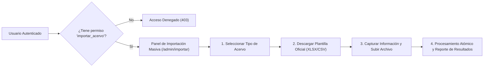

# 📥 Importador Masivo de Acervo Cultural por Excel / CSV

El módulo de **Importación Masiva de Acervo** permite a los administradores y custodios incorporar grandes volúmenes de piezas patrimoniales al sistema mediante hojas de cálculo de Microsoft Excel (`.xlsx`, `.xls`) o archivos de valores separados por comas (`.csv`), garantizando la integridad de datos, la validación de inventarios y la trazabilidad institucional.

> [!IMPORTANT]
> **Garantía Curatorial y Control de Calidad**:
> Por directriz de conservación patrimonial, toda pieza importada por defecto es registrada con **estatus de revisión "Pendiente"** (`estatus_revision = 'pendiente'` y `status = 0`), canalizándose automáticamente a la [[04 - Flujo de Revisión y Semáforo de Aprobación|Mesa de Revisión]] para que el equipo curatorial y de registro valide la información antes de su publicación en el catálogo general.

---

## 🧭 Ubicación y Permisos de Acceso

- **Ruta de Acceso Web**: `admin/importar` (o `admin/importar_acervo`)
- **Menú Lateral (Sidebar)**: Sección **TAREAS** → **Importar Acervo** (`bx bx-cloud-upload`).
- **Permiso RBAC Requerido**: `importar_acervo` (ID 36 en `bee_permisos`).
- **Roles con Acceso Habilitado**:
  - `Super Administrador` (Control global, importación a cualquier museo o sede).
  - `Administrador` (Importación restringida a la sede o museo custodio asignado).

---

## 📋 1. Selección de Acervo y Descarga de Plantillas Oficiales

El sistema soporta los tres acervos patrimoniales del Sistema de Inventario para el Acervo Cultural (SIPAC):

1. **🏛️ Acervo General**: Obras bidimensionales y tridimensionales (pintura, escultura, mobiliario, gráfica, fotografía, artes utilitarias, textiles).
2. **🏺 Acervo Arqueológico**: Bienes prehispánicos, lítica, cerámica, figurillas, piezas ceremoniales, números de inventario SCyT y claves INAH.
3. **🪙 Acervo Numismático**: Monedas novohispanas y contemporáneas, billetes, medallas conmemorativas, fichas de hacienda, ensayadores y cecas.

### Estructura de las Plantillas Prediseñadas
Cada plantilla generada dinámicamente contiene:
- **Fila 1 (Encabezados Formales)**: Títulos en español institucional con fondo guinda (`#6B1D2F`) y texto blanco en negrita. Los campos obligatorios se indican con `(*)`.
- **Fila 2 (Claves Técnicas)**: Nombres de columnas de base de datos en minúsculas (`codigo_interno`, `no_inventario`, `nombre_titulo_pieza`, etc.), útiles para que el motor identifique los campos sin ambigüedades.
- **Fila 3 (Guía de Llenado)**: Instrucciones breves y tipos de valores admitidos (resaltada en amarillo sutil).
- **Filas 4 en adelante (Ejemplos Reales)**: Tres filas con datos auténticos del patrimonio mexiquense (ej. pinturas de José María Velasco, cerámica teotihuacana, monedas de 8 Reales Carlos IV) que ilustran el formato correcto de medidas, materiales y técnicas.

> [!TIP]
> **Compatibilidad de CSV**: Las plantillas en formato `.csv` se exportan con firma **UTF-8 BOM** (`\xEF\xBB\xBF`), garantizando que Microsoft Excel en cualquier versión de Windows abra los acentos, diéresis y caracteres de la letra `ñ` sin corrupción tipográfica (*mojibake*).

---

## 📊 2. Especificación de Campos por Acervo

### A. Acervo General (`acervo_general` - Módulo 5)

| Campo | Encabezado en Plantilla | Requerido | Descripción y Ejemplo |
| :--- | :--- | :---: | :--- |
| `codigo_interno` | Código Interno | No | Identificador alfanumérico interno (Ej. `AG-2026-001`). |
| `no_inventario` | No. de Inventario | Clave | Número oficial de inventario (Ej. `INV-MBART-0104`). |
| `nombre_titulo_pieza` | Nombre o Título de la Pieza (*) | **SÍ** | Título de la obra o descripción formal. |
| `ubicacion_fisica` | Ubicación Física / Sede (*) | **SÍ** | Nombre oficial del museo custodio según catálogo activo. |
| `ubicacion_topografica` | Ubicación Topográfica | No | Sala, muro, vitrina, pasillo o bodega. |
| `tipo` | Tipo de Obra | No | `Pintura`, `Escultura`, `Mobiliario`, `Textil`, etc. |
| `autor` | Autor / Artista | No | Nombre del artista, taller o `Anónimo`. |
| `epoca` | Época / Periodo | No | `Siglo XIX`, `Siglo XX`, `Virreinal/Colonial`, etc. |
| `anio` | Año de Creación | No | Año o aproximación (`1894`, `ca. 1750`). |
| `tecnica` | Técnica | No | `Óleo sobre tela`, `Talla en madera`, `Acuarela`, etc. |
| `material` | Material | No | `Lino`, `Madera de cedro`, `Bronce`, etc. |
| `cm` | Dimensiones Bidimensionales | No | Alto x Ancho en cm (`102 x 155 cm`). |
| `medidas` | Medidas Tridimensionales | No | Alto x Ancho x Profundidad (`85 x 40 x 35 cm`). |
| `peso` | Peso | No | Peso con unidad (`14.5 kg`, `680 g`). |
| `lote` | No. de Lote | No | Lote de adquisición o ingreso. |
| `origen` | Origen / Procedencia | No | Municipio, estado o país de origen. |
| `estado_conservacion` | Estado de Conservación | No | `Bueno`, `Regular`, `Malo`. |
| `descripcion` | Descripción Detallada | No | Descripción iconográfica y estilística. |
| `observaciones` | Observaciones | No | Notas sobre restauraciones, faltantes o historial. |

### B. Acervo Arqueológico (`acervo_arqueologico` - Módulo 3)

| Campo | Encabezado en Plantilla | Requerido | Descripción y Ejemplo |
| :--- | :--- | :---: | :--- |
| `codigo_interno` | Código Interno | No | Código interno arqueológico (`ARQ-APX-012`). |
| `no_inventario_scyt` | No. Inventario SCyT | Clave | Folio de inventario de la Secretaría. |
| `no_registro_inah` | No. Registro INAH | Clave | Cédula oficial ante el INAH (`INAH-MEX-28910`). |
| `otros` | Otros Códigos / Marcas | No | Claves de campo o pozo de excavación. |
| `nombre_titulo_pieza` | Nombre o Título de la Pieza (*) | **SÍ** | Denominación del artefacto (`Vaso trípode de Tláloc`). |
| `ubicacion_fisica` | Ubicación Física / Museo (*) | **SÍ** | Museo custodio activo en catálogo. |
| `ubicacion_topografica` | Ubicación Topográfica | No | Vitrina o gaveta de reserva. |
| `epoca` | Época / Horizonte Cultural | No | `Periodo Clásico`, `Prehispánica`, etc. |
| `procedencia` | Procedencia / Sitio Arq. | No | Yacimiento o zona (`Teotihuacán`, `Calixtlahuaca`). |
| `material` | Material | No | `Barro cocido`, `Obsidiana`, `Basalto`, etc. |
| `medidas` | Medidas | No | Dimensiones métricas (`18.5 x 14.2 x 13.0 cm`). |
| `forma` | Forma / Tipología | No | `Figurilla`, `Olla`, `Cuenco`, `Punta de proyectil`. |
| `tecnica_manufactura` | Técnica de Manufactura | No | `Modelado a mano`, `Pastillaje`, `Percusión`. |
| `tecnica_decorativa` | Técnica Decorativa | No | `Pintura al fresco`, `Incisión`, `Bruñido`. |
| `coleccion` | Colección | No | Fondo patrimonial al que pertenece. |
| `obtencion` | Modo de Obtención | No | `Excavación`, `Donación`, `Decomiso`. |
| `numero_pieza_por_lote` | No. Piezas por Lote | No | Número de fragmentos o piezas asociadas. |
| `representacion` | Representación Iconográfica| No | `Antropomorfa`, `Zoomorfa`, `Deidad`. |
| `estado_conservacion` | Estado de Conservación | No | `Bueno`, `Regular`, `Malo`. |
| `descripcion` | Descripción | No | Morfología y rasgos diagnósticos. |
| `observaciones` | Observaciones | No | Consolidaciones o estado estructural. |

### C. Acervo Numismático (`acervo_numismatica` - Módulo 4)

| Campo | Encabezado en Plantilla | Requerido | Descripción y Ejemplo |
| :--- | :--- | :---: | :--- |
| `codigo_interno` | Código Interno | No | Clave interna (`NUM-MN-055`). |
| `no_inventario` | No. de Inventario | Clave | Inventario numismático (`INV-NUM-0084`). |
| `denominacion` | Denominación / Valor Facial (*) | **SÍ** | Valor facial (`8 Reales`, `Billete de 5 Pesos`). |
| `tipo_obra` | Tipo de Obra | No | `Moneda`, `Billete`, `Medalla`, `Ficha de hacienda`. |
| `ubicacion_fisica` | Ubicación Física / Museo (*) | **SÍ** | Museo custodio activo. |
| `ubicacion_topografica` | Ubicación Topográfica | No | Charola o carpeta numismática. |
| `material` | Material / Metal | No | `Plata Ley .903`, `Oro`, `Papel de algodón`. |
| `fecha_epoca` | Año de Acuñación / Época | No | Año o periodo visible (`1798`, `1925`). |
| `ensayador` | Ensayador / Ceca | No | Marca de ceca y ensayadores (`Mo FM`). |
| `cm` | Diámetro (cm) | No | Diámetro en centímetros (`3.9 cm`). |
| `medidas` | Medidas / Dimensiones | No | Grosor, peso o formato rectangular (`15.5 x 6.6 cm`). |
| `dimensiones` | Dimensiones Generales | No | Módulo y resumen ponderal. |
| `descripcion_cara_a` | Descripción Anverso (Cara A) | No | Efigie, busto, leyendas del anverso. |
| `descripcion_cara_b` | Descripción Reverso (Cara B) | No | Escudo de armas, cruz o valor del reverso. |
| `estado_conservacion` | Estado de Conservación | No | `Bueno`, `Regular`, `Malo`, `EBC`, `SC`. |
| `observaciones` | Observaciones | No | Pátina, cizallas o grado de rareza. |

---

## ⚙️ 3. Opciones de Configuración durante la Carga

Antes de ejecutar la importación, el usuario puede personalizar dos directivas clave:

### A. Manejo de Claves Existentes (Duplicados)
1. **Omitir duplicados (Recomendado)**: Si el número de inventario o código interno ya existe en el sistema o dentro del mismo archivo, la fila se salta y se añade una advertencia al reporte final sin interrumpir el proceso.
2. **Actualizar datos de pieza existente**: Si se localiza una pieza previa con la misma clave de inventario, se actualizan sus columnas con la información provista en el archivo.
3. **Rechazar fila**: Si se detecta una coincidencia previa, la fila se marca como error en la tabla de auditoría del proceso.

### B. Destino en el Flujo de Curaduría
1. **Mesa de Revisión (Pendiente)**: Las piezas se insertan inactivas (`status = 0`, `estatus_revision = 'pendiente'`), quedando visibles en `/admin/revision` para que los curadores emitan su dictamen formal.
2. **Aprobar e incorporar de inmediato**: *Disponible únicamente para Super Administrador y usuarios con permiso de dictamen*. Las piezas se marcan aprobadas (`status = 1`, `estatus_revision = 'aprobado'`) e ingresan de inmediato al catálogo público y consultas activas.

---

## 🔒 4. Seguridad, Tenancy y Control Transaccional

- **Aislamiento Multimuseo (Tenancy)**: Los usuarios con rol `Administrador` ligados a una sede específica sólo pueden ingresar piezas asignadas a su museo. Cualquier intento de importar piezas hacia otra sede es bloqueado fila por fila.
- **Transacciones Atómicas (PDO)**: Toda la ingesta se ejecuta dentro de un bloque `beginTransaction()`. Si ocurre un fallo crítico de motor o base de datos, se realiza `rollBack()` integral, impidiendo la corrupción parcial de registros.
- **Validación Binaria**: Se verifica la extensión y firma MIME contra archivos maliciosos. Tamaño tope admitido: 20 MB.
- **Trazabilidad Forense**: Cada lote de importación genera automáticamente una entrada en la bitácora `auditoria` con tipo `IMPORT_BATCH`, registrando total de filas, piezas insertadas, omitidas, errores y nombre del archivo original.

---

## 📈 5. Reporte de Resultados y Acciones Posteriores

Al finalizar la carga, la interfaz presenta:
- **Tarjetas KPI**: Total de filas leídas, importadas exitosamente, actualizadas y omitidas por duplicidad.
- **Tabla Detallada de Inconsistencias**: En caso de errores (campos vacíos, claves duplicadas o museos inexistentes), muestra el número exacto de fila en el archivo, el código de la pieza y la descripción puntual del fallo.
- **Acciones Rápidas**: Enlaces de un clic para trasladarse directamente a la **Mesa de Revisión** (`/admin/revision`), consultar el **Catálogo General** (`/admin/acervo`) o **Importar Otro Lote**.
