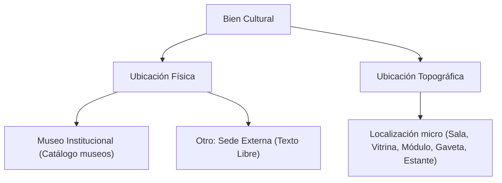

# 🏺 Tablas de Acervo Cultural (General, Arqueológico, Numismático)

El patrimonio material se encuentra particionado en tres tablas relacionales optimizadas para las características formales y curatoriales de cada disciplina.

---

## 1. Tabla `acervo_general` (Artes Plásticas y Visuales)

Esta entidad gestiona pinturas, grabados, esculturas, mobiliario histórico, textiles y piezas mixtas.

### 1.1. Estructura de Campos

| Campo | Tipo SQL | Nulo | Descripción y Reglas de Negocio |
| :--- | :--- | :--- | :--- |
| `id_acervo_general` | `int` (Auto Inc) | NO | Llave primaria única del registro. |
| `id_modulo` | `int` | NO | Identificador del módulo (`1` para General). |
| `codigo_interno` | `varchar(255)` | SÍ | Código patrimonial institucional asignado. |
| `no_inventario` | `varchar(255)` | SÍ | Número oficial de inventario de bienes muebles. |
| `nombre_titulo_pieza`| `text` | SÍ | Título formal de la obra o denominación genérica. |
| `cm` | `varchar(255)` | SÍ | **Medidas Bidimensionales**: Altura y ancho (ej. `120 x 80 cm`). |
| `medidas` | `varchar(1000)`| SÍ | **Medidas Tridimensionales**: Alto, ancho, profundidad, peso (ej. `Alto: 45 cm, Ancho: 30 cm, Profundidad: 20 cm`). |
| `fotografia` | `varchar(255)` | SÍ | Ruta relativa al archivo de imagen en `/assets/uploads/`. |
| `autor` | `varchar(255)` | SÍ | Nombre del creador, artista o taller atribuido. |
| `anio` | `varchar(50)` | SÍ | Año específico de creación o siglo estimado. |
| `epoca` | `varchar(255)` | SÍ | Época histórica (ej. Virreinal, Siglo XIX, Contemporáneo). |
| `tecnica` | `varchar(255)` | SÍ | Técnica pictórica/escultórica (Óleo sobre tela, Bronce a la cera perdida, etc.). |
| `material` | `varchar(255)` | SÍ | Soporte físico y materiales constitutivos (Lienzo, madera, mármol). |
| `origen` | `varchar(255)` | SÍ | País o región geográfica de origen. |
| `lote` | `varchar(255)` | SÍ | Número de lote si ingresó en adquisición masiva. |
| `peso` | `varchar(255)` | SÍ | Peso físico en gramos o kilogramos. |
| `ubicacion_fisica` | `varchar(255)` | SÍ | Recinto o museo donde se localiza (o sede externa). |
| `ubicacion_topografica`| `varchar(255)`| SÍ | Posición exacta dentro del inmueble (Sala 2, Vitrina 4, Pasillo C). |
| `estado_conservacion` | `varchar(255)` | SÍ | Bueno, Regular, Malo, En Restauración. |
| `observaciones` | `text` | SÍ | Notas curatoriales, marcas de autor, deterioros observados. |
| `descripcion` | `text` | SÍ | Reseña iconográfica y estilística de la pieza. |
| `status` | `tinyint(1)` | SÍ | Estado lógico: `1` Activo, `0` Eliminado/Baja lógica. |
| `estatus_revision` | `enum` | NO | Semáforo: `'aprobado'`, `'pendiente'`, `'cambios_solicitados'`, `'rechazado'`. |
| `observacion_revision` | `text` | SÍ | Retroalimentación del revisor si solicita correcciones o rechaza. |
| `id_usuario_revisor` | `int` | SÍ | ID del usuario que evaluó la pieza. |
| `fecha_revision` | `datetime` | SÍ | Marca de tiempo del último dictamen curatorial. |
| `id_usuario_creador` | `int` | SÍ | ID del usuario capturista que dio de alta la pieza. |
| `datos_anteriores_edicion`| `longtext` | SÍ | JSON con el snapshot anterior previo a la solicitud de cambios. |

> [!IMPORTANT]
> **Ajustes de Modelado**:
> - En Acervo General se retiraron los campos redundantes `materia` y `coleccion` para dar prioridad absoluta al campo normativo `material`.
> - Se implementó la conmutación condicional entre `cm` (bidimensional) y `medidas` (tridimensional).

---

## 2. Tabla `acervo_arqueologico` (Patrimonio Prehispánico)

Gestiona vestigios cerámicos, líticos, óseos y ornamentales con registro federal.

### 2.1. Campos Específicos

| Campo | Tipo SQL | Descripción |
| :--- | :--- | :--- |
| `id_acervo_arq` | `int` (Auto Inc) | Llave primaria única. |
| `no_inventario_scyt` | `varchar(255)` | Inventario interno Secretaría de Cultura y Turismo. |
| `no_registro_inah` | `varchar(255)` | Número de cédula oficial emitido por el INAH. |
| `procedencia` | `varchar(255)` | Zona arqueológica o yacimiento de extracción (ej. Teotihuacán, Malinalco). |
| `forma` | `varchar(255)` | Tipología morfológica (Cajete, olla trípode, figurilla antropomorfa). |
| `tecnica_manufactura` | `varchar(255)` | Modelado a mano, pastillaje, moldeado, pulido. |
| `tecnica_decorativa` | `varchar(255)` | Pintura al fresco, incisión, esgrafiado, negativo. |
| `representacion` | `varchar(255)` | Iconografía representada (Deidad, zoomorfo, fitomorfo, sacerdote). |
| `obtencion` | `varchar(255)` | Modo de ingreso (Excavación científica, donación, decomiso). |
| `numero_pieza_por_lote` | `varchar(255)` | Conteo específico en caso de pertenecer a ofrenda agrupada. |

---

## 3. Tabla `acervo_numismatica` (Monedas, Medallas y Billetes)

Gestiona piezas monetarias históricas, condecoraciones y medallas conmemorativas.

### 3.1. Campos Específicos

| Campo | Tipo SQL | Descripción |
| :--- | :--- | :--- |
| `id_acervo_numismatica`| `int` (Auto Inc) | Llave primaria única. |
| `tipo_obra` | `varchar(255)` | Moneda macuquina, moneda de cordoncillo, medalla, billete. |
| `ensayador` | `varchar(50)` | Letras del ensayador que autorizó la ley del metal (ej. `M`, `F`, `TH`). |
| `denominacion` | `varchar(255)` | Valor facial histórico (ej. 8 Reales, 1 Peso Fuerte, 4 Maravedíes). |
| `dimensiones` | `varchar(255)` | Diámetro en milímetros y espesor (ej. `39 mm ø`). |
| `descripcion_cara_a` | `varchar(255)` | **Anverso**: Escudo de armas, efigie del monarca o gobernante, leyendas. |
| `descripcion_cara_b` | `varchar(255)` | **Reverso**: Columnas de Hércules, cruz de Jerusalén, alegoría histórica. |

---

## 4. Esquema Común de Ubicación: Física vs. Topográfica

En las tres colecciones se estandarizó la gestión de ubicación espacial en dos campos complementarios:

1. **Ubicación Física (`ubicacion_fisica`)**:
   - Representa el inmueble o complejo arquitectónico.
   - Si pertenece a la red de museos de la Secretaría, se selecciona del catálogo [[05 - Catálogos y Tablas Auxiliares#1. Catálogo de Museos (`museos`)|`museos`]].
   - Si la pieza se encuentra en comodato o custodia temporal en otra dependencia gubernamental, se captura como `"Otro: [Nombre de la dependencia o recinto]"`.
2. **Ubicación Topográfica (`ubicacion_topografica`)**:
   - Anteriormente llamada "Ubicación Física" en versiones previas del software.
   - Describe las coordenadas de resguardo exactas al interior del inmueble (ej. *Bóveda de Seguridad 1, Estante 4, Nivel B, Charola 12*).

---

## 5. Referencias Cruzadas
- Consulta el flujo de aprobación en: [[04 - Flujo de Revisión y Semáforo de Aprobación]]
- Conoce el procedimiento de alta en: [[03 - Registro y Edición de Piezas Culturales]]
- Diccionario completo de columnas: [[01 - Diccionario de Datos Completo]]
