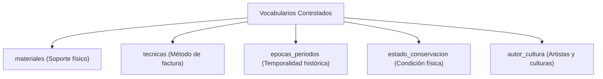

# 📚 Catálogos y Tablas Auxiliares

Para garantizar la normalización de la información curatorial y evitar discrepancias ortográficas, el sistema se apoya en una serie de catálogos y tablas maestras auxiliares.

---

## 1. Catálogo de Museos (`museos`)

Almacena la red oficial de museos y recintos culturales administrados por la Secretaría de Cultura y Turismo.

### 1.1. Estructura de la Tabla

```sql
CREATE TABLE `museos` (
  `id_museo` int NOT NULL AUTO_INCREMENT,
  `nombre_museo` varchar(255) DEFAULT NULL,
  `ubicacion` text,
  `telefono` varchar(10) DEFAULT NULL,
  `responsable_museo` varchar(255) DEFAULT NULL,
  `status` tinyint(1) NOT NULL DEFAULT '1',
  `created_at` timestamp NOT NULL DEFAULT CURRENT_TIMESTAMP,
  `updated_at` timestamp NULL DEFAULT NULL ON UPDATE CURRENT_TIMESTAMP,
  PRIMARY KEY (`id_museo`)
) ENGINE=InnoDB DEFAULT CHARSET=utf8mb4;
```

### 1.2. Integración en Formularios (`obtenerOpcionesMuseos`)
La función helper `obtenerOpcionesMuseos()` en `adminController.php` consulta los museos activos (`status = 1`), ordenados alfabéticamente:
```php
function obtenerOpcionesMuseos()
{
  $opciones = ['' => 'Seleccione una ubicación...'];
  $db = Db::connect();
  $stmt = $db->query("SELECT nombre_museo FROM museos WHERE status = 1 ORDER BY nombre_museo ASC");
  $museos = $stmt ? $stmt->fetchAll(PDO::FETCH_COLUMN) : [];
  foreach ($museos as $m) {
    $nombre = trim($m);
    if (!empty($nombre)) {
      $opciones[$nombre] = $nombre;
    }
  }
  $opciones['Otro'] = 'Otro (Especificar sede externa o dependencia)';
  return $opciones;
}
```

> [!NOTE]
> Al seleccionar la opción **"Otro"**, el frontend despliega dinámicamente un campo de texto adicional para capturar el nombre de recintos no pertenecientes a la red oficial (ej. Palacio de Gobierno, Secretarías externas, galerías en comodato).

---

## 2. Catálogos de Vocabulario Curatorial

El sistema cuenta con tablas maestras para estandarizar los campos de clasificación:



### 2.1. Materiales (`materiales`)
- Estandariza la composición de los bienes: Óleo, tela, bronce, madera tallada, barro policromado, plata, oro, jade, lino, papel, etc.

### 2.2. Técnicas (`tecnicas`)
- Estandariza los procedimientos artísticos: Pincelada directa, aguafuerte, cincelado, fundición a la cera perdida, pastillaje, modelado a torno, troquelado, acuarela, temple.

### 2.3. Épocas y Periodos (`epocas_periodos`)
- Clasificación histórica: Preclásico, Clásico, Posclásico, Virreinal (Siglos XVI - XVIII), México Independiente (Siglo XIX), Porfiriato, Posrevolucionario, Arte Contemporáneo.

### 2.4. Estado de Conservación (`estado_conservacion`)
- Estatus físico de los bienes:
  - **Excelente**: Sin deterioro evidente, óptima estabilidad estructural.
  - **Bueno**: Desgaste natural por el tiempo sin compromiso formal.
  - **Regular**: Pérdida de soporte menor, craqueladuras superficiales o manchas.
  - **Malo**: Afectación estructural severa, ataque biológico activo o fractura.
  - **En Restauración**: En intervención activa en taller o laboratorio especializado.

---

## 3. Módulos del Sistema (`modulos`)

La tabla `modulos` define los identificadores primarios de las tres colecciones:
- `1`: **Acervo General**
- `2`: **Acervo Arqueológico**
- `3`: **Acervo Numismático**

Esta columna `id_modulo` actúa como clave discriminadora en las tablas de acervo, auditoría y vistas dinámicas.

---

## 4. Referencias Cruzadas
- Consulta cómo se vinculan los museos al dar de alta una pieza: [[03 - Registro y Edición de Piezas Culturales]]
- Conoce el modelo ERD global: [[01 - Diagrama Entidad-Relación (ERD)]]
- Consulta el listado completo de campos en: [[01 - Diccionario de Datos Completo]]
