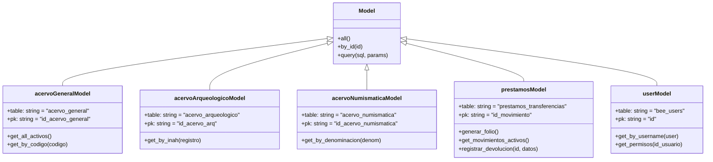

# 💾 Modelos y Capa de Persistencia PDO

La interacción con la base de datos se realiza a través de clases modelo en `app/models/`, las cuales encapsulan las consultas SQL mediante **PHP Data Objects (PDO)**, asegurando la separación de capas y blindaje contra ataques de inyección SQL mediante sentencias preparadas nativas.

---

## 1. Conexión Singleton (`app/classes/Db.php`)

Para optimizar el uso de conexiones en el servidor y evitar la saturación de conexiones abiertas en MariaDB/MySQL, la clase `Db` gestiona una única instancia compartida:

```php
class Db
{
  private static $instance = null;
  private $link = null;

  public static function connect(bool $throw_exception = false) 
  {
    try {
      if (self::$instance === null) {
        self::$instance = new self();
      }
      return self::$instance->link;
    } catch (PDOException $e) {
      if ($throw_exception) throw $e;
      die('Error al conectar a la base de datos: ' . $e->getMessage());
    }
  }

  public static function query(string $sql, array $params = [])
  {
    $db = self::connect();
    $stmt = $db->prepare($sql);
    $stmt->execute($params);
    return $stmt;
  }
}
```

---

## 2. Modelos Especializados del Sistema



---

## 3. Manejo de Transacciones y Consistencia de Datos

En operaciones compuestas que involucran más de una tabla (por ejemplo, registrar una transferencia y actualizar la ubicación física de la pieza en su tabla correspondiente), se emplean transacciones explícitas:

```php
$db = Db::connect();
try {
  $db->beginTransaction();

  // 1. Insertar el movimiento en prestamos_transferencias
  $sqlMov = "INSERT INTO prestamos_transferencias (folio_movimiento, tipo_movimiento, ...) VALUES (...)";
  $stmtMov = $db->prepare($sqlMov);
  $stmtMov->execute($paramsMov);

  // 2. Si es transferencia definitiva, actualizar la ubicación de la pieza
  if ($tipoMovimiento === 'transferencia_definitiva') {
    $sqlPieza = "UPDATE acervo_general SET ubicacion_fisica = :nuevo_destino WHERE id_acervo_general = :id";
    $stmtPieza = $db->prepare($sqlPieza);
    $stmtPieza->execute(['nuevo_destino' => $lugarDestino, 'id' => $idPieza]);
  }

  // 3. Registrar auditoría forense
  $sqlAud = "INSERT INTO auditoria (id_usuario, tipo_accion, ...) VALUES (...)";
  $stmtAud = $db->prepare($sqlAud);
  $stmtAud->execute($paramsAud);

  // Confirmar la transacción
  $db->commit();
} catch (Exception $e) {
  // Revertir ante cualquier inconsistencia
  $db->rollBack();
  throw $e;
}
```

---

## 4. Estándares de Seguridad en Consultas

1. **Sentencias Preparadas Obligatorias**: Ninguna variable externa de `$_GET` o `$_POST` se concatena directamente en las sentencias SQL. Se utilizan marcadores posicionales (`?`) o por nombre (`:param`).
2. **Desactivación de Emulación**: `PDO::ATTR_EMULATE_PREPARES => false` obliga al motor MySQL nativo a compilar la sentencia por separado antes de recibir los valores de parámetros.
3. **Escapado Automático UTF-8**: La codificación `utf8mb4` configurada en el DSN garantiza la protección contra ataques de inyección basados en bytes nulos o caracteres multibyte malformados.

---

## 5. Referencias Cruzadas
- Conoce los controladores que invocan estos modelos: [[01 - Controladores y Flujo de Peticiones]]
- Revisa el esquema relacional en: [[01 - Diagrama Entidad-Relación (ERD)]]
- Consulta los campos de tablas en: [[02 - Tablas de Acervo (General, Arqueológico, Numismático)]]
