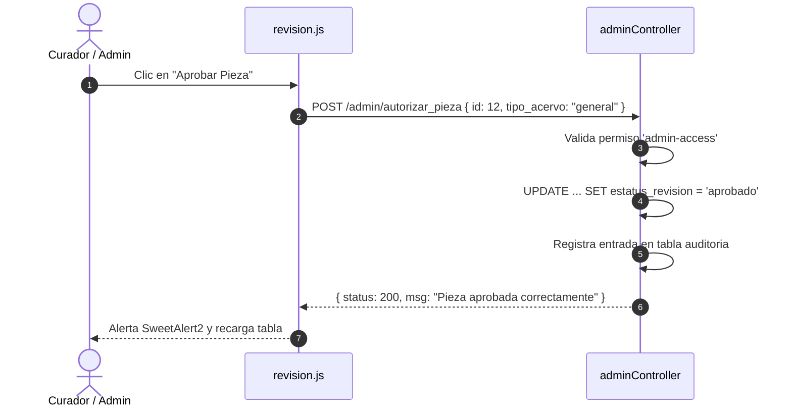

# 📡 Endpoints AJAX y API Interna

El sistema opera mediante una API asíncrona interna consumida por los scripts JavaScript de la interfaz administrativa. Todas las peticiones `POST` implementan validación contra ataques CSRF mediante tokens de sesión.

---

## 1. Convenciones y Estructura de Respuestas

Las respuestas de la API utilizan el tipo MIME `application/json; charset=UTF-8` y se apegan a la siguiente estructura base:

```json
{
  "status": 200,
  "msg": "Mensaje descriptivo del resultado de la operación.",
  "data": []
}
```

### Códigos de Estado Empleados:
- `200 OK`: Operación completada satisfactoriamente.
- `400 Bad Request`: Parámetros obligatorios faltantes o tipos de datos inválidos.
- `401 Unauthorized`: Sesión expirada o no autenticada.
- `403 Forbidden`: Permisos insuficientes (RBAC) para el recurso solicitado.
- `404 Not Found`: Registro patrimonial o movimiento inexistente.
- `500 Internal Error`: Excepción de base de datos o fallo de servidor.

---

## 2. Endpoints del Catálogo de Acervo

### 2.1. Listado Filtrado de Acervo General
- **Ruta**: `GET /admin/get_acervo_general`
- **Parámetros Query**:
  - `busqueda` *(string, opcional)*: Término de texto en código o título.
  - `filtro_ubicacion` *(string, opcional)*: Museo o sede física.
  - `filtro_anio` *(string, opcional)*: Año o temporalidad.
  - `filtro_autor_cultura` *(string, opcional)*: Nombre del autor.
- **Respuesta (200 OK)**:
```json
{
  "data": [
    {
      "id_acervo_general": 12,
      "codigo_interno": "SCYT-AG-0012",
      "no_inventario": "INV-7842",
      "nombre_titulo_pieza": "Retrato de Sor Juana Inés de la Cruz",
      "cm": "65 x 50 cm",
      "medidas": null,
      "fotografia": "assets/uploads/acervo/foto_sorjuana.jpg",
      "autor": "Miguel Cabrera (Círculo de)",
      "anio": "1750",
      "ubicacion_fisica": "Museo Virreinal de Zinacantepec",
      "ubicacion_topografica": "Sala Capitular, Muro Sur",
      "estado_conservacion": "Bueno",
      "estatus_revision": "aprobado",
      "acciones": "<div class='dropdown'>...</div>"
    }
  ]
}
```

### 2.2. Obtención de Pieza por ID (Modal de Edición)
- **Ruta**: `POST /admin/acervo_general_get_by_id`
- **Payload**: `id=12&csrf=...`
- **Respuesta**: Objeto completo de la pieza con campos dimensionales y de ubicación listos para precargar en el formulario.

### 2.3. Edición de Pieza
- **Ruta**: `POST /admin/acervo_general_editar`
- **Encabezado**: `multipart/form-data`
- **Payload**: Campos actualizados de la pieza + archivo de fotografía (opcional).

---

## 3. Endpoints del Módulo de Revisión y Semáforo



### 3.1. Listado de Revisión
- **Ruta**: `GET /admin/get_revision_data`
- **Respuesta**: Lista de piezas con estatus `pendiente`, `cambios_solicitados`, `aprobado` y `rechazado`, enriquecida con badges visuales de semáforo.

### 3.2. Autorizar Pieza
- **Ruta**: `POST /admin/autorizar_pieza`
- **Payload**: `id=12&tipo_acervo=general&csrf=...`

### 3.3. Solicitar Cambios (Devolución a Capturista)
- **Ruta**: `POST /admin/solicitar_cambios_pieza`
- **Payload**:
  - `id`: `12`
  - `tipo_acervo`: `general`
  - `observaciones`: `"Corregir las medidas de profundidad y verificar la técnica."`
- **Efecto**: Guarda snapshot en `datos_anteriores_edicion` y pasa el estatus a `cambios_solicitados`.

### 3.4. Rechazar Pieza
- **Ruta**: `POST /admin/rechazar_pieza`
- **Payload**: `id=12&tipo_acervo=general&observaciones="Pieza apócrifa o duplicada en inventario"`

---

## 4. Endpoints de Préstamos y Transferencias

### 4.1. Búsqueda de Piezas para Asignación
- **Ruta**: `POST /admin/buscar_piezas_para_movimiento`
- **Payload**: `tipo_acervo=general&q=Velasco`
- **Respuesta**: Lista de coincidencias con ID, código interno, título y ubicación actual para alimentar el combo Select2.

### 4.2. Registro de Nuevo Movimiento
- **Ruta**: `POST /admin/post_crear_movimiento`
- **Payload Form**:
  - `tipo_movimiento`: `prestamo_temporal` | `transferencia_definitiva`
  - `tipo_acervo`: `general` | `arqueologico` | `numismatica`
  - `id_pieza`: `12`
  - `lugar_origen`: `Museo de Bellas Artes`
  - `responsable_origen`: `Lic. Juan Pérez`
  - `lugar_destino`: `Centro Cultural Mexiquense Bicentenario`
  - `responsable_destino`: `Mtra. Ana Gómez`
  - `fecha_salida`: `2026-11-10`
  - `fecha_devolucion_estimada`: `2027-02-15` (requerido si es temporal)
  - `motivo`: `"Exposición Temporal: Retrospectiva del Paisaje"`
  - `no_oficio_autorizacion`: `"SCyT/DGM/2026/0458"`
  - `condiciones_entrega`: `"Enmarcado en perfecto estado, sin faltantes de soporte"`

### 4.3. Registro de Retorno (Devolución)
- **Ruta**: `POST /admin/post_devolver_prestamo`
- **Payload**:
  - `id_movimiento`: `45`
  - `condiciones_devolucion`: `"Pieza recibida íntegra, sin alteraciones"`
  - `lugar_devolucion`: `"Bóveda Central de Toluca"`

### 4.4. Cancelación de Movimiento
- **Ruta**: `POST /admin/post_cancelar_movimiento`
- **Payload**: `id_movimiento=45&motivo_cancelacion="Suspensión del evento por remodelación del recinto destino"`

---

## 5. Referencias Cruzadas
- Conoce los scripts que invocan estos servicios: [[05 - Componentes Frontend, Estilos CSS y JavaScript]]
- Revisa el controlador backend en: [[01 - Controladores y Flujo de Peticiones]]
- Modelo de auditoría que registra estas llamadas: [[04 - Sistema de Auditoría y Trazabilidad]]
