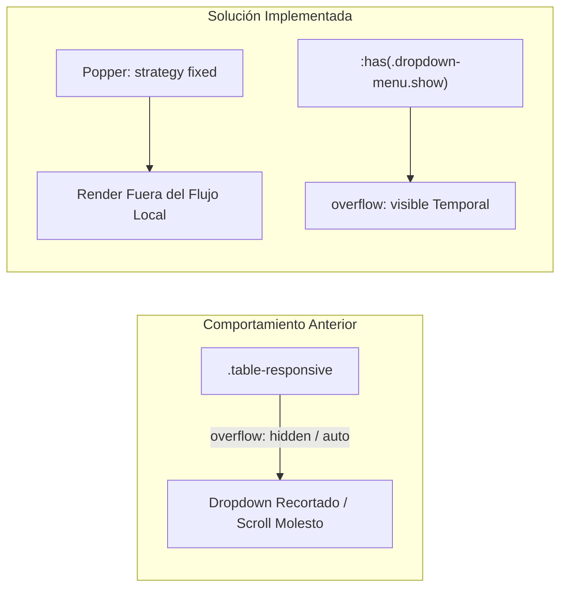

# 🎨 Componentes Frontend, Estilos CSS y JavaScript

La capa visual del aplicativo combina estilos adaptativos basados en **Bootstrap 5**, hojas de estilo personalizadas en `assets/css/admin/custom-admin.css` y controladores de eventos modulares en `assets/js/admin/`.

---

## 1. Arquitectura de Módulos JavaScript

Cada módulo de vista cuenta con su propio controlador de cliente:

```text
assets/js/admin/
├── admin.js                    # Inicializaciones globales, eventos de dropdowns y modales
├── acervo.js                   # Búsqueda AJAX, paginación y modal de edición de catálogo
├── registrar.js                # Lógica del conmutador 2D/3D y toggle de sede externa
├── revision.js                 # Bandeja de revisión, confirmaciones con SweetAlert2
└── prestamos_transferencias.js # Asignación de piezas, fechas, retorno y anulación
```

---

## 2. Solución de Desbordamiento y Posicionamiento de Dropdowns

### 2.1. Problema Histórico
En tablas interactivas envueltas en contenedores con desplazamiento horizontal (`.table-responsive`), al abrir el menú de acciones (`.dropdown-menu`), las opciones se recortaban por la propiedad `overflow-x: auto`, o bien la tabla generaba una barra de desplazamiento vertical interna no deseada que ocultaba los botones.



### 2.2. Implementación de la Solución Técnica

#### A. Estrategia Fija de Popper en Marcado HTML:
Los botones de acción en las tablas (`acervoView.php`, `revisionView.php`, `prestamosView.php`) se configuraron con:
```html
<button class="btn btn-sm btn-outline-secondary dropdown-toggle btn__actions" 
        type="button" 
        data-bs-toggle="dropdown" 
        data-bs-boundary="viewport"
        data-bs-popper-config='{"strategy":"fixed"}' 
        aria-expanded="false">
  <i class="bx bx-dots-vertical-rounded"></i> Acciones
</button>
```

#### B. Manejo Dinámico en `custom-admin.css`:
Se implementó el selector moderno `:has()` para levantar la restricción de desbordamiento de la tabla exclusivamente durante el tiempo que el menú desplegable permanezca abierto:
```css
/* Permite que el menú flotante sobresalga sin generar scroll interno */
.table-responsive:has(.dropdown-menu.show) {
  overflow: visible !important;
}

.btn__actions {
  display: inline-flex;
  align-items: center;
  gap: 0.35rem;
  font-weight: 500;
  border-radius: 0.375rem;
}

.dropdown-menu {
  z-index: 1060 !important;
  box-shadow: 0 0.5rem 1rem rgba(0, 0, 0, 0.15);
  border: 1px solid rgba(0, 0, 0, 0.08);
}
```

#### C. Escuchadores de Eventos en `admin.js`:
Para garantizar compatibilidad universal en navegadores que no soporten `:has()`:
```javascript
$(document).on('show.bs.dropdown', '.table-responsive', function () {
  $(this).css('overflow', 'visible');
});

$(document).on('hidden.bs.dropdown', '.table-responsive', function () {
  $(this).css('overflow', 'auto');
});
```

---

## 3. Desplazamiento Vertical en Ventanas Modales (Scroll Fix)

Para evitar que los formularios extensos (como el registro de préstamos o la ficha completa de edición) obligaran al usuario a utilizar la tecla `Tabulador` para ver los campos inferiores:
1. Se añadió la clase nativa de Bootstrap 5 `.modal-dialog-scrollable`.
2. Se estableció un límite de altura máxima dinámico sobre el cuerpo del modal:
```css
.modal-dialog-scrollable .modal-body {
  max-height: calc(100vh - 210px);
  overflow-y: auto;
  scrollbar-width: thin;
}
```

---

## 4. Conmutador Bidimensional vs. Tridimensional (`registrar.js`)

En el registro de piezas de **Acervo General**:
- Un grupo de botones de opción (`radio buttons`) permite al usuario elegir:
  - **Bidimensional**: Muestra el campo `#grupo-cm` y oculta `#grupo-medidas`.
  - **Tridimensional**: Muestra el campo `#grupo-medidas` y oculta `#grupo-cm`.

```javascript
$('input[name="tipo_dimension"]').on('change', function () {
  const val = $(this).val();
  if (val === 'bidimensional') {
    $('#grupo-cm').slideDown(200);
    $('#grupo-medidas').slideUp(200);
    $('#cm').prop('required', true);
    $('#medidas').val('').prop('required', false);
  } else {
    $('#grupo-cm').slideUp(200);
    $('#grupo-medidas').slideDown(200);
    $('#cm').val('').prop('required', false);
    $('#medidas').prop('required', true);
  }
});
```

> [!CAUTION]
> **Resolución de Conflicto en el DOM**:
> Anteriormente existía un identificador duplicado `#editar-cm` en el marcado de `acervoView.php`. Cuando una pieza tridimensional era devuelta con cambios y se modificaba a bidimensional, el selector jQuery seleccionaba el elemento erróneo, impidiendo que los cambios bidimensionales se reflejaran en la bandeja curatorial. La eliminación del duplicado resolvió la sincronización bidireccional.

---

## 5. Selector Dinámico de Museos y Sedes Externas

Cuando el usuario selecciona `"Otro"` en el menú de ubicación física:
```javascript
$('#ubicacion_fisica').on('change', function () {
  if ($(this).val() === 'Otro') {
    $('#contenedor_ubicacion_otro').removeClass('d-none').hide().slideDown(200);
    $('#ubicacion_fisica_otro').prop('required', true).focus();
  } else {
    $('#contenedor_ubicacion_otro').slideUp(200, function () {
      $(this).addClass('d-none');
    });
    $('#ubicacion_fisica_otro').val('').prop('required', false);
  }
});
```

---

## 6. Referencias Cruzadas
- Consulta los endpoints que alimentan estos scripts: [[04 - Endpoints AJAX y API Interna]]
- Conoce la operación de usuario del formulario: [[03 - Registro y Edición de Piezas Culturales]]
- Guía de navegación general: [[01 - Mapa de Navegación del Sistema]]
