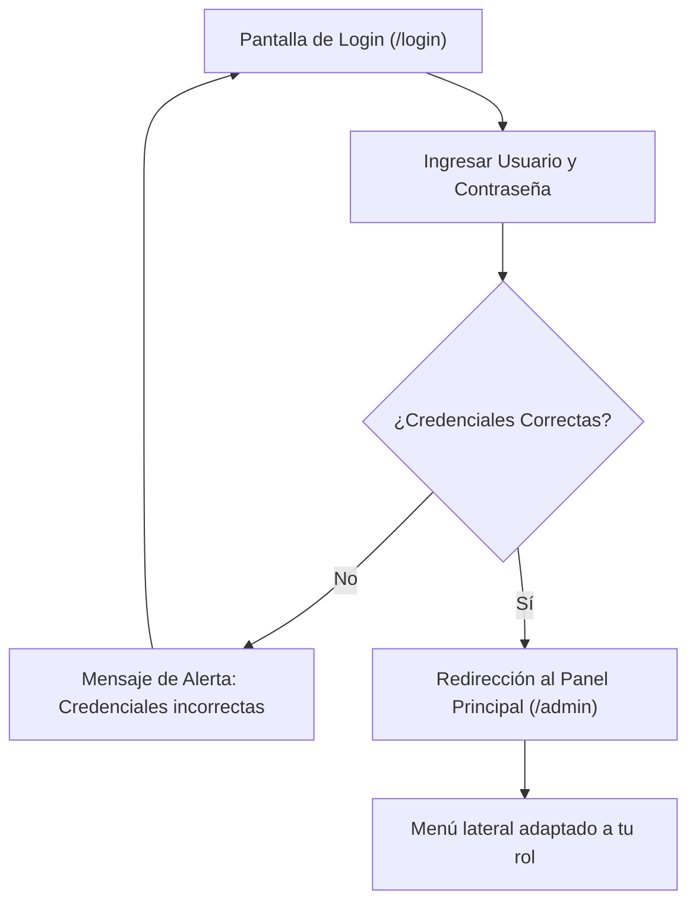

# 👤 Inicio de Sesión y Perfiles de Usuario

Bienvenido al **Manual de Operación de Usuario** del Sistema de Gestión de Acervo Cultural. Esta sección explica el proceso de autenticación en la plataforma y el comportamiento de la interfaz según el perfil asignado.

---

## 1. Acceso a la Plataforma

Para ingresar al sistema:
1. Abre tu navegador web de preferencia (Google Chrome, Mozilla Firefox, Microsoft Edge o Safari).
2. Dirígete a la dirección URL institucional asignada (ejemplo: `http://localhost/ACERVO_CULTURAL/login` o dominio de la Secretaría).
3. En la pantalla de inicio de sesión:
   - Introduce tu **Nombre de Usuario** o **Correo Electrónico**.
   - Digita tu **Contraseña**.
4. Haz clic en el botón azul **"Iniciar Sesión"**.

> [!TIP]
> Si olvidaste tu contraseña o requieres el desbloqueo de tu cuenta, contacta al **Super Administrador** o al área de Informática de la Secretaría de Cultura y Turismo.

---

## 2. Perfiles y Niveles de Acceso

Tu experiencia en la plataforma dependerá del rol asignado a tu cuenta:

### 2.1. 👑 Super Administrador
- **Para quién es**: Directores generales de tecnología y administradores de sistemas.
- **Capacidades**:
  - Control absoluto de todos los módulos.
  - Creación y edición de cuentas de usuarios del personal.
  - Creación de roles y asignación de permisos individuales.
  - Supervisión de la bitácora forense de auditoría.
  - Acceso total al catálogo, revisión, préstamos y catálogos maestros.

### 2.2. 👔 Administrador (Curador / Coordinador de Acervo)
- **Para quién es**: Directores de museos, conservadores en jefe y coordinadores de colecciones.
- **Capacidades**:
  - **Bandeja de Revisión Curatorial**: Aprobar, solicitar cambios o rechazar piezas capturadas por el personal operativo.
  - **Préstamos y Traslados**: Autorizar y registrar salidas temporales o definitivas de obra, así como fiscalizar el retorno de las piezas.
  - Edición y eliminación de registros de cualquier colección.
  - Exportación de inventarios consolidados a Excel y reportes PDF con sellos oficiales.

### 2.3. ✍️ Capturista (Personal Operativo y Registradores)
- **Para quién es**: Investigadores, restauradores y catalogadores de campo asignados a los recintos.
- **Capacidades**:
  - **Registro de Piezas**: Alta de nuevas obras en Acervo General, Arqueológico o Numismático con carga de fotografías y dimensiones.
  - **Edición de Piezas Propias**: Modificar fichas técnicas cuando un revisor le haya devuelto la pieza con observaciones en el estatus de *Cambios Solicitados*.
  - Consulta del catálogo de piezas aprobadas e historial de sus registros enviados.

### 2.4. 📖 Lector General (Consulta y Directivos)
- **Para quién es**: Personal administrativo, auditores externos o personal de atención al público.
- **Capacidades**:
  - Búsqueda, filtrado y exploración en el catálogo de piezas aprobadas.
  - Visualización y descarga de **Fichas Técnicas** en formato museográfico.
  - No puede modificar, registrar ni eliminar registros.

---

## 3. Navegación por la Interfaz

Una vez autenticado, visualizarás:
- **Barra Lateral Izquierda (Sidebar)**:
  - Contiene los enlaces a los módulos a los que tienes acceso (`Acervo`, `Registrar`, `Revisión de Acervo`, `Préstamos y Transferencias`, `Usuarios`, etc.).
  - Puedes colapsarla o expandirla con el botón de flecha inferior.
- **Barra Superior (Topbar)**:
  - Muestra tu nombre de usuario, fotografía de perfil y menú desplegable de cuenta.
- **Área Central de Trabajo**:
  - Despliega las tablas interactivas, tarjetas métricas y formularios del módulo activo.

---

## 4. Gestión de tu Cuenta y Cierre de Sesión

Para actualizar tus datos o salir de la plataforma:
1. Haz clic sobre tu nombre o avatar en la esquina superior derecha.
2. Selecciona **"Mi Perfil"** para modificar tu correo institucional o cambiar tu contraseña de acceso.
3. Al finalizar tu jornada laboral, selecciona **"Cerrar Sesión"** (`/logout`) para proteger la integridad de tus credenciales institucionales.

---

## 5. Referencias Cruzadas
- Aprende a buscar obras en: [[02 - Exploración, Búsqueda y Filtrado del Acervo]]
- Guía de alta de obras: [[03 - Registro y Edición de Piezas Culturales]]
- Guía curatorial: [[04 - Flujo de Revisión y Semáforo de Aprobación]]
