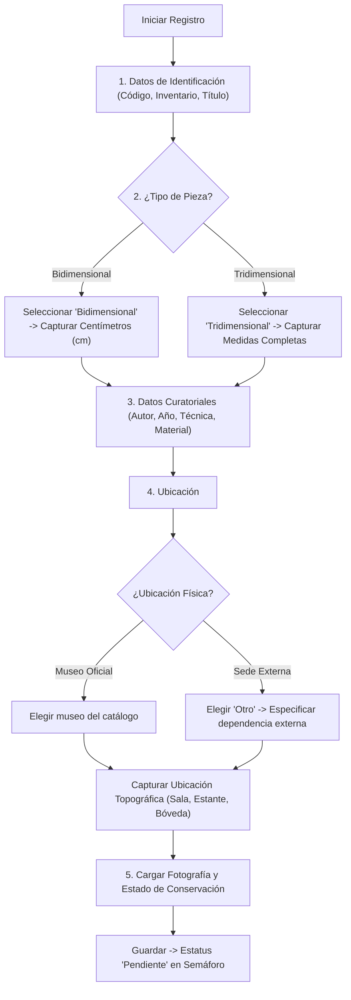

# 📝 Registro y Edición de Piezas Culturales

Esta sección detalla el procedimiento que debe seguir el personal capturista y administrativo para dar de alta una nueva pieza o actualizar un expediente existente.

---

## 1. Acceso al Módulo de Registro

1. En la barra lateral izquierda, haz clic en **"Registrar"** (`/admin/registrar`).
2. Se presentará una pantalla con un selector inicial para elegir el tipo de acervo:
   - **Acervo General**
   - **Acervo Arqueológico**
   - **Acervo Numismático**

> [!TIP]
> **Mejora Visual Aplicada**: Las opciones del menú desplegable de selección de acervo se muestran con contraste optimizado en texto oscuro desde el primer clic, facilitando su visualización en cualquier resolución de pantalla.

---

## 2. Formulario de Alta: Acervo General (Paso a Paso)

Al seleccionar **Acervo General**, el sistema desplegará el formulario dinámico. Completa los campos conforme a las siguientes pautas:

### 2.1. Identificación Básica
- **Código Interno**: Clave institucional de control patrimonial (ej. `SCYT-AG-2026-015`).
- **No. de Inventario**: Folio de inventario gubernamental oficial.
- **Nombre o Título de la Pieza**: Título catalogado de la obra.

### 2.2. Conmutador de Dimensiones (Bidimensional vs. Tridimensional)
Para evitar confusiones en la captura, se dispone de botones de selección dimensional:
- 🔘 **Bidimensional (Pinturas, dibujos, lienzos, grabados, fotografías)**:
  - Al marcar esta opción, se habilita el campo **Centímetros (cm)**.
  - Formato sugerido: `Alto x Ancho cm` (ejemplo: `120 x 85 cm`).
- 🔘 **Tridimensional (Esculturas, mobiliario, piezas mixtas, monumentos)**:
  - Al marcar esta opción, se habilita el campo **Medidas**.
  - Formato sugerido: Detallar cotas completas (ejemplo: `Alto: 45 cm, Ancho: 30 cm, Profundidad: 25 cm, Peso: 12 kg`).

> [!IMPORTANT]
> **Simplificación del Formulario**:
> Conforme a la normativa técnica institucional, se retiraron los campos en desuso `Materia` y `Colección`. Toda la información referente a la constitución física se registra en el campo estandarizado **Material**.

### 2.3. Ubicación: Física vs. Topográfica
- **Ubicación Física (Inmueble / Museo)**:
  - Despliega el catálogo oficial de museos administrados por la Secretaría.
  - **Sedes Externas**: Si la obra está resguardada fuera de la red de museos (por ejemplo, en el Despacho de la Secretaría de Finanzas o en una galería en comodato), selecciona la opción **"Otro"**. Inmediatamente aparecerá un campo de texto adicional para capturar la sede externa correspondiente.
- **Ubicación Topográfica (Coordenadas internas)**:
  - Especifica la localización micro al interior del inmueble (ejemplo: *Bóveda de Seguridad 2, Estante 4, Nivel B* o *Sala 3 Virreinal, Muro Norte*).

### 2.4. Fotografía y Conservación
- **Estado de Conservación**: Selecciona entre *Excelente*, *Bueno*, *Regular*, *Malo* o *En Restauración*.
- **Fotografía de la Pieza**: Carga un archivo de imagen nítido en formato JPG, PNG o WebP (tamaño máximo recomendado: 32 MB).
- **Descripción y Observaciones**: Anota peculiaridades estilísticas, firmas visibles, sellos en reverso o desprendimientos observados.

---

## 3. Envío y Estado Inicial de Revisión

Al presionar el botón **"Guardar Pieza"**:
1. El sistema valida que todos los campos obligatorios estén completos.
2. La imagen se almacena en el servidor y se genera el registro en la base de datos.
3. La pieza ingresa con estatus curatorial **"Pendiente"** (marcador azul) y se canaliza a la **Bandeja de Revisión** para dictamen de los curadores.

---

## 4. Edición de Piezas con "Cambios Solicitados"

Si un curador o administrador evaluó tu pieza y solicitó modificaciones:
1. Recibirás el registro en tu listado con el distintivo amarillo **"Cambios Solicitados"**.
2. Haz clic en el menú **"Acciones"** y selecciona **"Editar Pieza"**.
3. En la parte superior del formulario podrás leer las **Observaciones del Revisor** (ejemplo: *"Por favor rectificar el material y subir una foto con mejor iluminación"*).
4. Aplica las correcciones requeridas (puedes cambiar de medidas bidimensionales a tridimensionales si aplica).
5. Haz clic en **"Reenviar a Revisión"**. La pieza regresará al semáforo para su autorización definitiva.

---

## 5. Referencias Cruzadas
- Conoce el proceso de aprobación curatorial: [[04 - Flujo de Revisión y Semáforo de Aprobación]]
- Consulta el catálogo de piezas aprobadas: [[02 - Exploración, Búsqueda y Filtrado del Acervo]]
- Préstamos y movimientos de piezas: [[05 - Gestión de Préstamos y Transferencias]]
