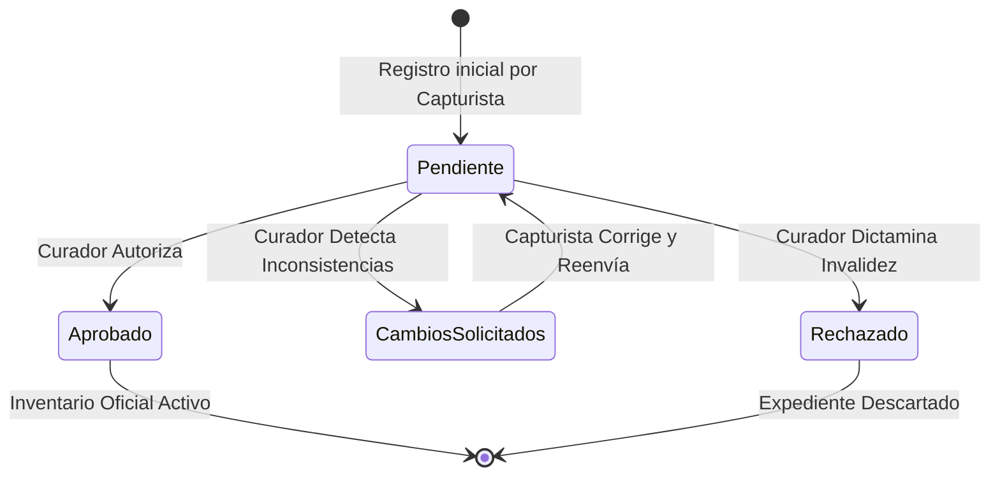
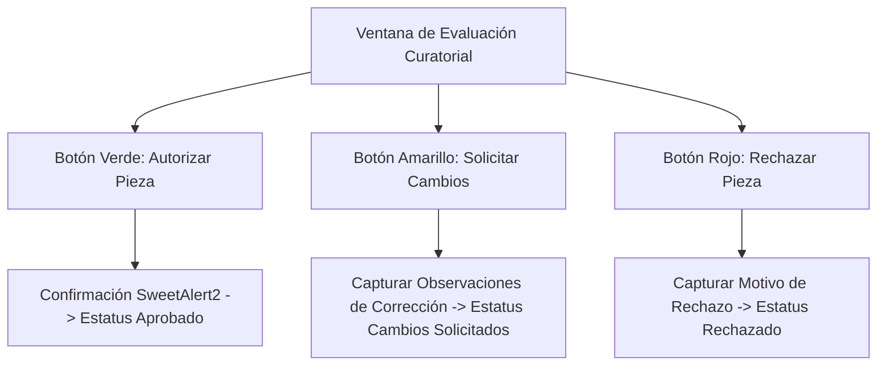

# 🚦 Flujo de Revisión y Semáforo de Aprobación

El módulo **Revisión de Acervo** (`/admin/revision`) es el filtro curatorial y de control de calidad del sistema. Garantiza que ninguna pieza ingrese al inventario patrimonial definitivo sin una rigurosa validación técnica e iconográfica.

---

## 1. El Semáforo Curatorial (Estados de Validación)

El sistema clasifica el estatus de cada bien cultural mediante cuatro insignias de color:

### Significado de los Estados:
- 🔵 **Pendiente (Badge Azul)**: La pieza ha sido capturada recientemente por un catalogador o restaurador y se encuentra a la espera de ser dictaminada por la coordinación curatorial.
- 🟢 **Aprobado (Badge Verde)**: La pieza ha superado satisfactoriamente los controles de calidad. Pasa a formar parte del catálogo patrimonial activo, habilitándose para fichas técnicas, préstamos y traslados.
- 🟡 **Cambios Solicitados (Badge Amarillo)**: El curador detectó inconsistencias en medidas, autoría, soporte o calidad de imagen. La pieza es devuelta temporalmente a la bandeja del capturista junto con un pliego de observaciones.
- 🔴 **Rechazado (Badge Rojo)**: La pieza fue dictaminada como apócrifa, duplicada o no acreditable legalmente para el acervo estatal. Queda archivada e inactiva.

---

## 2. Guía Operativa para Curadores y Administradores

Si tienes el rol de **Administrador** o **Super Administrador**, para evaluar piezas:

1. Ingresa a **"Revisión de Acervo"** en la barra lateral.
2. Utiliza las pestañas superiores para filtrar por *Pendientes*, *En Revisión* o *Todas las Colecciones*.
3. En la fila de la pieza a evaluar, despliega el menú **"Acciones"** y pulsa en **"Evaluar Pieza"** (`bx-check-shield`).
4. Se abrirá la ventana modal de dictamen curatorial con:
   - Fotografía de alta resolución de la pieza.
   - Resumen completo de ficha técnica (Título, Autor, Época, Material, Medidas, Procedencia).
   - Datos del usuario capturista y fecha de captura.

### 2.1. Para Autorizar una Pieza:
1. Haz clic en el botón verde **"Autorizar Pieza"**.
2. Confirma la acción en el diálogo de SweetAlert2.
3. El sistema registrará tu firma electrónica de usuario, la fecha y hora exacta en la tabla de auditoría, y la pieza pasará al inventario oficial.

### 2.2. Para Solicitar Cambios:
1. Haz clic en el botón amarillo **"Solicitar Cambios"**.
2. Aparecerá un cuadro de texto obligatorio: escribe con claridad qué aspectos debe rectificar el capturista (ejemplo: *"Corregir técnica a 'Óleo sobre tabla'; verificar medidas de marco; incluir foto del reverso"*).
3. Haz clic en **"Enviar Observaciones"**.

### 2.3. Para Rechazar una Pieza:
1. Haz clic en el botón rojo **"Rechazar Pieza"**.
2. Justifica el motivo técnico o legal del descarte.
3. Confirma la baja del proceso de registro.

---

## 3. Guía para Capturistas: Corrección y Reenvío

Si eres capturista y recibes una pieza con **Cambios Solicitados**:

1. En tu catálogo o en la vista de revisión, verás el distintivo amarillo.
2. Despliega el menú **"Acciones"** y selecciona **"Editar Pieza"**.
3. Lee el recuadro superior de **Observaciones Curatoriales**.
4. Realiza los ajustes necesarios:
   - Si se solicitaron cambios en dimensiones, puedes alternar entre **Bidimensional (`cm`)** y **Tridimensional (`medidas`)**.
   - Si se solicitó cambio de sede, ajusta el selector de **Ubicación Física**.
   - Si se solicitó mejor fotografía, reemplaza el archivo.
5. Haz clic en **"Guardar y Reenviar a Revisión"**. La pieza volverá a aparecer como **Pendiente** en la bandeja de los curadores.

---

## 4. Referencias Cruzadas
- Conoce el registro de piezas: [[03 - Registro y Edición de Piezas Culturales]]
- Consulta el historial de auditoría de revisiones: [[04 - Sistema de Auditoría y Trazabilidad]]
- Gestión de traslados para piezas aprobadas: [[05 - Gestión de Préstamos y Transferencias]]
